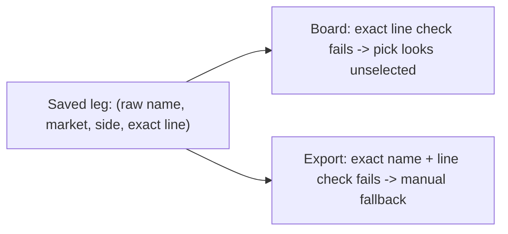
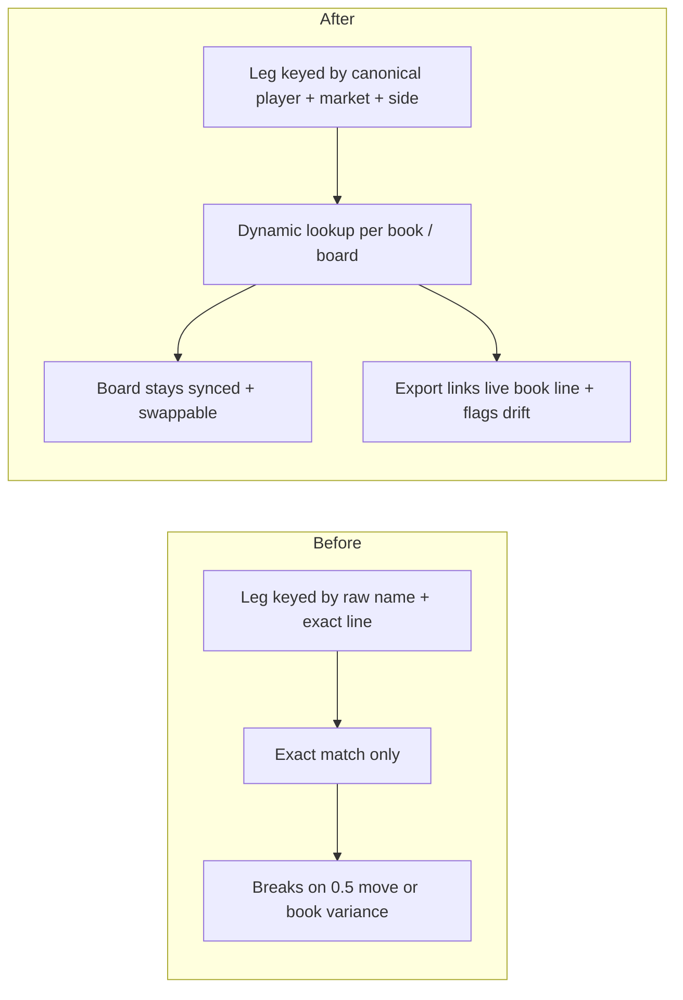

# Track prop selections dynamically when lines move

## Context

Sportsbook prop lines routinely shift by half a yard or vary slightly across books. Today, the app treats the exact line
number and raw player string as part of a pick's identity, so small line moves break both the pick board and sportsbook
export links:

- **Cross-book line differences break exports:** On prod leg 20 (`Bryce Young Over 248.5 Pass Yds`), the picker's home
  book (FanDuel) had `248.5` while DraftKings had `254.5`, BetMGM `245.5`, and BetRivers `247.5`. Export rejected
  DraftKings with `"line moved"` instead of linking to DraftKings' current line for Bryce Young Over Pass Yds.
- **Name mismatches break exports:** On prod leg 19 (`Ollie Gordon Over 17.5 Rush Att`), the saved leg recorded
  `"Ollie Gordon"` while DraftKings listed `"Ollie Gordon II"` at `17.5`, so export failed with `"no line"`.
- **Moved lines detach picks from the board:** Once a line moves after a pick is saved, exact-line matching on the board
  stops recognizing the leg as picked, breaking one-tap removal and swaps.

## Goals and non-goals

**Goals:**

- Make a prop pick's primary identity `(game, canonical player, market, side)` — `"Player X Over/Under Stat Y"` — and
  treat the line number and odds as live, updatable values.
- Keep board selection state (picked badge, remove, swap) intact when a line moves.
- Allow sportsbook export to build working deep links to a book's current standard line for that selection while showing
  clearly when a book's current line differs from the slip's line.
- Refresh or re-sync open picks cleanly against current lines before lock-in without breaking votes unnecessarily.

**Non-goals:**

- Mutating settled or locked historical slips after kickoff or grading.
- Supporting alternate/milestone line picking (e.g., matching a 100+ yard alt line to a standard O/U pick).

## Decision

Separate selection identity (`game`, `canonical player`, `market`, `side`) from the quoted `line` and `odds`, so board
matching, leg updates, and sportsbook export look up the target selection dynamically and resolve each book's current
line, price, and deep-link selection ID.

Simply ignoring line differences silently would mislead friends about what number they bet or graded. Keeping the picked
line for display/grading while matching and deep-linking by canonical selection (with a clear line-drift callout on
export) lets links and leg controls keep working without hiding line movement.

The `effort` rating is `hard` because selection identity is woven through leg creation, board matching, vote-clearing
rules, sportsbook link export, and auto-grading, requiring careful invariants around pre-kickoff vs locked/graded legs.

## Consequences

- **Easier:** Prop picks stay bound to their board row and sportsbook export links when lines move or books use
  different player name spellings. Pickers can sync a drifted line on an open slip with one tap without clearing
  existing votes.
- **Harder:** Selection matching now spans `db.SameSelection` across `db`, `board`, `slips`, `export`, and `web`, and
  export and pick views carry drift metadata to flag when a live book line differs from the saved slip line.
- **Revisit:** Keeping `leg.Line` as an opt-in sync prevents silent number changes, though pickers still have to tap
  `Sync line` if they want the saved slip line to match a moved market.

## Alternatives considered

- **Auto-updating `legs.line` in the background on every odds sync:** Rejected because friends' votes and agreed slip
  numbers would shift silently without anyone noticing.
- **Ignoring line differences silently on export:** Rejected because bettors could place a bet at a different number
  without warning while grading still uses the saved slip line.

## Implementation notes

- `db.SameSelection` compares `SelectionKey` values (`LegSelection` / `OddsSelection`) rather than taking `db.Leg` and
  `db.Odds` directly, because `db.Odds` does not store `PlayerID` while `db.Leg` and `board.Row` do.
- `UpdateLeg` preserves `leg_votes` on non-`OTHER` markets when `db.SameSelection` matches the existing leg; changing
  the player, team, market, side, or any `OTHER` pick still clears votes.
- Locked and final slips never mutate `leg.Line`, so `internal/grader` always grades against the saved slip number.
- One-tap `Sync line` works from both the pick board and the pick tray (`from=tray`).

## Follow-ups

None.
