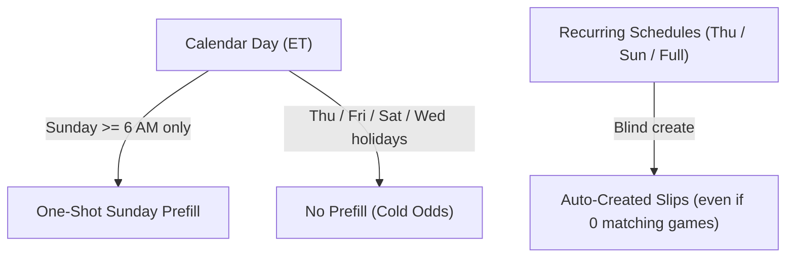
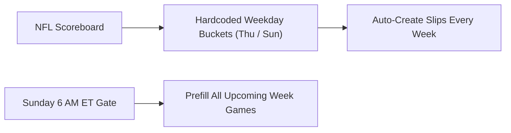
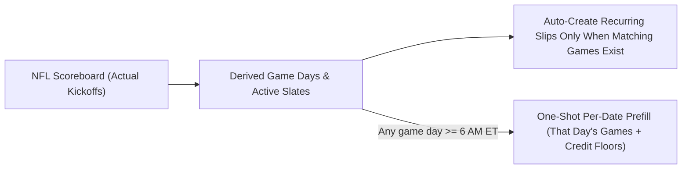
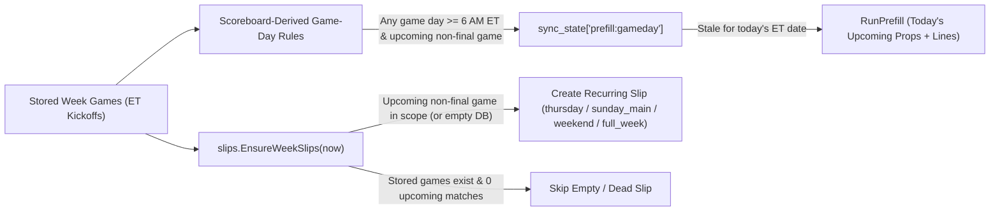

# Dynamic NFL schedule slip management and data loading

## Context

The app assumes a standard regular-season NFL week: one Thursday game, a Sunday main slate, and a Monday game. That
assumption is baked into both slip auto-management and data loading:

1. **Sunday-only pre-fill.** Automatic odds and prop pre-fill only triggers on Sundays at or after 6:00 AM ET. On
   Thanksgiving, Black Friday, Christmas, late-season Saturdays, and playoff Saturdays, pre-fill never runs, so groups
   open the pick board to cold lines and props.
2. **Hardcoded weekday scopes.** Recurring schedules only know `thursday`, `sunday_main`, and `full_week`. They cannot
   naturally represent holiday slates, Saturday doubleheaders, or playoff rounds without manual workarounds.
3. **Blind slip auto-creation.** Recurring schedules create slips for the active week even when that week has no games
   matching the schedule's weekday bucket (for example, a Thursday schedule during a playoff week), leaving behind empty
   or immediately closed slips.

As Thanksgiving, Christmas, late-season Saturday games, and the playoffs approach, these "special cases" become the norm
rather than the exception.

## Goals and non-goals

### Goals

- Drive data pre-fill and slip auto-management from the **actual stored NFL game schedule** (kickoff dates and times)
  instead of hardcoded Sunday/Thursday assumptions.
- Generalize the one-shot morning pre-fill to any **game day** that has upcoming games (Thanksgiving, Black Friday,
  Saturday, Sunday, Christmas, Playoffs), warming odds/props only for that day's upcoming games while preserving
  free-tier credit floors and single-instance guardrails.
- Prevent recurring schedules from auto-creating slips for weeks that have zero upcoming games matching their scope.
- Support dynamic, schedule-aware slate grouping so holiday and playoff slates work cleanly without adding one-off
  calendar hacks.

### Non-goals

- Adding paid or always-on background polling; all refreshes still run on authenticated full-page loads (plus the
  optional internal pre-fill fallback) within existing API credit budgets.
- Supporting non-NFL sports or multi-league calendars.
- Removing manual one-off slip creation (which handles arbitrary custom game subsets separately).

## Decision

Replace weekday-hardcoded automation with a **game-day-driven** model: the stored NFL scoreboard is the source of truth
for when slates exist, when recurring slips should be created, and when morning pre-fill should run.

### Before

### After

Deriving game days and pre-fill windows directly from the stored scoreboard beats maintaining a hardcoded
holiday/playoff calendar because the NFL moves games (flex scheduling, weather reschedules, Christmas shifting weekdays
every year) and the scoreboard already reflects the truth. Scoping each game-day pre-fill to that day's upcoming games
beats warming the entire week on every game day because it protects scarce Odds API and Parlay API credits during
multi-day holiday and playoff weeks. Skipping recurring slip creation when a week has no matching upcoming games beats
creating empty slips and asking users to ignore or delete them.

`complexity: high` fits because this redesigns the scheduling invariants shared across background refresh triggers,
credit-budgeted pre-fill idempotency, recurring slip auto-creation, and slate-scope evaluation across irregular
regular-season, holiday, and playoff calendars. `risk: medium` fits because a mis-scoped pre-fill trigger could
overspend monthly API credits or miss a game day, though per-date idempotency keys, existing credit floors, and
clock-injected tests keep the blast radius contained and verifiable.

## Overview

## Consequences

- **Easier:** Thanksgiving, Black Friday, Christmas, late-season Saturdays, and playoff weekends get automatic 6:00 AM
  ET pre-fill and game-day staleness windows straight from stored ESPN kickoffs without maintaining a holiday calendar.
- **Easier:** Recurring schedules support `weekend` (`Weekend Slate`, Sat/Sun/Mon ET) and stop creating empty or
  already-closed slips when a week has no upcoming matching games.
- **Harder:** Multi-day holiday or playoff weeks trigger `RunPrefill` once per Eastern game date instead of once on
  Sunday, spending one `odds:lines` call per game day while date-scoped prop warming keeps weekly Parlay prop spend
  flat.
- **Harder:** `slips.EnsureWeekSlips` now requires a `now time.Time` argument and `GamesForWeek` on its store interface,
  so callers and tests must supply a clock and week games when testing slip auto-creation.
- **Revisit:** Add dedicated `saturday` or dynamic holiday slate scopes if groups want recurring slips for Wednesday
  Christmas, Black Friday, or Saturday-only slates without using `full_week` or one-off slips.
- **Revisit:** Revisit the single `prefill:gameday` marker if late-day game flexes ever require re-running bulk prop
  pre-fill on a date that already ran.

## Alternatives considered

- **Static holiday and playoff calendar table:** Rejected because NFL flex scheduling, weather reschedules, and shifting
  weekday holidays (like Christmas) would need yearly updates, whereas ESPN's scoreboard already stores exact kickoff
  timestamps.
- **Warming all upcoming week props on every game day:** Rejected because running bulk props across every remaining game
  on each day of a Thanksgiving or playoff week would multiply monthly Parlay API credit spend; scoping automatic
  `RunPrefill` props to `upcomingGamesOnDate` preserves credit budgets while keeping a week-wide fallback for manual
  non-game-day `POST /internal/prefill` calls.
- **Per-date `sync_state` keys (such as `prefill:gameday:YYYY-MM-DD`):** Rejected in favor of reusing one
  `prefill:gameday` row checked by Eastern calendar date so `sync_state` does not grow unboundedly.
- **Auto-creating recurring slips unconditionally and asking groups to delete empty ones:** Rejected because empty or
  immediately closed slips add avoidable clutter on playoff and completed weeks.

## Implementation notes

- **No `0016` schema migration needed:** The design planned a migration for `slate_scope` `CHECK` constraints, but
  neither `slips` nor `group_slip_schedules` defines one, so `SlateScopeWeekend` needed no SQL migration.
- **Both kickoff time and `FINAL` status gate upcoming checks:** `upcomingGamesOnDate`, `upcomingWeekGames`, and
  `EnsureWeekSlips` exclude `db.GameFinal` alongside `!now.Before(g.Kickoff)` so finished games with synthetic future
  kickoff times are never treated as upcoming.
- **Cold-DB bootstrap fallback remains:** When `games` is empty (`len(games) == 0`), `isGameDay` falls back to
  Thu/Sun/Mon staleness and `EnsureWeekSlips` still creates slips for every active schedule so initial bootstrap works
  before the first scoreboard sync.
- **Shared form options without schedule-handler edits:** `internal/web/schedules.go` already validates via
  `db.SlateScope.Valid()`, so adding `SlateScopeWeekend` to `defaultSlateScopeOptions` surfaced it in both recurring
  schedule forms and `/slips/new`.
- **Legacy `prefill:sunday` row:** Existing databases leave any old `prefill:sunday` key untouched in `sync_state`;
  `prefill:gameday` takes over on the first game-day pre-fill after deploy.

## Follow-ups

- Add Saturday, Friday, and Wednesday kickoff window buckets to `internal/board` (`Window` and `Windows` in
  `internal/board/board.go`, plus `docs/concepts/slips.md` and `docs/reference/routes.md`) so irregular holiday and
  playoff games appear under matching pick-board filter chips.
- Clean up stale Sunday-only references in out-of-scope docs (`docs/reference/data-sources.md` line 58 on filtering
  scoreboard events to Sunday/Monday kickoffs, and `docs/guides/gcp-setup.md` lines 234–236 on the Sunday-only Cloud
  Scheduler cron example).
