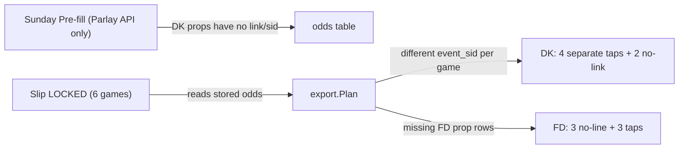
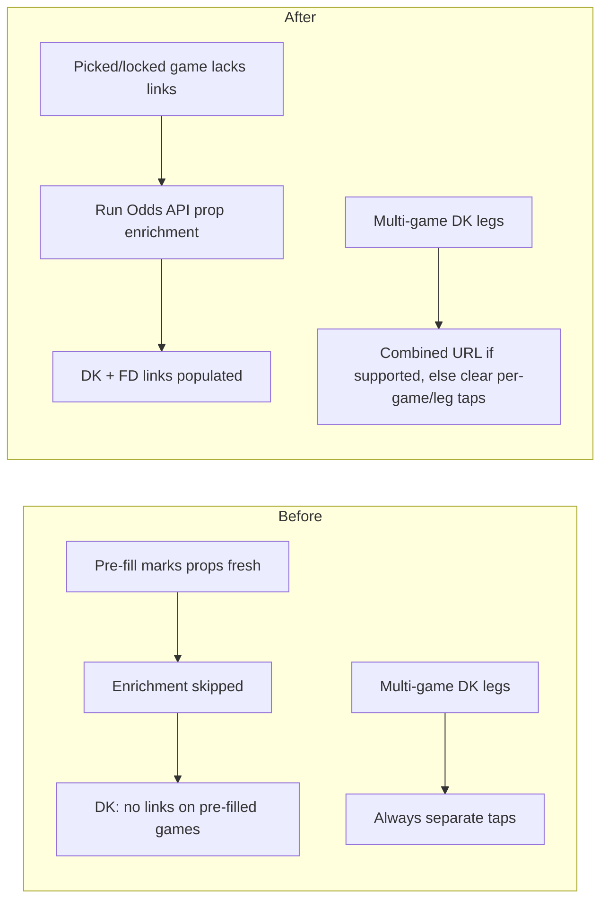
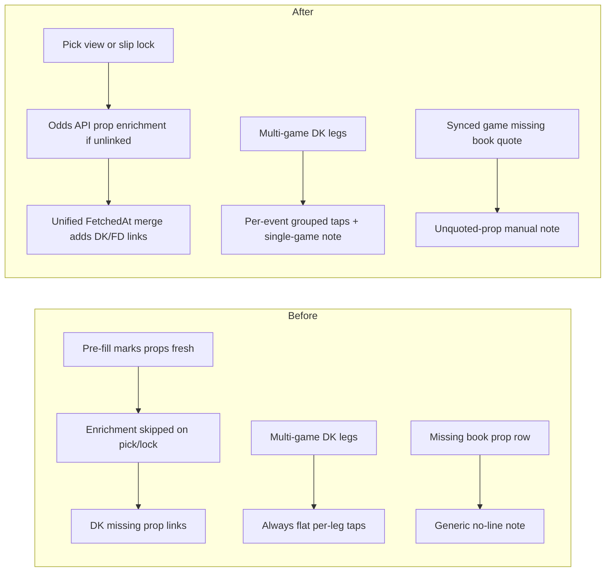

# Fix DraftKings and FanDuel export links

## Context

On the November 22, 2026 Sunday slate, a locked 6-leg slip across 6 games showed two export failures:

1. **Multi-game DraftKings slips never combine:** 4 of 6 legs had valid DraftKings links and selection IDs, but each belonged to a different game (`event_sid`). Because DraftKings' combiner requires all legs to share one event ID, it fell back to 4 separate links instead of one combined link.
2. **Pre-filled games had no DraftKings prop links:** 2 of the 6 games (`401873069` and `401873071`) had their props synced during Sunday morning pre-fill, which runs Parlay API-only. Parlay API omits DraftKings `link` and `sid` values, and because `sync_state` marked those games fresh, The Odds API enrichment never ran for them.
3. **Missing FanDuel prop lines:** FanDuel had no `odds` rows for 3 of the 6 picks (`RUSH_ATT` on two players, `REC_YDS` on one), leaving those legs as manual `no line` entries.

## Goals and non-goals

**Goals:**

- Ensure every game on a locked slip (or picked from the board) has deep-link enrichment when credits allow, even if its props were first populated by Parlay API-only pre-fill.
- Research and support multi-game combined DraftKings betslip links if DraftKings supports a multi-event URL format; otherwise make the single-game limitation explicit and minimize manual steps.
- Improve FanDuel/DraftKings fallback matching or surface clearer guidance when a book does not quote a picked prop market.

**Non-goals:**

- Raising free-tier API credit limits or adding paid sportsbook APIs.
- Placing bets automatically or integrating with sportsbook accounts.

## Decision

We will separate deep-link enrichment from initial pre-fill freshness so picked or locked games still fetch The Odds API links/sids when their stored rows lack links, and we will verify whether DraftKings supports a multi-event combined URL (falling back to grouped/clear per-leg taps only where the book's URL scheme forces it).

This beats running The Odds API on all games during Sunday morning pre-fill, which would burn ~100+ scarce Odds API credits per Sunday on games nobody picks.

- **Complexity: medium** — Coordinates across odds refresh staleness rules, prop enrichment, and sportsbook URL combining while respecting tiered credit floors.
- **Risk: medium** — Deep-link URL formats can only be verified against live sportsbooks on a phone, and enrichment triggers must not regress Odds API credit budgets.

## Overview

## Consequences

- **Easier:** Populating DraftKings and FanDuel prop links on pre-filled games without spending Odds API credits on unpicked Sunday games, and opening same-game legs from a multi-game DraftKings slip in one tap per game.
- **Easier:** Distinguishing a sportsbook that is not offering a prop market from a game whose props have not synced yet.
- **Harder:** Reasoning about prop freshness, because `odds:props:{gameID}` and `odds:props:enrich:{gameID}` must keep a unified `FetchedAt` timestamp on merged rows so `db.CurrentOdds` does not hide Parlay-only markets.
- **Revisit:** DraftKings multi-game combining if DraftKings adds a verified multi-event betslip URL, which is isolated behind `draftKingsCombiner`.

## Alternatives considered

- **Run The Odds API during Sunday pre-fill:** Rejected because enriching a full 14-game slate would burn ~100–140 Odds API credits per week on unpicked games and exhaust the 500/month free tier in 3–4 weeks.
- **Use DraftKings' root `/?outcomes=` URL across games:** Rejected because a 2026-11-07 phone test showed it loads only one selection, and DraftKings exposes no public multi-event GET betslip URL.
- **Enrich inside `GET /slips/{id}/export`:** Rejected to keep `internal/export` and export rendering strictly read-only so SSE refreshes and reloads never spend API credits.

## Implementation notes

- **Plan accuracy:** Both phases shipped as designed with no deviations.
- **DraftKings single-game limit:** DraftKings' combined URL is event-scoped, so multi-game slips still require one tap per game (grouped when a game has 2+ linked legs, individual otherwise).
- **Credit floor and unquoted props:** Enrichment skips without failure backoff once The Odds API balance drops below `TheOddsAPIEnrichFloor` (100), and props that a book genuinely does not quote still require manual entry.
- **Cross-provider name matching:** Merging Parlay API and The Odds API props relies on `normalizePropSubject` for punctuation, casing, and generational suffixes (`Jr.`, `III`); materially different spellings across feeds will not merge.

## Follow-ups

- **Post-deploy phone verification:** Test a per-game combined DraftKings event link and the background SSE `#slip-export` refresh after locking a slip with a pre-filled prop leg on a live phone.
