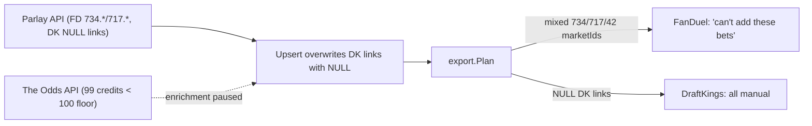
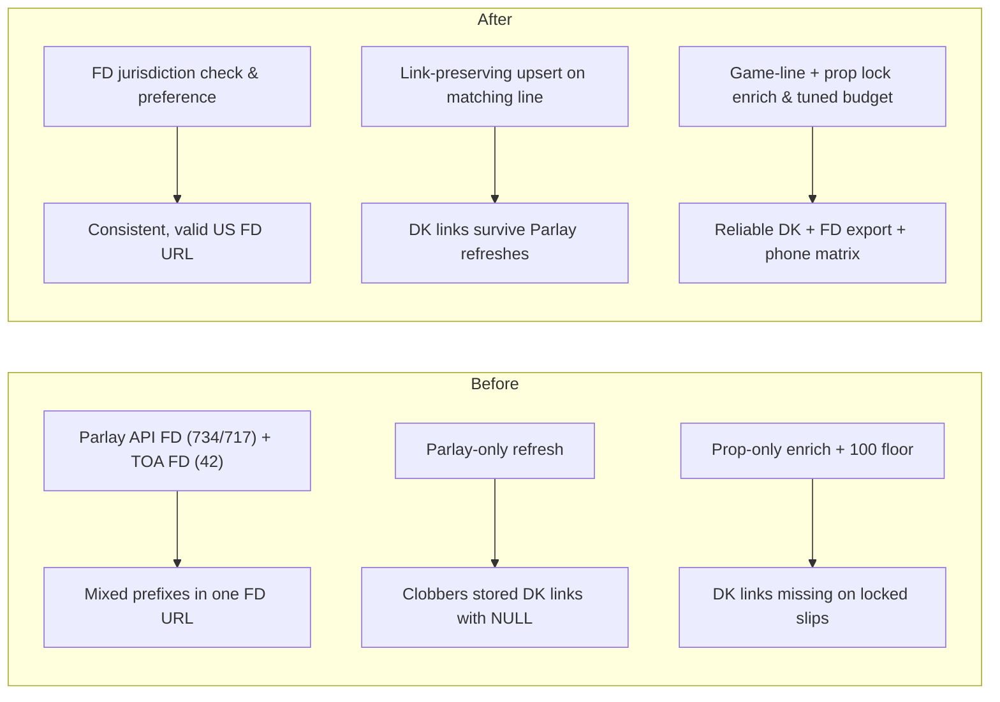
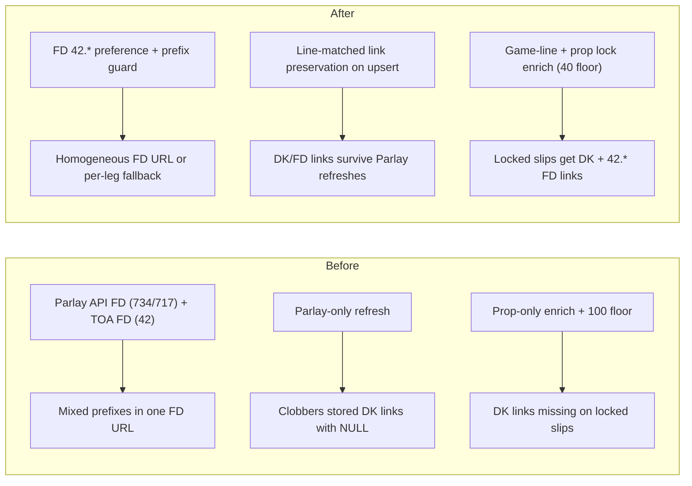

# Reliable DraftKings and FanDuel export deep links

## Context

Exporting locked slips to FanDuel and DraftKings still fails in real use. On Week 12 Thanksgiving slips (Turkey Day Lay
and Gobble Gobble Bitches), tapping the combined FanDuel link opened FanDuel and returned a generic "can't add these
bets" error, while DraftKings had almost no links at all.

Inspecting the production database (`parlay-good-20261126`) exposed three concrete root causes:

1. **FanDuel `marketId` jurisdiction mismatch and mixing:** Across stored FanDuel rows, `marketId` prefixes come from
   three different FanDuel jurisdictions—`734.*` (2,385 rows), `42.*` (571 rows), and `717.*` (90 rows). On Turkey Day
   Lay (slip 12), the combined FanDuel URL mixed `734.*`, `717.*`, and `42.*` market IDs into a single `addToBetslip`
   URL. On Gobble Gobble Bitches (slip 14), all three legs carried `734.*` IDs from Parlay API rather than US-standard
   `42.*` IDs. When FanDuel receives foreign or mixed jurisdiction market IDs, it opens and rejects the betslip.
2. **DraftKings links wiped by subsequent refreshes and stalled at the credit floor:** In Week 12, only 13 of 791
   DraftKings rows had a `link` and `event_sid`. `odds:theoddsapi` sat at `99` credits remaining—one credit below
   `TheOddsAPIEnrichFloor` (`100`)—which silently disabled all DraftKings enrichment. Worse, games that *had* already
   been enriched (`401873080`, `401873081`, `401873082` around 16:00 UTC) lost their DraftKings `link`, `sid`, and
   `event_sid` when later Parlay-only prop refreshes upserted `NULL` over them.
3. **No lock-time game-line enrichment or live-payload verification:** Lock-time enrichment only checks prop legs, not
   game-line legs, and automated tests only check static 2026-11-07 fixtures where every FanDuel `marketId` happened to
   be `42.*`.

## Goals and non-goals

**Goals:**

- Resolve FanDuel `marketId` jurisdiction mismatches: verify which FanDuel `marketId` prefix(es) work on US phones,
  prevent mixing incompatible prefixes in a combined URL, and prefer valid US FanDuel links (such as The Odds API's
  `42.*` links) when Parlay API returns non-working jurisdiction IDs.
- Preserve existing non-null `link`, `sid`, and `event_sid` values when a subsequent Parlay-only refresh updates the
  same line, so enrichment work is never wiped out.
- Revisit The Odds API enrichment credit floor and lock-time enrichment scope (covering both game lines and props) so
  DraftKings and FanDuel links stay populated within the free-tier budget.
- Add contract tests against real Week 12 recorded payloads (including mixed `734.*`/`717.*`/`42.*` FanDuel links and
  Parlay-over-enriched refreshes) plus a repeatable phone verification matrix for both DraftKings and FanDuel.

**Non-goals:**

- Raising free-tier API credit limits or paying for a third-party deep-link service.
- Placing bets automatically or integrating with sportsbook accounts.
- Supporting sportsbooks beyond DraftKings and FanDuel.

## Decision

Fix the three production failure paths together: guard FanDuel link selection and combining against incompatible
jurisdiction `marketId` prefixes, stop Parlay-only refreshes from clobbering existing deep links when lines match, and
tighten lock-time link enrichment and credit-floor handling—backed by fresh recorded-payload contract tests and a phone
test matrix.

This beats dropping combined links entirely, which would throw away one-tap exports when the actual failure is
jurisdiction-mismatched FanDuel `marketId`s and clobbered DraftKings links. It also beats running The Odds API on every
pre-fill game, which would exhaust the 500/month credit cap in a few weeks.

- **Complexity: medium** — Spans odds ingestion/upsert link preservation, FanDuel `marketId` jurisdiction validation,
  lock-time enrichment across game lines and props, and credit-floor tuning.
- **Risk: high** — External sportsbook deep-link routing and mobile app handoff (including FanDuel jurisdiction
  behavior) cannot be verified by automated tests alone, and enrichment changes directly affect scarce Odds API credits.

## Overview

## Consequences

- **Easier:** Exporting locked slips to DraftKings and FanDuel without Parlay-only refreshes wiping enriched deep links or FanDuel combining mixed-jurisdiction `marketId`s.
- **Easier:** Enriching both game-line and prop legs at slip lock when DraftKings links are missing or FanDuel links carry non-`42.*` prefixes.
- **Harder:** Replacing an existing stored link on an unchanged line requires supplying a non-null replacement row, because `NULL` now preserves the stored link.
- **Harder:** Diagnosing FanDuel export failures in states that might expect a prefix other than `42.*`, since merges prefer `42.*` and mismatched prefixes fall back to per-leg taps.
- **Revisit:** The `40`-credit `TheOddsAPIEnrichFloor` and lock-time game-line enrichment if monthly Odds API credit burn spikes during high-volume weeks.
- **Revisit:** Whether non-`42.*` FanDuel links (`734.*`, `717.*`) should also be suppressed on single-leg taps if phone testing shows they fail across US accounts.

## Alternatives considered

- **Drop combined FanDuel links entirely:** Rejected because it would remove one-tap multi-leg exports when the failure came from mixing incompatible `marketId` prefixes and keeping non-US IDs over `42.*` IDs.
- **Fetch The Odds API for every pre-fill game:** Rejected because it would exhaust the 500/month credit cap in a few weeks; lock-time enrichment gated by a `40`-credit floor keeps usage bounded.
- **Keep unconditional overwrites in `Store.UpsertOdds`:** Rejected because Parlay-only refreshes arrive with `NULL` links and wipe earlier DraftKings enrichment on unchanged lines.

## Implementation notes

- The plan shipped with no deviations.
- Automated tests cover recorded Week 12 payloads, not live sportsbook apps; FanDuel jurisdiction routing and mobile app handoff still depend on user state and device behavior.
- `Store.UpsertOdds` preserves `link` and `sid` only when the line is unchanged; when a line moves and the incoming row has `NULL`, stale `link` and `sid` are cleared while game-level `event_sid` is kept.

## Follow-ups

- Run the 5-case phone verification matrix on iOS and Android for both DraftKings and FanDuel after deploy (single game-line leg, single prop leg, same-game parlay, cross-game parlay, and moved-line leg), and suppress non-`42.*` FanDuel links on single-leg taps if they fail on US phones.
