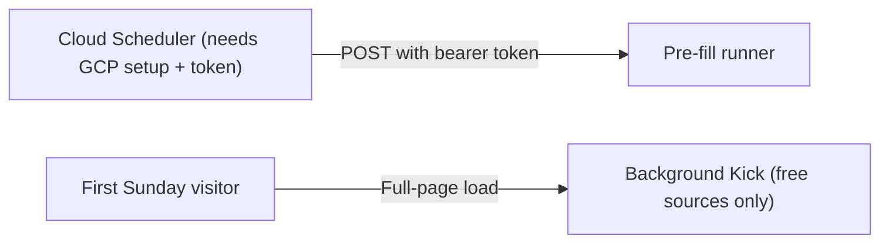
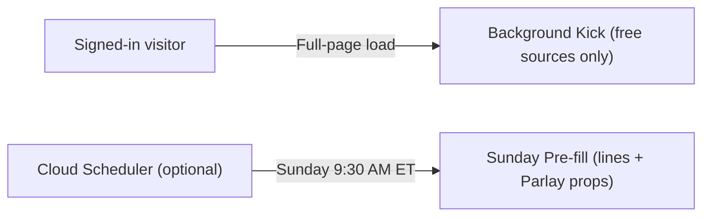
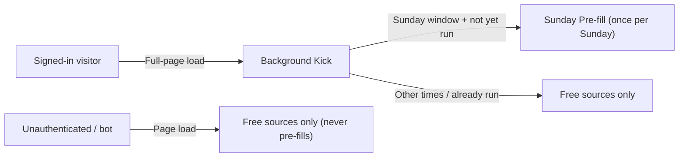

# Run Sunday prefill on first authenticated visit

## Context

Today, Sunday morning pre-fill only runs when an external Cloud Scheduler job calls the internal pre-fill endpoint with
a bearer token. If the token secret and scheduler job are not configured in GCP, the pre-fill endpoint returns `404` and
Sunday pre-fill never runs.

## Goals and non-goals

**Goals:**

- Automatically run the Sunday pre-fill once per Sunday when the first signed-in user loads a full page on Sunday
  morning (Eastern time) while upcoming games remain.
- Persist the pre-fill completion state so Cloud Run cold starts, restarts, and subsequent page loads do not re-run it
  or burn extra API credits.
- Prevent unauthenticated requests, bots, and health checks from triggering paid API calls.

**Non-goals:**

- Replacing pick-time refreshes or manual refresh buttons on open slips.
- Removing the optional internal pre-fill endpoint; it can remain available as a manual/scheduled fallback.
- Warming lines or props on non-Sunday days (such as Thursday or Monday night games).

## Decision

Trigger the Sunday pre-fill from the background page-load refresh when a signed-in user visits on Sunday morning in
Eastern time, guarded by persisted sync state so it runs at most once per Sunday.

### Before

### After

Running pre-fill on the first authenticated Sunday visit eliminates the Cloud Scheduler and secret-management setup
while keeping the existing credit floors and single-flight guards intact. Unlike an external cron, it requires zero GCP
configuration and adapts naturally when nobody opens the app on a given Sunday. The `effort` is `medium` because it
coordinates across authentication context, page-load refresh triggering, Eastern-time window rules, and persisted sync
state to guarantee at-most-once execution across restarts.

## Consequences

- **What got easier:** Sunday pre-fill runs automatically on the first authenticated full-page visit at or after 6:00 AM
  ET while Sunday games remain, removing the need to configure Cloud Scheduler and `prefill-token` in GCP.
- **What got harder:** Tests calling `Kick()`/`KickContext()` with a Sunday morning clock and upcoming Sunday games now
  enter the pre-fill path unless `prefill:sunday` is pre-seeded or a non-Sunday/post-kickoff clock is used.
- **What we would revisit:** The 6:00 AM ET start hour and the 2-minute `prefillKickTimeout` if Sunday slates grow or
  cold starts plus bulk prop fetches approach the timeout.

## Alternatives considered

- **Running `RunPrefill` synchronously on the first Sunday `GET /`:** Rejected because fetching bulk props for up to 16
  games would stall mobile first-paint latency; running it asynchronously in `Kick()` keeps `GET /` fast while HTMX
  partials and SSE keep Cloud Run CPU active.
- **Reusing `odds:lines` staleness instead of a dedicated `prefill:sunday` key:** Rejected because Saturday or midnight
  pick-time refreshes update `odds:lines` without warming Sunday Parlay bulk props.
- **Starting the Sunday window at 00:00 ET:** Rejected because late Saturday-night browsing after midnight ET would
  trigger Sunday's one-shot pre-fill hours before Sunday morning inactives and line movement settle.

## Implementation notes

- If the sole Sunday morning visitor closes the browser before HTMX partials or the SSE stream open, Cloud Run may
  throttle CPU before background `RunPrefill` completes; `Shutdown` drains `s.wg` within `shutdownTimeout`.
- If `espn:scoreboard` fails on the first Sunday visit with an empty week in SQLite, `sundayPrefillWindow` sees no
  upcoming Sunday games and skips pre-fill until `espn:scoreboard` recovers after its 5-minute backoff.
- Partial odds progress (`LinesSynced || PropsSynced > 0`) records `prefill:sunday` under `s.stopCtx` so one failing
  game prop or flaky free source does not cause `Kick()` to re-spend bulk credits; zero-progress failures enter a
  5-minute backoff and fall back to `freeSourcesFor`.

## Follow-ups

None.
