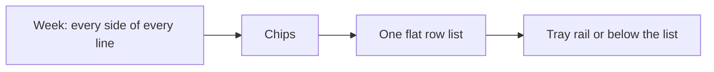
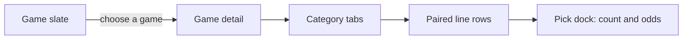

# Game-first pick board

## Context

The pick board is one flat list. Every side of every line is its own full-width row: Over and Under are separate rows,
and so are the home and away sides of a spread. A Sunday slate with a dozen games and a few opened prop boards puts
hundreds of rows in one scroll. The only game context is a small matchup link under each row, and the only pairing is a
two-column grid after someone already filters to one game.

Researching props means scrolling past every other game first. Raw ISO timestamps render in each row until the browser
formats them. The viewer's picks sit in a side rail on wide screens and below the whole list on a phone, so they scroll
away exactly when someone is deep in a prop list. The rail never shows the combined odds while picking.

The board already reads the week's games, odds, rosters, and the viewer's legs in one place, and the slip already
persists picks on the server. The problem is the shape of the screen, not missing data.

## Goals and non-goals

**Goals:**

- Group the week by game first. A person picks a game, then a market, then a side.
- Pair the two sides of one line into one row: Over/Under, home/away spread, and home/away moneyline.
- Cluster one player's markets under that player inside a game.
- Show the selected game, category, kickoff window, and search in the URL, so back, refresh, and a shared link restore
  the same view.
- Replace raw ISO timestamps with a short kickoff label in the reader's zone.
- Keep the viewer's pick count and combined odds visible while browsing, with one tap to review the slip.
- Build phone first: a slate, then a drilldown with a back link, then the dock. Widen to two independent panes at `lg`.
  Touch targets stay at least 48px tall.
- Keep prop loading lazy. Opening a game, changing a tab, or filtering never spends a credit; only "Load them" does,
  through the existing cache and credit floors.

**Non-goals:**

- A client-side index, SPA, JSON API, or build step. Grouping stays server-rendered with HTMX.
- A new route family or a change to slip membership, locking, or odds math.
- A global parlay dock on every page. The dock lives on the pick board; picks already persist across pages on the
  server.
- A new blocking rule or analyzer rule. Pairing stops both sides of one line in the normal path; a single pick is never
  refused, and the analyzer keeps its friendly voice.
- Eager or scheduled prop sync, new data sources, or raising the Odds API budget.
- Sportsbook integrations or money handling.

Success looks like this: at 390px, a person goes slate → game → category → pick without losing the dock, and the back
link keeps the window and search. At 1024px, the game list and the game detail scroll independently. A refresh restores
the game and tab. A game whose props were never fetched still offers "Load them," and browsing the rest of the slate
spends no credits.

## Decision

Rebuild the pick board as a game-first master-detail screen. The slate lists games with their kickoff, matchup, spread,
total, and prop count. Choosing a game opens its detail: a pinned header, category tabs, then rows grouped by player,
with both sides of each line in one row. Desktop shows the slate beside the detail; a phone shows the slate, then pushes
the detail with a back link. The same URL drives both widths, so there is no separate mobile router. A sticky dock shows
the pick count and combined odds and opens the existing tray as a sheet.

This beats a client-side React index because the app is already server-rendered templates and HTMX; a second state layer
would duplicate grouping and sync. It beats adding more filters to the flat list because filters cannot supply game
context or player clusters. It beats a third desktop column because a games list, a prop workspace, and a tray do not
fit at 1024px.

The effort is hard: it replaces the board's view model and templates, adds line pairing and URL state across two
breakpoints, and rewrites the board tests that assume a flat list.

## Consequences

The pick board is now structured around games rather than a flat list of hundreds of disconnected rows. A user browses
the week's slate with kickoff, matchup, lines, and prop counts, opens a specific game detail, navigates by category tabs
(Lines, Passing, Rushing, Receiving, TDs, Kicking), and selects sides from cleanly paired rows.

What got easier:

- Both sides of a line (Over/Under, home/away spread, home/away moneyline) live in one row via `board.Pair`. Adding,
  removing, or switching sides to the opposite choice updates in place through `PUT /legs/{id}` without full-page
  reloads.
- The fixed bottom dock keeps the pick count and live combined odds visible at every viewport width, using the same odds
  calculation as the payout card (`parlay.CombinedOdds` and `parlay.DecimalToAmerican`). Tapping "Slip" opens the tray
  sheet without losing scroll position or context.
- Navigation state (`game`, `cat`, `q`, `win`, `sort`) is preserved in URL query parameters, so browser refresh,
  back/forward buttons, and shared links land on the exact game and tab.
- At `lg`, the slate and game detail scroll independently side-by-side above the fixed dock. On phone screens, opening a
  game transitions into a focused drilldown with a back link to the slate.
- Free-tier guardrails are preserved: browsing games, changing tabs, filtering, and searching consume zero API credits.
  Only an explicit "Load them" tap fetches props for that specific game.

What got harder:

- More partials and URL parameters must stay coordinated (`#pick-body`, `#pick-detail`, `#pick-dock`,
  `pick-line-group`).
- Switching a pick across different lines requires firing both `tray-updated` and `board-updated` so the previously
  picked line does not retain a stale delete button.
- Viewport height math on wide screens (`lg:h-[calc(100dvh-3.5rem-4.5rem)]`) requires precise coordinate sizing to
  prevent the scroll panes from overflowing into the bottom dock.
- The local Sunday sandbox replay needed labeled empty fallbacks so opening non-featured games renders realistic empty
  states rather than failing closed on uncaptured fixtures.

We would revisit showing partner picks and group votes directly on the pick board rows, and caching built board rows if
keystroke latency appears.

## Alternatives considered

- **Client-side React/SPA or JSON index.** Rejected: the app is built on server-rendered Go templates and HTMX. Adding a
  client-side state framework would introduce a second rendering architecture and duplicate grouping, validation, and
  sync logic.
- **Adding more filter chips to the flat list.** Rejected: filters alone cannot provide per-game context or group player
  props across multiple markets; users still had to scroll through hundreds of rows across the entire slate.
- **Three-column desktop layout (slate, detail, tray rail).** Rejected: a three-column layout does not fit comfortably
  at 1024px (`lg`). Replacing the tray rail with a fixed bottom dock and an on-demand tray sheet preserves horizontal
  workspace for lines and player cards.
- **Eager or scheduled prop syncing across the slate.** Rejected: would exhaust the 500-credit monthly Odds API budget.
  Prop fetching remains strictly lazy and scoped to individual games.
- **Full partial reload on leg updates.** Rejected: reloading `#pick-body` on every pick caused visual flicker and lost
  focus. Returning the refreshed `pick-line-group` partial updates the line in place.

## Implementation notes

- **`board.Detail` signature simplification:** `board.Detail` accepts `(game db.Game, rows []Row, q Query)`. The planned
  `roster` argument was omitted because `board.Build` already copies `PlayerID` and `Position` onto each `Row`.
- **Dedicated dock partial:** The design did not specify an endpoint for the dock to refresh independently. Because
  `/tray` returns full tray markup, a new `GET /slips/{id}/pick/dock` partial was added to serve `#pick-dock` updates.
- **HTMX trigger inheritance:** HTMX elements inherit `hx-trigger`. The dock's "Slip" button required an explicit
  `hx-trigger="click"` so background `tray-updated` events would not unintentionally trigger the tray sheet to open.
- **Dual triggers on tray delete:** Deleting a leg from within the tray sheet (`DELETE /legs/{id}?from=tray`) triggers
  both `tray-updated` and `board-updated` so both the dock summary and the board line buttons update immediately.
- **Uncaptured sandbox research fallbacks:** Opening non-featured games in the local Sunday sandbox previously failed
  closed due to uncaptured fixtures. The replay transport now supplies labeled empty fallbacks
  (`X-Sandbox-Replay: empty`) for uncaptured props, rosters, game logs, and summaries so secondary games render normal
  empty states.
- **ET kickoff fallback:** Server-rendered `<time>` elements compute ET formatted kickoffs using `America/New_York`
  (falling back to UTC) to avoid blank timestamps before client-side JavaScript executes.

## Follow-ups

- **Capture prop fixtures for additional sandbox games:** Expand the sandbox registry with captured props for secondary
  slate games so exploring games outside the featured matchup shows populated lines.
- **Display partner picks and votes on pick rows:** Show teammate activity badges or vote tallies directly on the pick
  board's line options to guide collaborative selection.
- **Deep link to player cards:** Allow query parameters or URL anchors to highlight or scroll to specific player cards
  within a game's detail tab.
