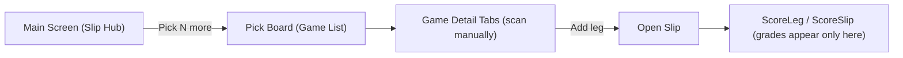
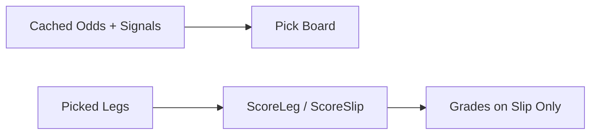
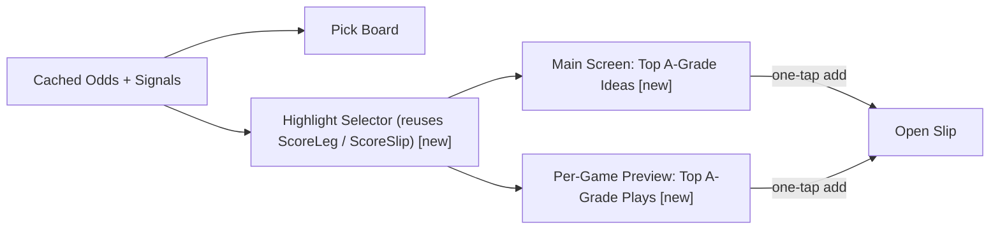
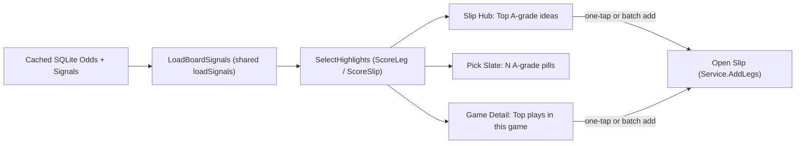

# A-grade leg and parlay highlights

## Context

Today, leg and slip grades only appear after someone adds a pick to a slip. On the pick board, game cards show basic
lines and prop counts, and players carry small suggestion tags (`Smash matchup`, `Role bump`), but there is no way to
see which legs or correlated parlays earn an A grade before picking.

Friends who open the app on Sunday morning blanking on what to bet have to tap through individual games and scan tabs to
find strong plays. The main screen (the slip hub) shows a "Pick N more" banner with no curated ideas to help them get
started.

## Goals and non-goals

**Goals:**

- Surface a small, curated list of A-grade legs and A-grade correlated 2–3 leg parlay ideas on the main screen (when the
  viewer still has picks to make) and inside each game's preview on the pick board.
- Score candidate legs and combos strictly from already-cached odds and signals using the same deterministic `ScoreLeg`
  and `ScoreSlip` engine, with zero extra external API calls.
- Let a user tap any highlighted leg (or combo) to add it directly to their open slip, alongside a short sharp-friend
  reason for the A grade and a link to the full breakdown.
- Keep the phone-first layout scannable by capping the number of highlights and failing soft (hiding the section) when
  no cached plays reach an A grade.

**Non-goals:**

- Auto-filling a user's slip or locking picks on their behalf.
- Triggering paid odds or prop fetches just to populate highlights; highlights only score cached rows within the slip's
  slate scope.
- Adding LLM-generated blurbs or betting advice; every highlight and reason stays deterministic plain Go.

## Decision

### Before

### After

Add a pure highlight selector that runs the existing `ScoreLeg` and `ScoreSlip` engine over already-cached board rows
and valid correlated combos, then renders a compact "Top ideas" strip on the main screen and inside each game preview
with one-tap add.

This beats building a separate recommendation heuristic because a separate heuristic would drift from the analyzer and
confuse friends when a "top pick" drops to a C once added to the slip. Waiting on `sharp-book-grading` ensures
highlighted A-grade legs already clear the sharp-line price check rather than spotlighting stale or overpriced retail
numbers.

`complexity: medium` fits because the selector must bound combo generation so page renders stay fast, deduplicate
overlapping legs and combos, respect slate scopes and already-picked legs, and fit cleanly into phone-first hub and
game-preview layouts. `risk: low` fits because highlights are read-only over cached data and reuse existing add-leg
endpoints, failing soft when data is absent with full coverage from deterministic selection tests.

## Overview

## Consequences

- **Easier:** Friends blanking on picks see deterministic A-grade singles and conflict-free 2–3 leg combos on the hub and game detail, with one-tap single or atomic batch add.
- **Easier:** Board and slip signal loading share `loadSignals`, so highlight grades match slip grades with zero extra API calls or credit spend.
- **Harder:** Hub and pick-board renders now run batched board signal queries and combo scoring in memory (~3.25 ms on a 16-game slate) whenever the viewer has open pick slots.
- **Revisit:** The fixed combo pool cap (top 12 A-grade legs plus up to 6 B-grade stack partners) if new markets or prop types widen the candidate pool enough to miss valid stacks or slow renders.

## Alternatives considered

- **Separate recommendation heuristic:** Rejected because a separate heuristic would drift from `ScoreLeg` and `ScoreSlip`, causing a highlighted play to drop in grade once added to a slip.
- **Precomputing highlights in a background job or SQLite table:** Rejected to avoid cache invalidation bugs as odds, weather, injuries, and user picks change; bounded in-memory scoring is fast enough per render.
- **Relaxing the bar to B+ when no A-grades exist:** Rejected because surfacing B+ picks dilutes trust in the A badge; hiding the strip when empty is clearer.

## Implementation notes

- `board.Row` stores American odds in `Odds` rather than `Price`, so highlight ranking and `CombinedOdds` use `Row.Odds`.
- `HighlightOptions` treats `0` as "use default" (`3` legs, `2` parlays, `1` per player), so callers must pass negative values to disable a cap or return zero items.
- Slip routes are registered in `slipHandlers.Routes` (`internal/web/slips.go`) rather than `internal/web/routes.go`, and transactional batch validation (`Service.AddLegs`) lives in `internal/slips/rules.go` to keep handlers thin.
- `POST /slips/{id}/legs` gained a `from=pick` branch because `from=board` returns a single `pick-line-group` partial, whereas `#pick-detail` highlight buttons need `#pick-body` refreshed.
- `"Top plays in this game"` sits below the sticky header in `#pick-detail` rather than inside it so mobile viewports can scroll past it.
- Highlights only score already-cached SQLite rows in the slip's slate scope; before odds or props are cached, or when nothing reaches an A grade, the strip stays hidden.

## Follow-ups

None.
