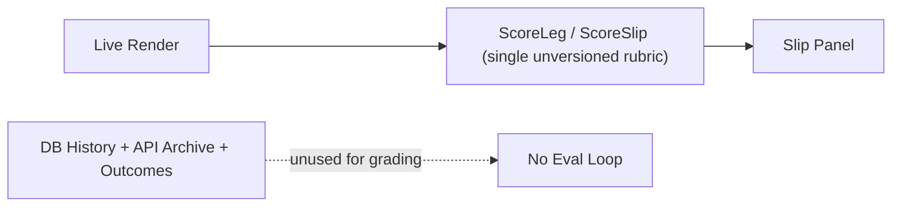
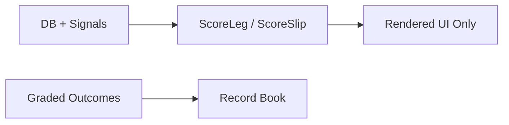
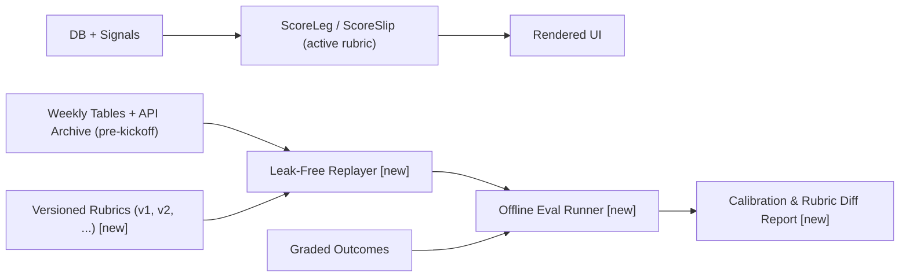
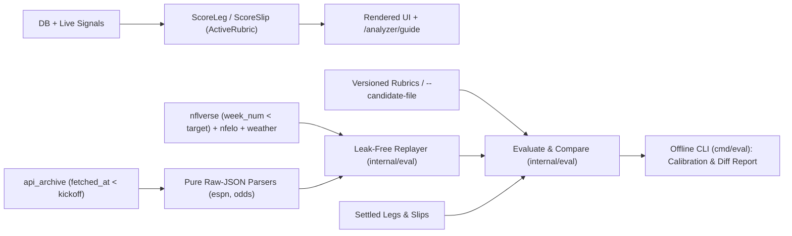

# Grading evals and calibration

## Context

Today, `ScoreLeg` and `ScoreSlip` run on the fly when rendering a slip or tray, and every weight and threshold in the rubric was chosen by hand.

We have no way to check whether our grades actually work: whether A-grade legs win more often than C- or F-grade legs, which factors add real predictive signal versus noise, or whether a rubric change improves calibration before we ship it.

At the same time, the app already stores graded legs, slips, game outcomes, weekly nflverse rows, nfelo projections, and an append-only archive of raw API responses. We just lack a versioned replay and eval flow that turns that history into a repeatable benchmark.

## Goals and non-goals

**Goals:**

- Version the grading rubric in code (e.g., `v1`, `v2`) so multiple candidate rubrics can be run deterministically over the same historical data without storing derived grades in SQLite.
- Reconstruct leak-free pre-kickoff inputs for past weeks from stored weekly tables (`week_num < targetWeek`) and pre-kickoff payloads in the raw API archive (`fetched_at < kickoff`) for overwritten sources (odds, game logs, injuries).
- Build a deterministic offline eval runner that replays historical legs and parlays through one or more rubric versions, joins them with actual outcomes, and reports calibration metrics: hit rate by letter grade (A–F), lift over implied odds, per-factor hit rate and lift, and parlay hit rate by slip grade.
- Support side-by-side comparison between a baseline rubric and a candidate rubric so we can tune weights and rules against real historical data.

**Non-goals:**

- Persisting rendered grades or grade snapshots in SQLite; grades stay derived and idempotent from versioned rubrics.
- Automated machine-learning training or self-tuning weights in production; grading stays plain, human-reviewed Go rules.
- Adding an eval dashboard to the end-user web UI; evals run offline against a local or Litestream-restored SQLite database.
- Calling external APIs or spending odds credits during eval runs.

## Decision

### Before

### After

Version the grading rubric in Go and build an offline, leak-free historical replayer and eval runner that scores past weeks across rubric versions and compares calibration against actual leg and parlay outcomes.

This beats storing grade snapshots in SQLite because comparing a new rubric against past weeks requires replay anyway, pure-Go re-scoring over a full season takes milliseconds, and skipping grade storage keeps the Litestream-replicated database smaller and results idempotent. Reconstructing overwritten inputs (odds, game logs, injuries) from pre-kickoff `api_archive` payloads prevents future-week data from leaking into historical grades.

`complexity: medium` fits because the change coordinates leak-free historical input reconstruction across weekly tables and raw archived HTTP payloads, versioned rubric dispatch, and calibration reporting for both legs and multi-leg parlays. `risk: low` fits because the eval runner is strictly offline with no schema changes and no impact on live request paths, backed by deterministic replay tests.

## Overview

## Consequences

- **Easier:** Testing and comparing rubric weight changes (`RubricV1` vs. built-in or JSON-file candidates) offline against historical weeks without touching live request paths or SQLite schemas.
- **Easier:** Identifying predictive vs. noisy analyzer rules via per-factor lift over implied odds and band migration matrices before shipping weight changes.
- **Harder:** Adding new analyzer rules or weights requires threading them through the `Rubric` struct rather than package-level constants so live scoring, `/analyzer/guide`, and offline evals stay aligned.
- **Revisit:** Revisit per-factor sample-size thresholds or confidence bounds once multiple seasons of archived weeks accumulate, since single-season friend-group slip counts can make factor lift noisy.

## Alternatives considered

- **Storing grade snapshots in SQLite at lock time:** Rejected because comparing a new rubric against past weeks still requires replay, pure-Go re-scoring takes milliseconds, and skipping stored grades keeps the Litestream-replicated database smaller and results idempotent.
- **Falling back to overwritten live tables (`player_gamelogs`, `roster_players.injury_status`, `odds`) on archive gaps:** Rejected because silent post-kickoff data leakage would artificially inflate historical calibration; the replayer fails soft and reports gaps in `DataCoverage` instead.
- **Automated grid search or ML weight tuning:** Rejected because small weekly sample sizes would overfit quickly and violate the deterministic, human-reviewed Go grading rule.

## Implementation notes

- **Archive coverage limits:** Pre-archive weeks or missing pre-kickoff payloads produce partial signal coverage; `DataCoverage` surfaces those counts on every run instead of falling back to live tables.
- **Priced-leg `Lift` alignment:** `Evaluate` aligns `Lift` denominators to decided legs with valid odds so unpriced legs do not skew `WinRate - AvgImpliedProb`.
- **Factor attribution labels:** `Evaluate` normalizes factor attribution keys to canonical `GradeRubric()` labels so aggregate reports group rules consistently across legs.

## Follow-ups

- Propose and tune a `RubricV2` candidate in `internal/analyzer/rubric.go` using `cmd/eval` once sufficient archived weeks and settled slips are available.
- Add minimum-sample warnings or confidence intervals to `internal/eval/metrics.go` factor attribution output to flag low-`N` rules during early-season runs.
