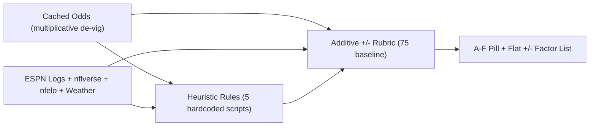
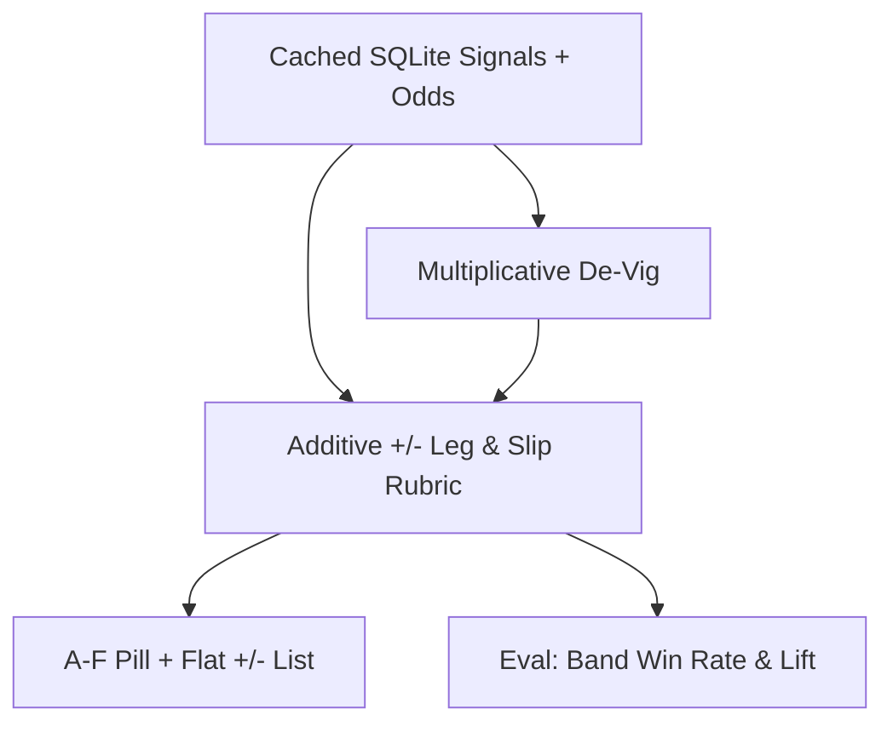
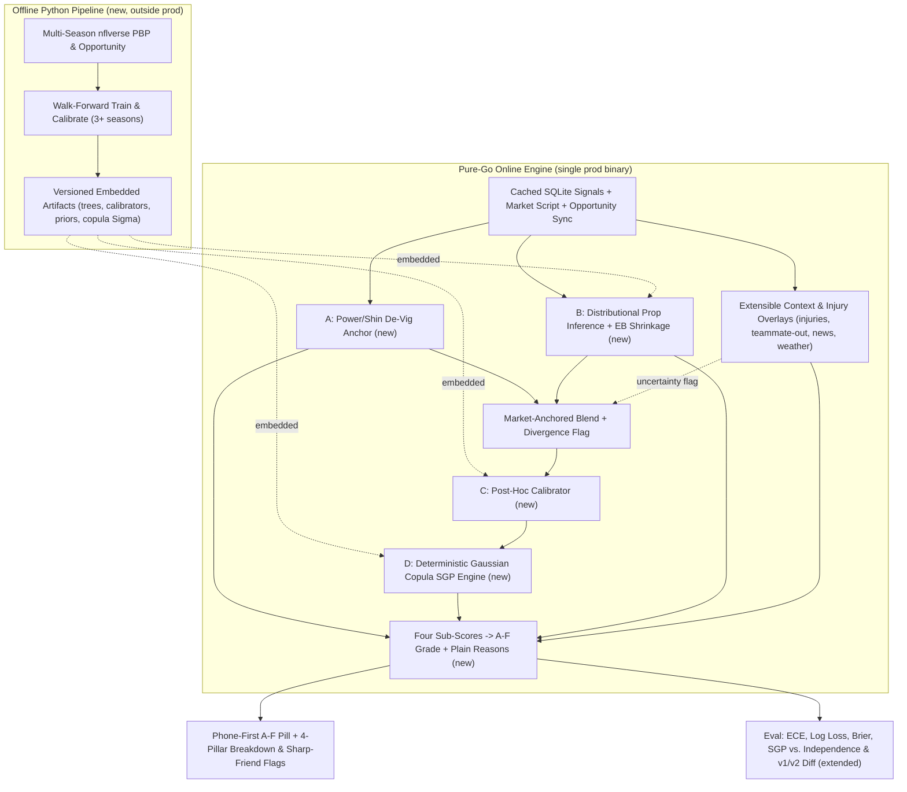
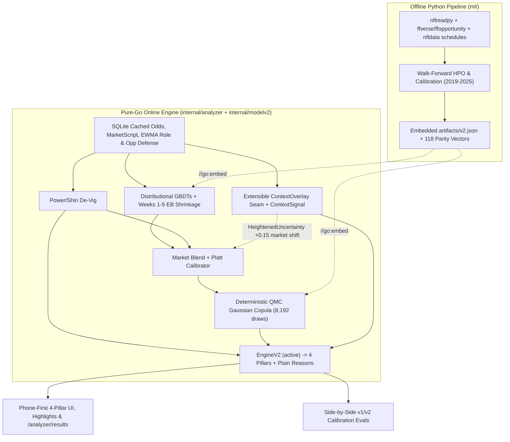

# Calibrated v2 grading and prediction model

## Context

The v1 analyzer grades every leg from a fixed 75-point baseline by adding and subtracting hand-tuned deltas across form,
matchup, and price, then averages leg scores with flat slip penalties for conflicts, leg count, and heavy chalk. It was
fast to build, but it has four structural flaws that show up as real mistakes on Sunday parlays:

1. **Uncalibrated scores mask compounding vig and SGP tax.** Additive points cannot estimate a slip's true hit
   probability. A 4-leg parlay stacked with -130 legs or a heavily taxed Same-Game Parlay (SGP) narrative can still
   score a B or A even when sportsbook juice destroys the payout math. Multiplicative two-way de-vigging also
   understates favorite-longshot vig bias on props and alt lines.
2. **Naive correlation rules miss real SGP math.** Today's analyzer only catches five hardcoded script patterns (two
   stacks, three conflicts) and treats every other same-game combination as independent. It misses continuous
   correlations—like QB passing yards with WR2/TE receiving yards, cross-team shootout bring-backs, or RB rushing yards
   fighting a trailing spread—and cannot tell whether a book already over-taxed an obvious stack.
3. **Box-score heuristics chase noise and ignore variance.** Rewarding raw 5-game hit rates chases recency streaks after
   sportsbooks have already moved the line. High-variance markets like Anytime TDs and extreme alt lines get graded on
   the same scale as stable volume props, hiding lottery-ticket tail risk.
4. **No distributional prop pricing.** When two-way sharp odds are missing (one-way markets, Anytime TDs, or alt lines),
   v1 cannot evaluate the underlying stat distribution or flag when a player's opportunity and game script diverge
   sharply from the offered line.

## Goals and non-goals

**Goals:**

- **Build a calibrated risk and mistake auditor** that estimates fair leg and joint parlay probabilities to catch five
  core failure modes: compounding vig and bad prices, contradictory game scripts, over-taxed SGP narratives,
  tail-risk/variance traps, and recency or context illusions.
- **Fit cleanly inside our single-instance pure-Go runtime and free-tier budget.** Run model training, walk-forward
  calibration, and correlation estimation offline in Python on multi-season nflverse data, and ship compact, versioned
  static artifacts that the Go server evaluates deterministically in milliseconds with zero Python runtime and zero new
  paid API calls.
- **Implement the four-component modeling stack:**
  1. Power/Shin two-way de-vigging as the primary market anchor when liquid two-way odds exist.
  2. Stat-family distributional prop models (skewed continuous for yards, overdispersed counts for receptions/attempts,
     rare-event models for TDs) with Empirical Bayes shrinkage for Weeks 1–5 and conservative market blending
     ($p_{\text{leg}} = w \cdot p_{\text{market}} + (1 - w) \cdot p_{\text{model}}$).
  3. Strict chronological post-hoc calibration (isotonic/Platt) selected on proper scoring rules (Log Loss, Brier, CRPS)
     and classwise Expected Calibration Error with bin-spread guards.
  4. A deterministic Gaussian copula engine over empirical role-archetype correlations ($\Sigma$) to estimate SGP joint
     hit rates and the correlation multiplier ($M_{\text{corr}}$).
- **Keep grades scannable and explainable in plain language.** Preserve the phone-first A–F pill across slips, pick
  boards, highlights, and research views, backed by four decomposed sub-scores (**Price & Vig**, **Script Fit**,
  **Stability & Tail Risk**, and **Context & Traps**) and approximate, sharp-friend plain-English reasons ("bad pick
  because X and Y") free of +EV lectures.
- **Retain existing context signals and make room for new ones.** Keep the non-box-score analysis we already compute
  (injury status, same-position teammate-out volume bumps, nfelo QB downgrades, weather, key-number hooks) and treat
  **Context & Traps** as an extensible overlay layer so future deterministic signals—like structured recent news,
  late-breaking inactive reports, or sharp line movement—can adjust grades, surface warnings, and flag heightened model
  uncertainty without retraining the core statistical models.
- **Prove v2 beats v1 before promoting it.** Keep v1 and v2 side-by-side in our offline walk-forward evaluation harness
  across at least three NFL seasons and archived production slates, checking zero future leakage, proper scoring
  improvement over market/independence baselines, and parameter stability.

**Non-goals:**

- **Beating Vegas or hunting +EV alpha.** Retail player props carry 8–15% vig plus SGP tax; routine large +EV claims
  against consensus lines are treated as a leakage or calibration bug, not an edge.
- **Adding a Python service, second Cloud Run container, LLM calls, or new paid odds feeds.** Production stays a single
  deterministic Go binary over SQLite using free nflverse/nfelo/ESPN/Open-Meteo data and cached odds.
- **Blocking user picks or requiring exact mathematical attribution.** Every pick stays allowed, and explanations
  surface the top plain-language drivers rather than exact Shapley decompositions.
- **Changing live in-game progress models or sportsbook export.** This change covers pre-kickoff prediction, grading,
  warnings, evals, and their UI presentation.

## Decision

Split the v2 grading stack into an **offline Python training and calibration pipeline** that emits compact, versioned
artifacts embedded into the Go binary, and a **pure-Go deterministic online grading engine** that runs all four modeling
components on cached SQLite data and rolls them into four explainable sub-scores behind the existing A–F grade pills.

### Before

### After

**How the pieces work together:**

- **Offline training, pure-Go serving.** Training distributional GBDTs, post-hoc calibrators, early-season Empirical
  Bayes priors, and PSD-projected role correlation matrices belongs in Python where `nflreadpy`, `ffopportunity`,
  `lightgbm`/`xgboostlss`, and `scikit-learn` live. Exporting those trained models as small static JSON artifacts lets
  the Go server evaluate trees, survival functions (Gamma/Log-Normal, Negative Binomial, Poisson), isotonic curves, and
  fixed-seed / quasi-Monte-Carlo Cholesky copula draws natively in milliseconds with zero runtime dependencies.
- **Local training cadence and Git-backed deployment.** Run training locally on a developer workstation via a single
  reproducible task, verify Go/Python parity and calibration metrics against production snapshots, and commit the
  versioned artifacts in a normal PR so CI and the existing Cloud Run deploy pipeline ship them inside the binary
  (respecting the game-window blackout and keeping rollback to a revert). Retrain 2–3 times per season—pre-season for
  full multi-season refresh, mid-season or pre-playoffs only if live calibration drift or covariate shift shows up, and
  ad-hoc on feature changes—while weekly player, team, injury, weather, and odds inputs continue syncing automatically.
- **Unified coverage for props and game lines.** Player props run through all four components; game markets (spreads,
  moneylines, totals, team totals) anchor on Power/Shin de-vigged sharp/consensus lines blended with nfelo and join the
  same copula matrix (via team margin and game total nodes) so mixed game-and-prop SGPs get real script correlation
  math. Unmatched players or sparse markets fail soft to market-anchored probabilities plus context rules.
- **Extensible context, injury, and news overlay layer.** Trailing box-score models naturally lag breaking changes. The
  **Context & Traps** pillar stays an open, deterministic overlay seam that retains everything we already compute
  (teammate-out role bumps, player injury status, nfelo QB drag, wind and weather hazards, key-number hooks, snap/target
  drops) and cleanly accommodates future signals like structured recent news, game-day inactives, or line-movement
  alerts. Overlays can both score the Context & Traps sub-score and attach an uncertainty flag when breaking context
  makes trailing stats less reliable, leaning back toward the live market anchor.
- **Four-pillar explainability without jargon.** On phone screens, every leg and slip keeps its compact A–F pill.
  Tapping it reveals four visual sub-scores—**Price & Vig**, **Script Fit**, **Stability & Tail Risk**, and
  **Context & Traps**—each paired with short, approximate sharp-friend explanations pulled from the top contributing
  signals (for example, naming the bad price vs. consensus, the two conflicting legs, the Anytime TD variance trap, or
  the wind/snap-drop warning) rather than raw +EV math or opaque feature weights.

**Why this beats the alternatives:**

- Running a Python sidecar or second microservice in Cloud Run would break our single-instance SQLite guardrail, add
  cold-start latency, and blow up operational cost.
- Hand-tuning pure-Go statistical formulas without offline multi-season walk-forward training cannot calibrate skewed
  prop distributions or empirical SGP correlations and would recreate v1's arbitrary heuristic bias.
- Keeping v1's additive rubric and tacking on Power de-vig or copula deltas as extra ± points would leave grades
  uncalibrated and still let compounding vig, tail risk, and recency streaks masquerade as A-grade picks.

**Complexity (`high`):** Spans a multi-season leak-free offline training and calibration pipeline, a portable artifact
contract, pure-Go distributional inference and Gaussian copula math, free nflverse opportunity enrichment, four-pillar
grading and explanation presentation across slips, highlights, and research views, and side-by-side calibration
verification in the eval suite.

**Risk (`medium`):** Subtle chronological leakage, non-PSD correlation matrices, or poorly calibrated tail probabilities
could silently distort grades across every slip and highlight; risk stays bounded because v2 runs side-by-side against
v1 behind mandatory multi-season walk-forward Log Loss, Brier, ECE, and SGP-vs-independence gates before promotion, and
missing features fail soft to market-anchored baselines.

## Overview

## Consequences

- **Easier:** New breaking-context checks (inactives, sharp steam, structured news) plug into `ContextOverlay` and
  `ContextSignal` without retraining or re-exporting model artifacts.
- **Easier:** Grading changes can be compared side-by-side against `EngineV1` across `internal/eval`,
  `/analyzer/results`, and web handler tests via `GradingEngine` and `Dependencies.GradingEngine`.
- **Easier:** Good scripts with bad prices stay visibly distinct because `EngineV2` splits `Price & Vig`, `Script Fit`,
  `Stability & Tail Risk`, and `Context & Traps` instead of folding them into one additive score.
- **Harder:** Modifying EWMA decay, Empirical Bayes shrinkage, feature definitions, or QMC Sobol sequences requires
  re-running `mise run train-v2` and keeping Go and Python aligned within `1e-6` across all 118 parity vectors.
- **Harder:** Tracing why a single leg landed on a given score takes more effort than reading v1's flat `+8/-5` rubric
  deltas, because probabilities pass through GBDT parameters, market blending, Platt calibration, and copula simulation.
- **Revisit:** Re-evaluate `lightgbm` or `xgboost` versus the custom second-order `DistributionalGBDT` over
  `scikit-learn` if training environments standardize `libomp` or tree complexity grows.
- **Revisit:** Run `mise run eval-prod` against live production Litestream snapshots as soon as Google ADC is available
  in an authenticated shell to confirm calibration on live group slips.

## Alternatives considered

- **Python sidecar or ONNX/CGO serving vs. embedded flat JSON trees:** Rejected a Python Cloud Run service (breaks the
  single-instance SQLite invariant and adds cold-start cost) and ONNX Runtime (breaks `CGO_ENABLED=0` static Alpine
  builds). Embedded flat JSON trees evaluate with zero heap allocations.
- **`lightgbm`/`xgboostlss` vs. custom Newton-Raphson GBDTs over `scikit-learn`:** Native `xgboost` and `lightgbm`
  wheels failed to load on macOS without Homebrew `libomp.dylib`. Implemented second-order `DistributionalGBDT` over
  `scikit-learn` `DecisionTreeRegressor` (preserving native `NaN` routing) and exported `+/-inf` missingness split
  thresholds as finite `+/-1e300` sentinels.
- **Patching v1's additive rubric vs. replacing it with four calibrated pillars:** Appending Power de-vig or copula
  deltas to a 75-point checklist would leave probabilities uncalibrated and let compounding vig or tail risk pass as A
  grades. Built `EngineV2` behind `GradingEngine` and kept `EngineV1` solely as an eval baseline.
- **Random Monte Carlo or bivariate approximations vs. deterministic QMC Cholesky draws:** Bivariate closed-form rules
  break past two legs, and pseudo-random sampling causes grades to jitter on reload. Precomputed Joe & Kuo Sobol draws
  (`N = 8,192`) stay deterministic and sub-millisecond for multi-leg SGPs.
- **Standalone model probabilities vs. market-anchored blending (`[0.70, 0.85]`):** Weekly nflverse box scores lag
  Sunday morning news and sharp action. Blending toward Power-devigged consensus suppresses false `+EV` claims while
  still catching one-way/alt-line mispricings and wide model-market divergence.
- **Per-leg opponent SQL queries vs. single season-wide query:** Querying opponent matchups per leg would create N+1
  database round-trips because classifying opposing `WR1`/`WR2`/`RB1`/`RB2` requires each opponent's full team depth
  chart. Switched to one `NFLversePlayerWeeksForSeasonTypes` fetch when player legs exist.

## Implementation notes

- **Upstream nflverse dataset gaps:** `nflverse/nflverse-data` returned HTTP 404 for
  `ff_opportunity/ep_weekly_{season}.csv`, and `nflreadpy.load_schedules` returned HTTP 404 on
  `schedules/games.parquet`. Opportunity ingestion points to `ffverse/ffopportunity` (`latest-data`), infers
  `season_type` from week number, reads optional `passing_cpoe` from `stats_player_week`, and falls back to
  `nflverse/nfldata` `games.csv` during training.
- **Shin de-vig negative-overround edge case:** `DevigTwoWayShin` falls back to multiplicative normalization when
  overround is in `[0.95, 1.0)` because Shin's insider-trading parameter `z` requires positive overround;
  `DevigTwoWayPower` solves across the full `[0.95, 1.25]` range.
- **Promotion eval gaps:** `mise run eval-prod` was skipped because Google ADC was unavailable to restore the Litestream
  backup (`gs://parlay-club-parlay-litestream`), and `ep_weekly_2026.csv` was omitted from
  `internal/sandbox/registry.go` to avoid breaking its fixed 104-fixture snapshot check. Promotion used the 2023–2025
  walk-forward validation (`Log Loss 0.603852` vs. market `0.624527`, `Copula SGP LL 0.590423` vs. naive `0.618393`) and
  a real 2025 Weeks 7–10 replay dataset (`benchmark_dataset.json`).
- **Copula node coverage limits:** `artifacts/v2.json` omits standalone `ANYTIME_TD` and `TEAM_TOTAL` columns from its
  base regime matrices; cross-player pairs proxy to attenuated yardage/TD nodes while `WithinPlayer` applies exact
  same-player overrides. Single games with over 32 legs fall back from Sobol draws to Halton draws.
- **Test and coverage caveats:** `TestEngineV2FullSlateLatencyBudget` skips its `<100ms` assertion under `-race` via
  build tags so full-suite race runs do not flake, and `DataCoverage.WithNFLVerse` in `internal/eval/replay.go` still
  tracks v1 coverage fields rather than `EWMA` to keep baseline CLI assertions comparable.

## Follow-ups

- **Validate `EngineV2` on live production slips:** Run
  `LITESTREAM_BUCKET=parlay-club-parlay-litestream mise run eval-prod` from an authenticated `gcloud` shell to confirm
  calibration and SGP lift on archived group slips.
- **Feed live breaking signals into `ContextSignal`:** Wire late inactive feeds, injury status changes, or sharp
  line-movement alerts into `Game.ContextSignals` and `PlayerStats.ContextSignals` via the `external_context_signals`
  overlay seam.
- **Add native `ANYTIME_TD` and `TEAM_TOTAL` copula columns:** Estimate cross-player empirical correlations for
  `ANYTIME_TD` and `TEAM_TOTAL` in `ml/copula.py` so `internal/modelv2/copula.go` can drop cross-player node proxying.
- **Track v2 feature coverage in `eval.DataCoverage`:** Add `EWMA` and `MarketScript` counters to
  `internal/eval/replay.go` alongside the existing v1 `WithNFLVerse` coverage check.
