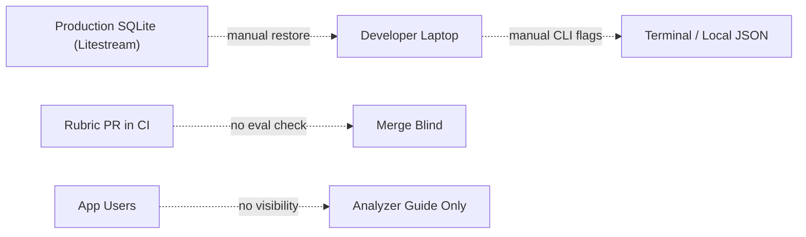
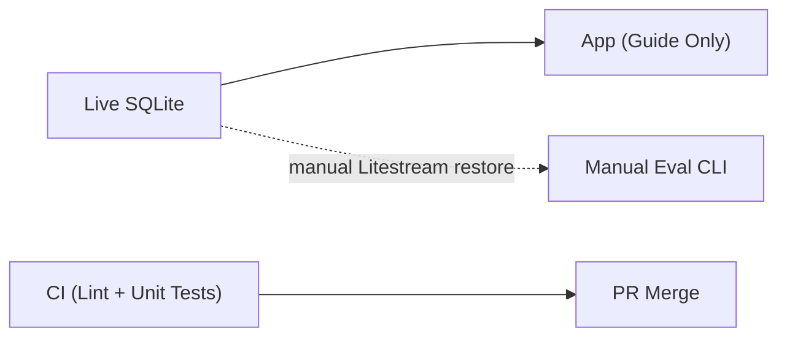
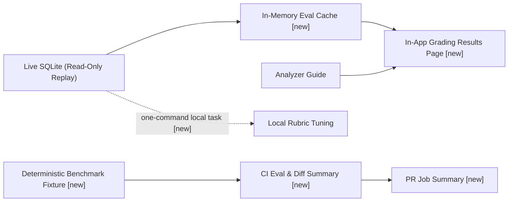
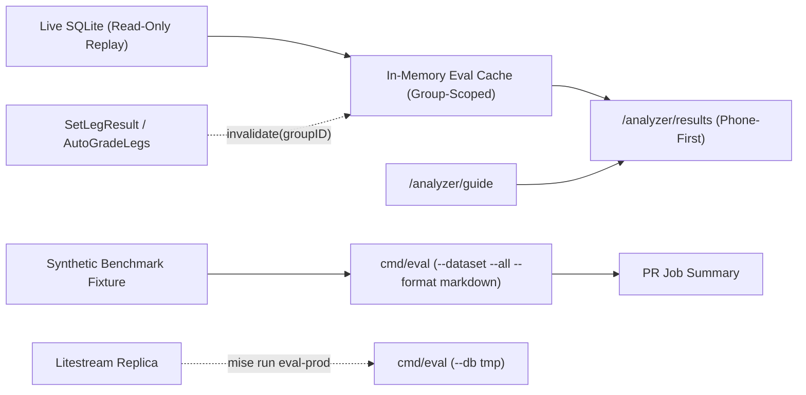

# Automated grading evals and in-app results page

## Context

The offline eval runner can replay settled slips and compare rubric versions without post-kickoff leakage, but using it
today is entirely manual. Checking how grades perform requires restoring a Litestream copy of production, running the
CLI by hand, and saving JSON files to compare across runs.

Because results stay trapped on a developer's machine, nobody in the app can see whether A-grade legs actually beat C-
or F-grade legs over the season, and pull requests that tweak analyzer weights get no automatic calibration feedback.

## Goals and non-goals

**Goals:**

- Publish a phone-first **Grading Results** page in the app, linked from the analyzer guide, showing live, leak-free
  calibration for the active group: A–F leg and slip hit rates, lift over implied odds, flat ROI, factor attribution,
  data coverage, side-by-side comparison across built-in rubrics, and week-over-week progression.
- Keep the in-app results page fast and free-tier safe by reading the app's existing SQLite database and caching
  computed reports in memory until a slip settles.
- Add an automatic CI eval step that runs all built-in rubrics against a deterministic synthetic benchmark fixture and
  publishes a calibration and rubric-diff summary on pull requests, without touching pre-push speed.
- Add a single local task command for restoring a read-only production snapshot and running a baseline-vs-candidate
  rubric comparison in one step.

**Non-goals:**

- Pulling production databases or Litestream credentials into CI, or committing real user slip history into git.
- Persisting computed eval snapshots or derived grade rows in SQLite.
- Adding a scheduled Cloud Run cron job to precompute evals.
- Running slow or network-dependent eval restores in git pre-push hooks.
- Auto-tuning rubric weights or changing the friendly, non-blocking analyzer tone.

## Decision

### Before

### After

Split eval automation into two clean loops: serve live, group-scoped calibration directly inside the app from its own
SQLite database, and run deterministic fixture evals in CI while keeping a one-command local task for
production-snapshot tuning.

Serving the Grading Results page directly from the app's existing database beats publishing static reports from CI
because results stay automatically up to date as slips settle, group privacy stays enforced inside normal auth and group
scoping, and CI never needs production database credentials or user data; keeping pre-push limited to fast unit tests
avoids slowing down local pushes or requiring network access.

`complexity: medium` fits because the change coordinates across the group-scoped web UI and cache invalidation boundary,
multi-rubric and weekly trend aggregation in the eval layer, and CI workflow plus local task automation while respecting
single-instance and group-privacy invariants. `risk: low` fits because all eval queries are read-only with no schema
changes, external API calls, or impact on live picking and grading, and deterministic unit and handler tests cover
aggregation, cache invalidation, and group scoping.

## Overview

## Consequences

- **Easier:** Checking whether A–F grades calibrate over a group's season inside the app, without restoring production databases or running CLI tools.
- **Easier:** Comparing future rubric versions side by side; adding a rubric to `analyzer.BuiltInRubrics()` enables comparison in both `/analyzer/results` and CI without extra wiring.
- **Easier:** Running local baseline-vs-candidate comparisons against production snapshots with a single `mise run eval-prod` command that cleans up its temporary DB on exit.
- **Harder:** Keeping cached eval reports fresh if SQLite is modified outside `slips.Service` (`SetLegResult` or `AutoGradeLegs`), since direct DB edits bypass `InvalidateGroup`.
- **Revisit:** Adding bounded capacity or eviction to `eval.Cache` if active group and season counts grow enough to pressure single-instance memory.
- **Revisit:** Pre-warming or optimizing `All seasons` replay if large multi-season groups hit slow first-load misses (currently mitigated by defaulting to the latest graded season).

## Alternatives considered

- **Publishing static eval reports from CI:** Rejected because it would either require production database credentials in CI or limit the app to synthetic numbers. Serving from SQLite through an in-memory cache preserves group privacy and updates as slips settle.
- **Persisting eval reports in SQLite:** Rejected to avoid schema migrations and keep grades and evals derived and idempotent. Pure-Go replay over a group's season is fast and caches in memory until settlement.
- **Running evals in git `pre-push` hooks:** Rejected because snapshot restores need network access and credentials, and extra CLI runs slow local pushes. Keeping `pre-push` to `go test -short ./...` and running fixture evals in CI keeps pushes fast.

## Implementation notes

- **Generation-guarded cache writes:** `eval.Cache` tracks global and per-group invalidation generations so an in-flight cache miss cannot write stale metrics back after a concurrent settlement invalidation.
- **Single-rubric state:** With only `v1` registered today, `SuiteReport.Diffs` is empty and `/analyzer/results` shows a placeholder note until a second rubric is added.
- **Synthetic CI benchmark:** The CI summary runs against a deterministic 4-week, 24-slip, 72-leg synthetic fixture to catch regressions and verify formatting; it does not reflect live production hit rates.
- **Docs lint adjustment:** `good-vibes docs lint` promotes `names-path` warnings to errors on modified docs, which required removing backticks from six pre-existing runtime paths in `docs/guides/local-dev.md`.

## Follow-ups

- Propose and register a `v2` analyzer rubric in `analyzer.BuiltInRubrics()` informed by `mise run eval-prod` production replays to activate side-by-side comparison in `/analyzer/results` and CI.
- Add size-bounded eviction (LRU or TTL) to `eval.Cache` if single-instance memory usage grows with many active groups and seasons.
