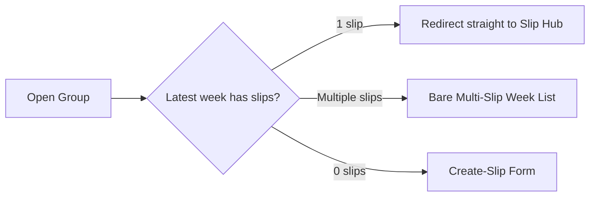
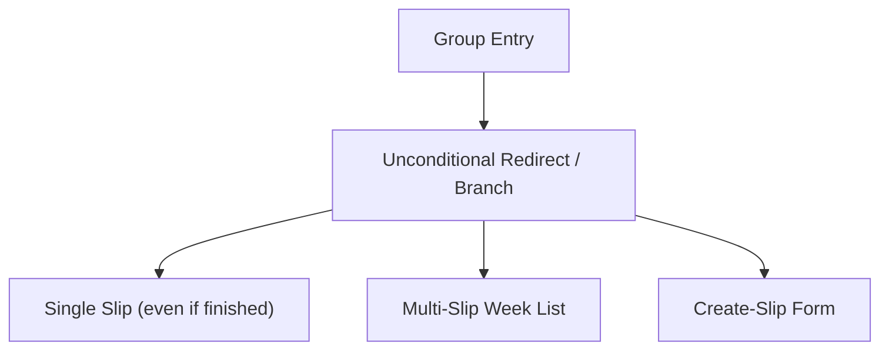
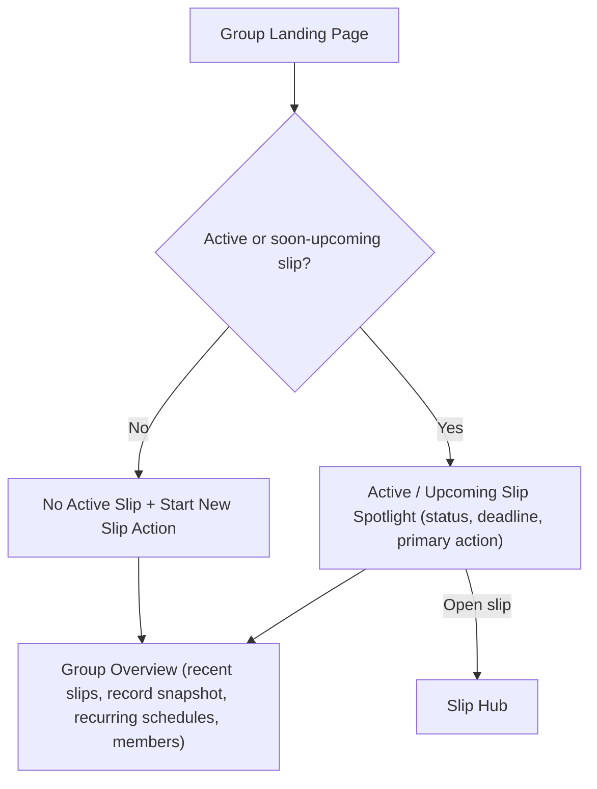
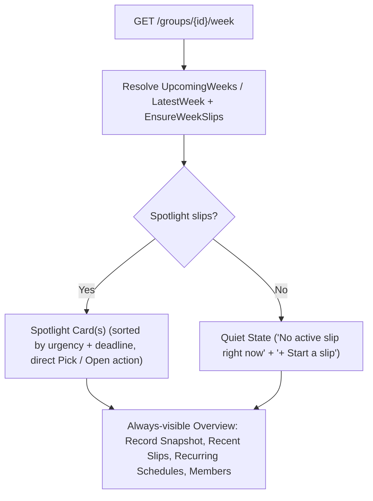

# Redesign per-group landing page

## Context

Opening a group today jumps straight into a single week's slip mechanics: if the latest week has one slip, the group
immediately redirects to that slip; if it has multiple slips, it shows a minimal week list; if it has none, it drops the
member onto the create-slip form.

That shortcut works while a slip is actively open or about to kick off, when the member's only goal is to pick, lock in,
or check legs. Outside that window—after a week finishes, between weeks, or when a group has no live slip—landing on a
closed slip or an empty creation form feels abrupt and hides the group's bigger picture (recent results, recurring
schedules, members, and what is coming up next).

## Goals and non-goals

### Goals

- Make the per-group landing page a dedicated **group overview** rather than an unconditional redirect to a slip or
  create form.
- Prominently highlight any **active or soon-upcoming slip** at the top of the page with its current step, deadline, and
  primary action so live game-week play stays one tap away.
- When no slip is active or soon upcoming, lead with the group overview: recent slip results, group record snapshot,
  active recurring schedules, members, and a clear action to start a new slip.
- Keep the layout phone-first and scannable at every width.

### Non-goals

- Replacing the individual Slip Hub (members still open a slip to pick, vote, lock in, export, or grade).
- Replacing the full Record Book or group invite/management screens; the overview summarizes and links to them.
- Changing how recurring schedules auto-create slips or how external odds are fetched.

## Decision

Turn the per-group entry point into a state-aware group landing page that always renders a coherent overview, elevating
active or soon-upcoming slips into a hero spotlight when present.

### Before

### After

Keeping one consistent landing page with a conditional spotlight beats redirecting on active weeks and showing an
overview on quiet weeks because members always know where they land when they tap a group, and they can still reach
group context (schedules, recent slips, record) without hunting through menus during a live week. Summarizing key group
data inline beats linking out to separate tabs for everything because a club's status—who is in, how the group is doing,
and what is next—fits naturally on one phone-first screen.

`complexity: medium` fits because the landing page aggregates slip state, upcoming-slip detection, recent results,
recurring schedules, and group record summaries into one view. `risk: low` fits because it is a read-heavy presentation
change on the group entry route that leaves slip mutations, grading, and background sync untouched, with straightforward
handler and template test coverage.

## Overview

## Consequences

- **Easier:** Members always land on a consistent per-group home with one-tap access to live picks (`Pick N more` or
  `Open slip`), record stats, recent results, and recurring schedules.
- **Easier:** Joining `weeks` in `RecentSlipsForGroup` and exposing `CurrentWin`/`CurrentLoss` on `record.Book` keeps
  overview assembly free of N+1 queries and duplicated streak math.
- **Harder:** Every `GET /groups/{id}/week` load now reads recent slips, graded season slips, recurring schedules, and
  members rather than short-circuiting with a 303 redirect.
- **Revisit:** The recent slips list caps at 5 non-spotlight slips and the record snapshot scopes to the active week's
  season (`overviewRecordSeason`), which may need an all-time or expanded view later.

## Alternatives considered

- **Redirect on 1 active slip, overview on 0 slips:** Rejected because members lose quick access to group record,
  schedules, and starting another slip during live weeks, and the changing destination feels jarring.
- **Separate tabs instead of inline summaries:** Rejected because a group's record, recent slips, schedules, and members
  fit cleanly on one phone-first screen.
- **Keep inline schedule creation on the landing page:** Rejected in favor of linking `+ Add recurring slip` to
  `/slips/new?mode=recurring` to avoid duplicating the creation form.

## Implementation notes

- `Store.RecentSlipsForGroup` returns all slips for the group regardless of spotlight status, so the handler fetches
  `5 + len(weekSlips)` rows and excludes spotlight IDs before capping the recent list at 5.
- `GroupRecordSnapshot` formats `"W-L"` when pushes are zero and `"W-L-P"` when pushes are positive, and displays `"–"`
  when there is no active streak.

## Follow-ups

None.
