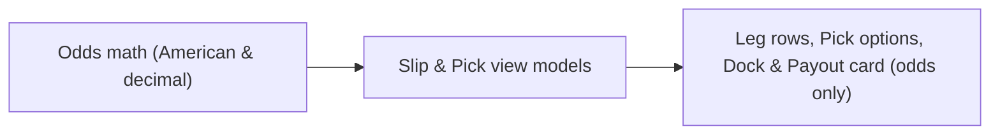
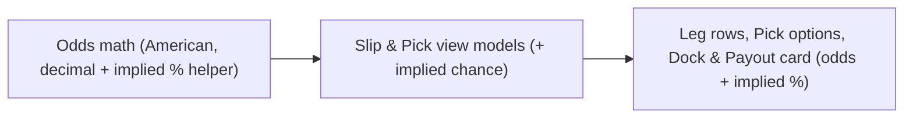
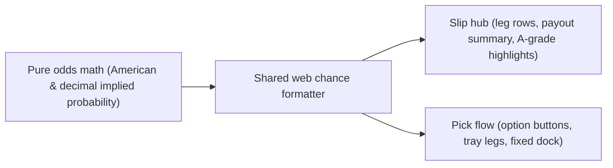

# Implied percentage chances on legs and parlays

## Context

Every leg and parlay in Sunday Parlay Club shows odds in American or decimal form (such as `-110`, `+250`, or `6.50x`).
For a group of friends building a casual Sunday parlay, those numbers are hard to read at a glance. It is not obvious
that `-110` implies a 52% chance, `+250` implies 29%, or a four-leg `+1200` parlay implies roughly 7.7%.

The odds math module already computes raw implied probability for internal analyzer and evaluation checks, and it
already computes combined decimal odds across counting legs. None of those implied chances reach the screens where
people pick legs or review a slip.

## Goals and non-goals

**Goals:**

- Show each leg's implied chance as a percentage alongside its odds on the slip hub, pick tray, pick options, and
  highlight cards.
- Show the overall parlay's implied chance alongside its combined odds in the slip payout summary, pick dock, and parlay
  highlight combos.
- Keep the measure purely informative, phone-first, and consistent with the exact odds displayed next to it, excluding
  pushed and voided legs from the parlay calculation just as combined odds do.

**Non-goals:**

- De-vigging every leg or modeling correlation-adjusted same-game parlay probabilities.
- Changing analyzer grades, warnings, reference odds, payouts, or Record Book units.
- Storing implied percentages in the database or adding external API calls.
- Blocking picks or adding +EV advice based on implied chance.

## Decision

Derive implied percentage chances directly from the displayed price (`1 / decimal` for a leg, and `1 / combined_decimal`
for an overall parlay) in the pure odds math module, format them for quick reading (including small percentages on
long-shot parlays), and render them as muted secondary metadata beside existing odds.

### Before

### After

Using raw implied probability from the displayed price beats two-way de-vigging because it works for every leg
(including single-sided props, custom picks, and historical slips without an opposite quote) and always matches the
price shown next to it. Computing it on the fly from existing odds beats persisting it because it adds no schema state
and stays in sync automatically when lines drift or legs push and void.

`complexity: low` fits because the work is narrow and pattern-following across pure odds math, view models, and
templates with no new state transitions or cross-package invariants. `risk: low` fits because display-only percentages
have a small blast radius—they cannot corrupt stored bets or payouts—and deterministic unit and rendered-HTML tests
cover the math and every view.

## Overview

## Consequences

- `Easier:` Friends can read the market-implied chance of any leg or parlay at a glance beside its odds on both the slip
  hub and the pick flow.
- `Easier:` Any new surface that needs an implied percentage can reuse one pure decimal probability helper and one
  boundary-tested formatter.
- `Harder:` Phone-width rows and two-column pick buttons have less horizontal room, especially on moneyline legs that
  also show an `nfelo` model chip.
- `Revisit:` Revisit raw implied probability if two-way market quotes become available for all prop and custom leg types
  and users want vig-free fair chances.

## Alternatives considered

- **Two-way de-vigged probabilities:** Rejected because one-sided props, custom picks, and historical slips often lack
  an opposite-side quote, and de-vigged percentages would not match the displayed price.
- **Formatting percentage strings in the odds math package:** Rejected to keep `internal/parlay` pure math and match
  existing odds formatting in the web layer.
- **Persisting implied percentages in SQLite:** Rejected because computing them from existing odds avoids schema state
  and stays accurate as lines move or legs push and void.
- **Adding a new row to the slip payout summary grid:** Rejected in favor of inline text beside Combined and Reference
  odds so the 2x2 payout grid stays compact on phones.

## Implementation notes

- The implementation followed the design without deviations.
- Displayed percentages are raw market-implied probabilities (`1 / decimal`), so they include sportsbook vig and assume
  independent legs rather than modeling same-game parlay correlation.
- Empty or all-pushed/voided slips omit the implied percentage instead of showing `100%` when combined odds equal `1.0`.

## Follow-ups

None.
