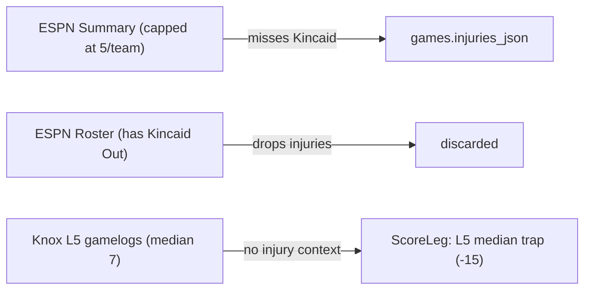
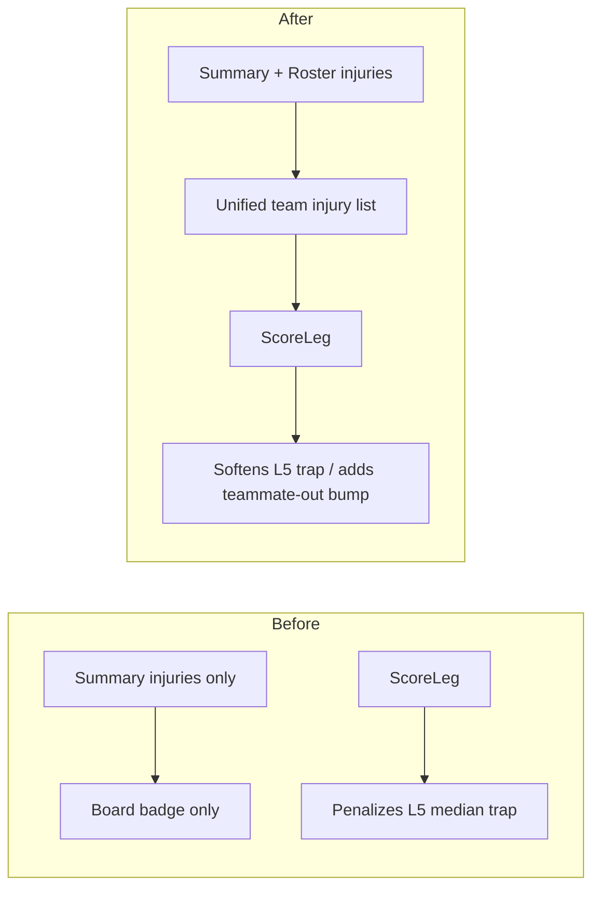
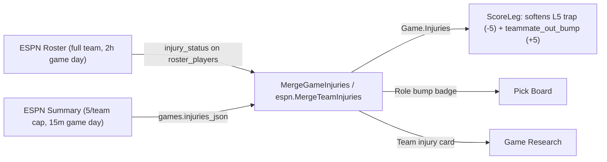

# Include roster injuries in leg grading

## Context

On November 22, 2026, Buffalo TE1 Dalton Kincaid was `Out` (updated on ESPN's roster feed at `16:34Z`, before the 1:00
PM ET kickoff), and Buffalo TE2 Dawson Knox was picked for `Over 21 Rec Yds`.

Two gaps caused the app to miss this context:

1. **ESPN's summary endpoint truncated Kincaid:** All 15 archived `espn:summary:401873070` responses capped `injuries`
   at 5 players per team and omitted Dalton Kincaid. Meanwhile, ESPN's team roster response (`espn:roster:2`) *did*
   include Kincaid's `Out` injury status, but roster ingestion currently drops the `injuries` field.
2. **Leg grading ignores injuries:** `ScoreLeg` only inspects player game logs, nflverse usage, weather, matchup EPA,
   nfelo, and line price. Because Knox's last 5 games with Kincaid active had a median of 7 receiving yards, `ScoreLeg`
   penalized `Dawson Knox Over 21 Rec Yds` with `L5 median trap (-15)` without accounting for Kincaid being `Out`.

## Goals and non-goals

**Goals:**

- Parse and persist player injury status from ESPN team rosters alongside summary injuries so `Out` / `Doubtful` /
  `Questionable` players are not lost to summary truncation.
- Factor same-team, same-position `Out` teammates into `ScoreLeg` deterministically (softening or offsetting
  `L5 median trap` and/or awarding a role-bump adjustment when a key teammate is `Out`).
- Keep all grading 100% deterministic plain Go rules with no LLM calls.

**Non-goals:**

- Adding paid injury feeds or scraping beat-writer social posts.
- Changing how `Role bump` badges work on the pick board beyond sharing the fuller injury data.

## Decision

We will capture player injury status during ESPN roster ingestion, merge it with game summary injuries when building
analyzer inputs, and add a deterministic teammate-injury adjustment in `ScoreLeg` so backup/secondary pass-catchers and
runners are not penalized for historical low-volume games played behind an `Out` starter.

This beats relying solely on ESPN's summary endpoint (which silently drops players beyond 5 per team) or adding a new
external injury API (which would add cost and failure modes).

- **Complexity: medium** — Spans ESPN roster ingestion, SQLite storage, web/board signal loading, and deterministic
  analyzer scoring rules.
- **Risk: low** — Purely additive deterministic rules backed by unit tests against archived ESPN payloads and existing
  analyzer test suites.

## Overview

## Consequences

- **Easier:** Surfacing truncated `Out` players across slip grading, the pick board, and Game Research through one shared merge seam (`MergeGameInjuries` and `espn.MergeTeamInjuries`).
- **Easier:** Keeping injury state self-cleaning, since each roster upsert overwrites `roster_players` and clears `injury_status` when ESPN returns an empty `injuries` array.
- **Harder:** Diagnosing short-lived discrepancies between feeds on game days, when summaries refresh every 15 minutes and rosters refresh every 2 hours.
- **Revisit:** Weighting teammate absences by snap share or depth-chart order if depth-player `Out` statuses create noisy `+5` bumps for starters.

## Alternatives considered

- **Relying only on ESPN summaries or adding a paid injury API:** Rejected because ESPN's summary endpoint silently truncates teams at 5 players, while an external injury feed adds recurring cost and failure modes.
- **Adding a `player_injuries` table:** Rejected because `roster_players` already holds one row per athlete and upserts on every sync; two `TEXT` columns avoid extra joins and clear recovered players automatically.
- **Treating `Injured Reserve` the same as `Out`:** Rejected because long-term IR absences are already reflected in a teammate's L5 game logs, which would double-count old injuries.
- **Suppressing `L5 median trap` completely when a teammate is `Out`:** Rejected in favor of softening it from `-15` to `-5` alongside a `+5` `teammate_out_bump` (net `0`) so the grade pill explains both the low L5 median and the offsetting absence.

## Implementation notes

- All three phases shipped without plan deviations.
- **Game-day roster refresh lag:** Roster syncs run every 2 hours on game days compared to 15 minutes for game summaries, so a late inactive who falls outside ESPN's 5-player summary cap can take up to 2 hours to appear.
- **No depth-chart ranking:** Any same-team, same-position (`WR`, `TE`, `RB`) `Out` teammate triggers the adjustment on Over and Anytime TD Yes props, so a depth receiver being `Out` can boost a starter (capped within `scoreFormAndUsage`'s `+15` ceiling and named in the factor detail).
- **Intentional exclusions:** `Questionable`, `Doubtful`, and `Injured Reserve` statuses, `QB` props, self-injuries, and Under props do not trigger teammate-out adjustments.

## Follow-ups

- Weight `teammate_out_bump` by nflverse snap/target share or depth-chart order so backup-of-backup `Out` players do not boost high-volume starters.
- Increase pre-kickoff roster sync frequency on game days if late inactive announcements continue to overflow ESPN's 5-player summary cap.
