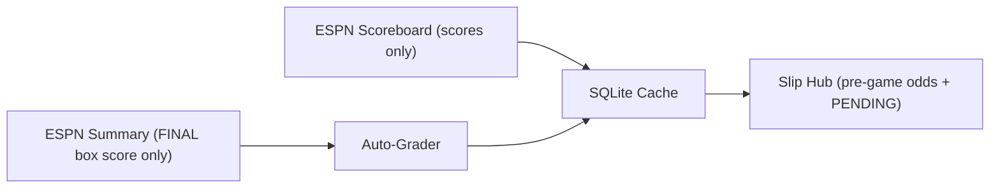
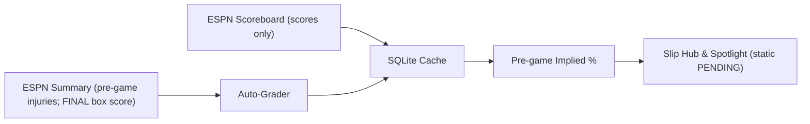
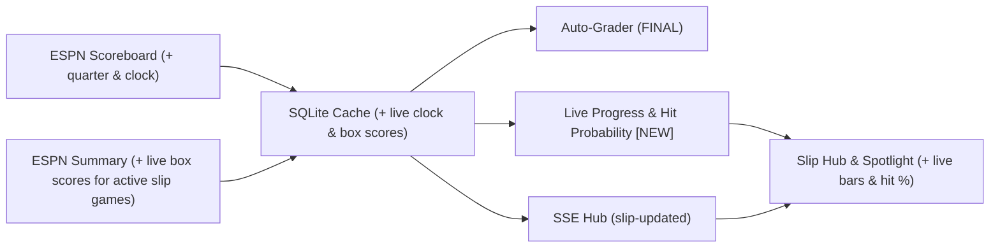
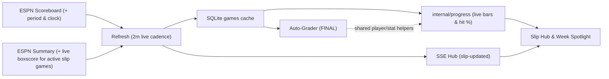

# Live parlay and leg progress bars with live hit probability

## Context

Once a slip locks in and games kick off, the slip hub goes quiet until games end. Each leg keeps showing its pre-game
odds, pre-game implied percentage chance, and a static `PENDING` chip until the game goes `FINAL` and auto-grading runs.

Watching a Sunday parlay in the app gives no sense of momentum. Friends cannot tell if a quarterback is 18 yards away
from an over, if a spread pick is hanging on by a field goal in the fourth quarter, or how likely the full parlay is to
cash right now. They have to leave the app and check box scores by hand.

Today, the free ESPN scoreboard sync already refreshes every 2 minutes during live games, but it drops quarter and game
clock. The free ESPN summary sync already parses player box scores for final auto-grading, but it never stores live box
scores while a game is in progress.

## Goals and non-goals

**Goals:**

- Show a live progress bar on every active parlay slip and on each live leg, tailored to the market (current stat vs.
  line for player props, live score and margin with quarter/clock for game and team markets, and cashed/busted states
  when mathematically settled).
- Show an updated live hit probability percentage for each live leg and for the combined parlay, anchored to pre-game
  odds at kickoff and updating smoothly as stats, scores, and time remaining change.
- Stay strictly within free-tier and product guardrails: use only free ESPN feeds, spend zero paid odds API credits, run
  plain deterministic Go math with no LLM calls, add no background cron jobs, and render cleanly at phone width first.
- Keep live updates flowing through the existing lazy refresh and SSE hub so open slip views update when live scores,
  clock, or stats change.

**Non-goals:**

- Buying or polling live in-game sportsbook odds from Parlay API or The Odds API.
- Adding a play-by-play feed, drive chart, or field-position tracker.
- Adding scheduled background polling jobs outside the existing page-load refresh and SSE model.
- Changing how `FINAL` auto-grading, manual grade overrides, or payout calculations work.
- Computing live progress for free-text `OTHER` legs or unlinked historical legs.

## Decision

Extend the free ESPN live refresh path to capture live game clock, quarter, and in-progress player box scores for games
with active slip legs, then run a pure deterministic live progress and probability engine to render leg and parlay
progress bars with updated hit chances on the slip hub and week spotlight cards.

### Before

### After

Using a deterministic time-remaining model over free ESPN live data beats polling live sportsbook odds because it spends
zero paid API credits, covers every player prop and game market uniformly without book-specific gaps or line
suspensions, and stays anchored to the exact line locked on the slip.

Computing progress and probability inside a dedicated pure Go module beats burying formulas in web handlers or templates
because every market's math, edge cases (overtime, early cash-in, early bust, pushes/voids), and combined parlay product
can be unit-tested directly against real game states.

This change has `medium` complexity because it coordinates across several seams—ESPN live ingest, cached storage,
refresh staleness and SSE fan-out, a new deterministic probability model across all supported markets, and phone-first
UI—requiring consistent contracts across boundaries without redesigning core architecture.

Its `risk` is `low` because live progress and hit probabilities are additive, read-only display signals over free ESPN
data that leave grading, payouts, and paid odds budgets untouched, and every market's math is verifiable with
deterministic unit tests.

## Overview

## Consequences

- **Easier:** Computing live leg and parlay progress without extra writes, because `boxscore_json` is cached once per
  live game and `internal/progress` evaluates legs purely on read.
- **Easier:** Keeping live prop progress and final grading consistent, since both share `FindPlayer`,
  `PlayerMarketStat`, and `AnytimeTDCount` from `internal/grader`.
- **Harder:** Tuning or debugging live probability swings on edge-case games, because `internal/progress` models
  remaining production with Normal and Poisson approximations anchored to pre-game odds rather than live market prices.
- **Revisit:** The 2-minute `espn:summary:{gameID}` live cadence and hardcoded market coefficients of variation if live
  Sunday traffic hits ESPN rate limits or late-game probabilities feel noisy.

## Alternatives considered

- **Polling live sportsbook odds (Parlay API / The Odds API):** Rejected because it spends scarce monthly free-tier
  credits, breaks during suspended live markets, and tracks different lines than those locked on the slip.
- **Storing per-leg live stats in a new database table:** Rejected in favor of storing `boxscore_json` once per `LIVE`
  game on `games`, keeping writes to one row per game and computing leg progress on read.
- **Adding a background polling job for live games:** Rejected because it violates the Cloud Run single-instance
  free-tier guardrail; riding on `Kick()` with 2-minute staleness and SSE fan-out lets idle instances scale to zero.

## Implementation notes

- `internal/ingest/espn/boxscore.go` needed no changes because its internal `rawSummaryBoxScore` and `parseBoxScore`
  helpers were reused directly by `Client.Summary`.
- Yardage props (`PASS_YDS`, `RUSH_YDS`, `REC_YDS`) stay `LIVE` (capped at `99%`) until `FINAL` because negative plays
  can reduce totals, while monotonic markets settle early as soon as `cur > line`.
- Unpopulated live box scores (`!box.HasStats`) degrade to pre-game probability (`"Live · stats pending"`), and absent
  players in a populated live box score evaluate at `0` rather than `VOID`.
- Unlinked legs, `OTHER` market legs, and missing or unparseable live clocks fall back to pre-game probability or a
  `0.50` remaining-time fraction.

## Follow-ups

None.
