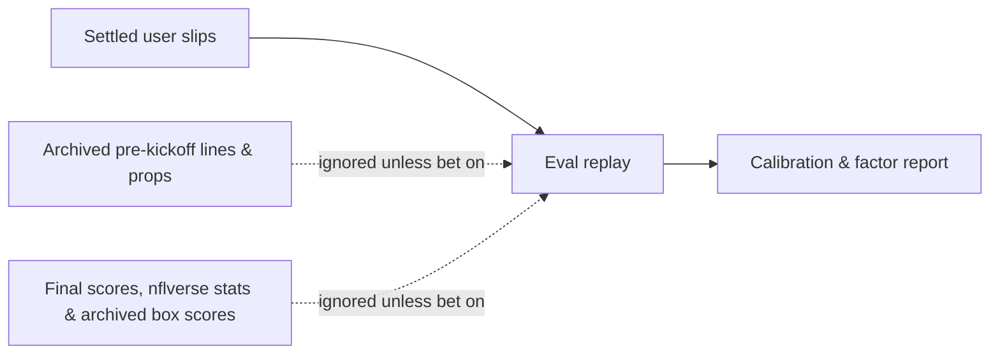
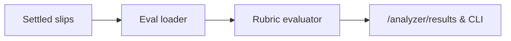
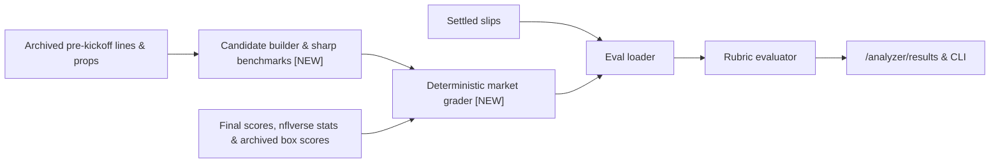
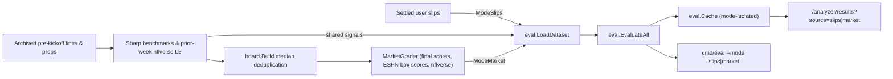

# Market-wide grading evaluation

## Context

Today, grading calibration on `/analyzer/results` and in the eval CLI only replays settled user slips and legs. Even
when scoped across all groups, the sample stays tiny because groups only bet on a small slice of the NFL slate each
week.

Meanwhile, the app already collects league-wide pre-kickoff data—archived game lines and player props, injury reports,
weather, nfelo projections, and prior-week nflverse team and player stats—plus final scores and league-wide weekly
nflverse player stats once games end (along with post-final ESPN box scores for games that had user prop legs). Almost
none of that market data is used to measure how well the A–F grading rubric predicts outcomes.

There are also two signal gaps that hurt grading-eval accuracy today:

- The eval replayer does not rebuild pre-kickoff sharp-book benchmarks from archived odds, so sharp-book line and price
  rules go untested.
- ESPN player game logs are only fetched for players on user slips or opened in research, leaving recent-form (L5) rules
  silent on unpicked players unless eval falls back to strictly prior-week nflverse player stats.

## Goals and non-goals

### Goals

- Measure A–F leg calibration, lift over implied odds, flat ROI, Brier score, and factor attribution across all
  collected pre-kickoff game lines and player props for finished games—not just user-submitted slips.
- Deduplicate multi-book quotes into one representative candidate per market selection side (matching how the pick board
  and highlights present lines) so sample sizes and metrics are not inflated by counting the same outcome once per
  sportsbook.
- Reconstruct the full pre-kickoff signal set for every synthetic market leg, including sharp-book benchmarks from
  archived pre-kickoff odds and strictly prior-week nflverse player stats when a player has no pre-kickoff archived ESPN
  game log.
- Stay strictly leak-free: only use pre-kickoff archived odds, lines, injuries, weather, projections, and prior-week
  stats when scoring, and grade outcomes deterministically from final scores, post-final archived ESPN box scores (when
  present), and league-wide nflverse weekly player stats.
- Keep user-slip evaluation intact (including slip-level parlay drag, correlation, and stack rules) alongside
  market-wide leg calibration on `/analyzer/results` and in the offline eval CLI, with zero external API calls during
  evaluation.

### Non-goals

- Persisting synthetic market legs into the production slip or leg tables, or mixing synthetic market legs into group
  Record Books or slip-level parlay stats.
- Adding new live or post-game ESPN polling to fetch box scores for games nobody bet on.
- Backfilling historical seasons that lack archived pre-kickoff odds, final scores, or post-game player stats.
- Tuning or promoting a `v2` rubric in this change (this change builds the market-wide eval dataset so `v2` tuning has
  real sample size).

## Decision

Extend the eval dataset loader with a market-wide leg mode that parses archived pre-kickoff game lines and player props
for every finished game, deduplicates them into one representative candidate per selection side, rebuilds the full
pre-kickoff signal set (including sharp-book benchmarks and prior-week nflverse L5 fallback), grades each candidate
deterministically against final scores and post-game player stats, and feeds those graded legs through the existing
rubric evaluator.

### Before

### After

**Why this approach beats alternatives:**

- *Synthesizing at eval replay time vs. persisting synthetic slips:* Replaying read-only from archived snapshots keeps
  slip and leg tables clean, avoids database bloat and migrations, and lets us change sampling or book-selection rules
  without rewriting stored rows.
- *One representative line per selection side vs. scoring every book row:* Sportsbooks quote 6–10 copies of the same
  market. Counting every book row inflates sample size with correlated duplicate outcomes and skews calibration; one
  representative line per side matches what the pick board and highlights actually score.
- *Post-final archived box scores + nflverse weekly stats vs. polling ESPN for every final game:* Combining
  already-archived ESPN box scores with league-wide nflverse weekly player stats covers finished games offline with zero
  new API calls or background polling.
- *Evaluating market legs alongside slip stats vs. replacing slip evals:* Market-wide legs give large sample sizes for
  A–F leg calibration and single-leg factors, while real user slips remain the only source of parlay-level slip grades
  and multi-leg correlation rules.

**Ratings:**

- `complexity: medium`: Coordinates across archive parsing, multi-book candidate deduplication, pre-kickoff
  sharp-benchmark and L5-fallback reconstruction, deterministic market grading across ESPN and nflverse stats, and the
  eval/web layers while enforcing strict pre-kickoff leak-free boundaries, without changing live request paths or
  database schemas.
- `risk: low`: Read-only evaluation over archived and final game data with no effect on live slip creation, payouts, or
  paid API budgets, and every market-grading and signal-reconstruction rule is verifiable with deterministic unit tests.

## Overview

## Consequences

- **Easier:** Measure A–F leg calibration, lift, flat ROI, Brier score, and factor attribution across the full NFL slate
  via `cmd/eval --mode market` or `/analyzer/results?source=market` without waiting for user slips.
- **Easier:** Exercise sharp-book (`sharp_line_edge`, `sharp_price_edge`) and recent-form (`hit_rate`, `median_trap`)
  rules in replay, since both `ModeSlips` and `ModeMarket` now reconstruct `Game.Sharp` from archived odds and fall back
  to prior-week `nflverse_player_weeks` when pre-kickoff ESPN game logs are absent.
- **Harder:** Diagnose missing player-prop coverage when sportsbook player names do not match pre-kickoff rosters or
  `nflverse` crosswalks; unmatched props lose L5 and usage signals during scoring and are dropped from market grading.
- **Harder:** Reason about cache freshness across two independent invalidation paths in `eval.Cache`, where slip
  settlement evicts per-group entries and newly `FINAL` games or `nflverse` updates evict market entries.
- **Revisit:** Cold-cache replay latency once multi-season archives grow, or whether `ModeMarket` should support
  closing-line-only or per-book sampling alongside median consensus.

## Alternatives considered

- **Synthesizing at replay time vs. persisting synthetic market slips:** Replaying read-only from archived snapshots
  keeps `slips`, `legs`, and Record Book tables clean, avoids schema migrations, and lets deduplication or grading rules
  change without rewriting stored rows.
- **Median consensus via `board.Build` vs. scoring every sportsbook row:** Scoring every book row inflates sample size
  6–10x with correlated copies of the same outcome and skews calibration. Reusing `board.Build` with `homeBook == ""`
  emits one representative line per selection side, matching the pick board and highlights.
- **Separate `ModeSlips` and `ModeMarket` vs. merging into one report:** Mixing synthetic single-leg market candidates
  with user parlays would dilute parlay-level slip grades and blur user-selected vs. league-wide leg metrics. Separate
  modes reuse `eval.Evaluate` and `eval.Compare` while keeping slip-only sections hidden in market mode.
- **Archived box scores + `nflverse` vs. polling ESPN for every final game:** Combining already-archived
  `espn:summary:{gameID}` box scores with league-wide `nflverse_player_weeks` covers finished games offline with zero
  new API calls or background polling.
- **Dropping unmatched `nflverse` props (`NeedsGrading`) vs. marking `Void`:** A missing `nflverse` row can reflect an
  unmapped crosswalk rather than a DNP, so dropping unmatched props avoids inflating void counts while completed ESPN
  box scores still record true DNPs as `Void`.

## Implementation notes

- All three phases shipped without plan deviations.
- **Archived event matching:** When `games.odds_event_id` is unset or overwritten, `odds:lines` matching falls back to
  team names and kickoff time (`odds.MatchEvents`); unmatched events are skipped and appear as lower `WithOdds` and
  `WithSharp` coverage counts.
- **Player identity limits:** Props whose names fail to match pre-kickoff archived rosters or prior-week
  `nflverse_player_weeks` lose `PlayerID` (disabling L5 and usage rules) and are dropped by `MarketGrader` if no
  completed ESPN box score is archived for that game.
- **L5 fallback scope:** Prior-week `nflverse_player_weeks` fallback covers `PASS_YDS`, `PASS_TDS`, `RUSH_YDS`,
  `RUSH_ATT`, `REC_YDS`, `RECEPTIONS`, `ANYTIME_TD`, and `KICKER_PTS` when no pre-kickoff `espn:gamelog:{id}` exists,
  tracked separately from `WithGameLogs` via `WithL5Fallback`.
- **CLI flag constraint:** `cmd/eval` rejects `--mode` when `--dataset` is set because JSON fixtures already encode a
  fixed dataset.

## Follow-ups

- Tune and evaluate a `v2` grading rubric using `ModeMarket` sample sizes across finished weeks
  (`cmd/eval --mode market` and `eval.Compare`).
- Audit player-name mismatches between archived `odds:props:{gameID}` payloads, pre-kickoff rosters, and
  `nflverse_player_weeks` to reduce dropped props and raise `WithL5Fallback` coverage.
- Consider adding a closing-line-only or sharp-book-only sampling option to `ModeMarket` if `v2` tuning needs to
  separate consensus pricing from closing-line value.
