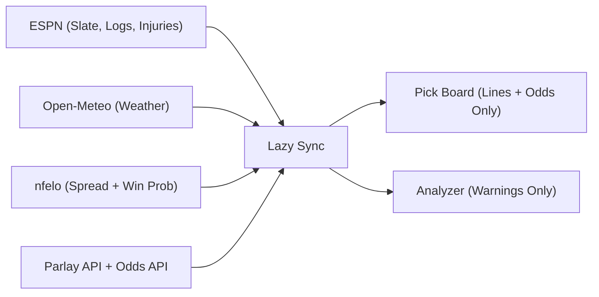
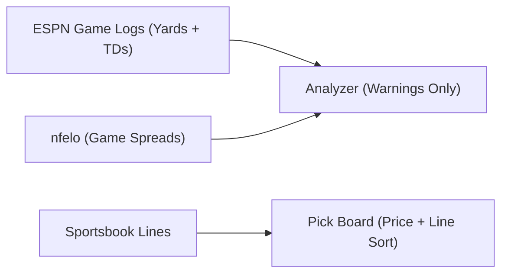
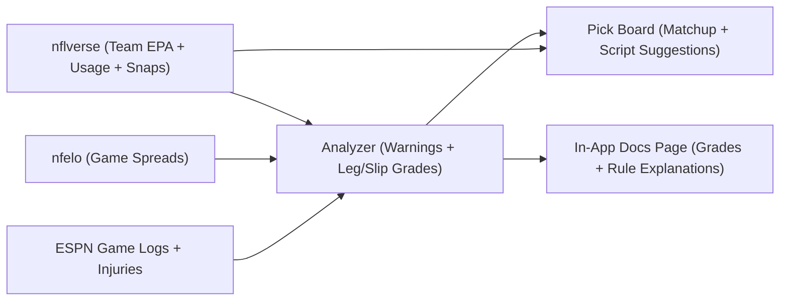

# nflverse signals for leg suggestions and grading

## Context

Today, the analyzer and pick board judge picks from game lines, stadium weather, `nfelo` game projections, and raw ESPN
player game logs. That leaves three blind spots when friends build and review a Sunday slip:

- **No defense context.** A receiver's over reads the same against the best pass defense in the league as it does
  against the worst.
- **No usage or efficiency signals.** Raw ESPN game logs show yards and touchdowns, not whether a player ran routes on
  90% of snaps, earned a 30% target share, or got lucky on two long plays.
- **No quality score for legs or the whole slip.** The analyzer emits individual warnings, or "Looks clean" when none
  fire, so a friend has no quick read on how strong each chosen leg is or whether the combined slip fights itself.

[nfelo signals in the analyzer](../../docs/decisions/nfelo-signals.md) deferred `nflverse` EPA as a separate change. Now
that `nfelo` is in place for sides and totals, props and overall slip quality are the missing piece.

## Goals and non-goals

**Goals:**

- Pull free weekly `nflverse` team efficiency, player usage, snap count, and player ID crosswalk CSVs through the same
  lazy, fail-soft sync pattern as `nfelo`, spending zero Odds API or Parlay API credits.
- Surface deterministic leg suggestions on the pick board—matchup mismatches, high-usage buy-low spots, injury-driven
  role bumps, and slip-compatible pairings—without auto-picking or hiding any market.
- Grade every chosen leg and the overall parlay in plain Go using deterministic, sharp-friend rules (form, usage,
  opponent defense, weather, key numbers, price, and slip correlation), while leaving post-game win/loss grading to ESPN
  box scores.
- Add an in-app grading and analyzer docs page and link every warning, leg grade, and slip grade to its exact rule and
  score breakdown so friends can tap any badge to see why.
- Fail soft when `nflverse` data is missing, stale, or unmatched so every existing screen and rule keeps working.

**Non-goals:**

- Ingesting raw play-by-play files (too large for the single-instance SQLite archive cap).
- Replacing ESPN box scores for post-game win/loss grading.
- Blocking picks, nagging with "+EV" or expected-value lectures, or calling an LLM on any request path.
- Auto-building parlays or recommending bet sizes.

## Decision

Add `nflverse` as a free, weekly lazy-synced source alongside `nfelo`, then feed its team-defense EPA, player usage, and
snap-share signals into two pure, deterministic layers: sharp-friend **leg and slip grades** in the analyzer, and
**matchup/script badges** on the pick board.

**Before:**

**After:**

**Why this beats the alternatives:**

- **Weekly aggregated CSVs over raw play-by-play:** Pre-aggregated team, player, and snap CSVs stay small enough for the
  SQLite archive and need no Parquet or Python runtime, unlike raw play-by-play.
- **Deterministic rubric over LLM summaries:** Plain Go scoring keeps every grade fast, testable, offline-capable in the
  local sandbox, and free of per-request API cost.
- **Surfacing badges over auto-picking:** Highlighting strong matchups and slip-friendly legs respects the club's "every
  pick stays allowed" rule while still helping friends pick faster on mobile.

**Why `medium` effort fits:** The change follows existing ingest, storage, and pure-rule patterns, while requiring
cross-package coordination across data sync, player ID matching, analyzer scoring rubrics, pick-board filtering, and UI
badges.

## Consequences

**Easier:**

- The analyzer, pick board, and player research views now incorporate free weekly `nflverse` team EPA, player usage, and
  snap-share signals without spending Odds API or Parlay API credits.
- Friends get deterministic `A`–`F` leg and slip grades with factor breakdowns, pick-board matchup/script badges, and an
  in-app `/analyzer/guide` page generated from the same structs as the engine so docs cannot drift from thresholds.
- Missing, stale (> 7 days), or unmatched `nflverse` data fails soft without breaking existing picks or post-game ESPN
  grading.

**Harder:**

- Any new analyzer rule added to `rules` in `internal/analyzer` must also be registered in `RuleDocs()` (enforced by a
  1:1 test with `RuleIDs()`).
- Ingest relies on `nflverse` GitHub release CSVs staying under the `archive.MaxBodySize` (8 MiB) cap (`players.csv` is
  ~7.0 MiB for 2026); if a file crosses 8 MiB, archiving skips that body while keeping cached rows.

**What we would revisit:**

- If `players.csv` grows past 8 MiB in future seasons, filter or stream-trim inactive/retired players during ingest
  rather than raising the global archive body cap.

## Alternatives considered

- **Raw `nflverse` play-by-play files:** Rejected because raw play-by-play CSVs exceed the 8 MiB SQLite archive cap and
  would require Parquet/Python tooling; pre-aggregated weekly CSVs parse directly with Go's `encoding/csv`.
- **LLM-generated leg/slip summaries:** Rejected to keep every request path deterministic, fast, offline-capable in the
  local sandbox, and free of per-request API cost.
- **Auto-building parlays or hiding weak markets:** Rejected to preserve the club's "every pick stays allowed" rule;
  surfacing badges and grades helps friends pick faster without blocking choices.

## Implementation notes

- `snap_counts_{season}.csv` uses `game_type` (`REG`, `WC`, `DIV`, `CON`, `SB`) rather than `season_type`, and
  `stats_player_week_{season}.csv` leaves position-specific EPA/share cells blank (and occasional rows missing
  `player_id`); the client maps `game_type`, drops rows without identity fields, and defaults blank/`NA` stat cells to
  `0`.
- `pickPairRow` in `internal/web/pick.go` also runs `board.ApplySignals` so HTMX `POST /slips/{id}/legs` partial swaps
  preserve row badges on updated line groups.

## Follow-ups

None.
