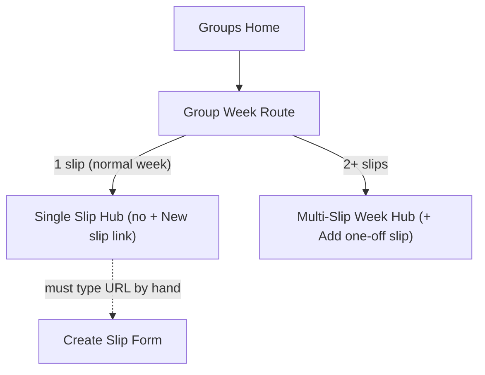
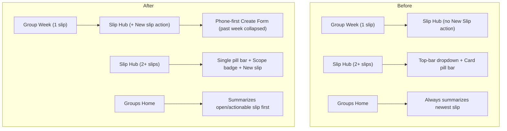
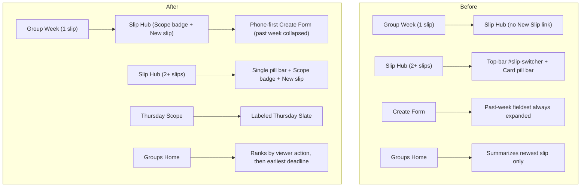

# Smooth out one-off slip flow

## Context

Most groups run one recurring slip per week (their normal Sunday ticket), and only occasionally want a second, one-off
slip—like a Thanksgiving Day ticket alongside Sunday. Today, the app makes that optional one-off flow unreachable from
the UI and bumpy once you get into it:

1. **No entry point from a single-slip week:** When a group has one slip for the week, opening the week redirects
   straight to that slip. The "+ Add one-off slip" button and recurring schedules only live on the multi-slip week hub,
   which only renders when two or more slips already exist. A member cannot start an extra ticket without typing the
   create URL by hand.
2. **Create form assumes an empty week:** Opening the create form when a slip already exists still says
   *"No slip for Week X yet"* and puts an expanded *"Or add a past week"* section ahead of the slip name, slate scope,
   and members.
3. **Confusing Thursday label:** The Thursday slate scope already matches all Thursday Eastern kickoffs (including
   Thanksgiving afternoon games), but the UI calls it *"Thursday Night"*.
4. **Cluttered multi-slip navigation:** Once a week has two slips, the slip page shows two separate slip switchers at
   once—a dropdown in the sticky top bar and a pill bar inside the slip header—while omitting which slate scope the
   current slip covers.
5. **Stale Groups home summary:** On the Groups landing list, each group card only summarizes the newest slip in the
   week. Once an earlier one-off slip (like Thanksgiving) settles, the card shows that finished result all weekend
   instead of the open Sunday slip that still needs picks.

## Goals and non-goals

**Goals:**

- Let any group member start an optional one-off slip directly from a single-slip week in one tap, without breaking the
  zero-friction redirect for normal single-slip weeks.
- Make the create-slip form phone-first and accurate when adding another slip to an active week, with past-week entry
  tucked out of the way.
- Label the Thursday scope clearly for all-day slates like Thanksgiving as well as Thursday Night Football.
- Keep multi-slip navigation to one clean switcher on the slip page and show the active slip's slate scope clearly.
- Summarize the most actionable slip on the Groups home list so finished mid-week tickets never hide an open Sunday
  ticket.

**Non-goals:**

- Changing recurring schedule storage, slate ingestion (such as adding Black Friday games), or pick/deadline rules.
- Adding a new Thursday morning automatic odds pre-fill job or changing free-tier sync guardrails.
- Redesigning the pick board, analyzer, or export flows.

## Decision

Keep the single-slip redirect for normal weeks, and expose a clean, optional path to add a one-off slip directly on the
slip hub. Tidy the create form, label Thursday as *"Thursday Slate"*, consolidate multi-slip switching onto the slip
header's status pill bar (with a scope badge), and have the Groups home list summarize the next actionable slip first.

Adding a "+ New slip" entry point on the slip hub beats removing the single-slip redirect, because most weeks still have
one slip and should stay one tap away from picking. Keeping the card's status pill bar and dropping the redundant
top-bar dropdown beats keeping both, because the pill bar already shows each slip's progress without crowding the phone
header.

`complexity: low` fits because every change follows existing web handler and template patterns within the slip and home
views, with no new data model or cross-package invariants. `risk: low` fits because the blast radius is limited to UI
navigation, labels, and display ordering with no schema or sync-budget changes, and existing handler and rendering tests
cover each affected screen.

## Overview

## Consequences

- **Easier:** Members can start a one-off slip in one tap from any single-slip week, create-slip fields sit above the
  fold on phones, and open Sunday slips stay visible on Groups home after an earlier mid-week slip settles.
- **Harder:** `GET /` now evaluates `NextStep` across every slip in a group's latest week (adding per-slip member and
  leg queries alongside one shared `GamesForWeek` read) instead of inspecting only the newest slip.
- **Revisit:** Batch the per-slip queries in `groupWeekSummary` if groups ever run many slips in the same week, or
  revisit card copy if users want an explicit multi-slip count alongside the top action.

## Alternatives considered

- **Always show the multi-slip week hub even with one slip:** Rejected because most weeks have a single slip, and
  dropping the redirect would add an extra tap to the primary Sunday flow.
- **Keep both the top-bar dropdown and the card pill bar:** Rejected because two switchers crowd phone headers, and the
  pill bar already carries per-slip status summaries that a `<select>` cannot show cleanly.
- **Display a generic count such as `"2 slips"` on Groups home:** Rejected because the group card relies on actionable
  next-step copy, which priority ranking preserves across multiple slips.

## Implementation notes

- Implementation matched the design with no deviations.
- Groups home `GET /` issues `SlipMembers` and `LegsForSlip` queries per slip in the latest week; this stays
  sub-millisecond on local SQLite for a handful of slips but is not batched.
- `"Thursday Night"` still appears in test fixtures as user-chosen slip and schedule *names*; only the slate scope label
  changed to `"Thursday Slate"`.

## Follow-ups

None.
