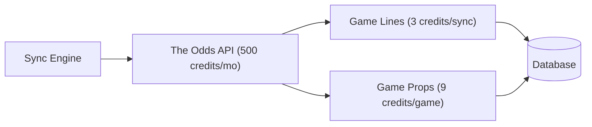
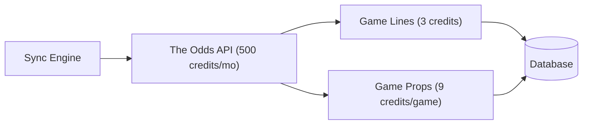
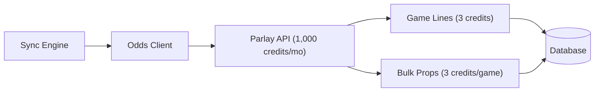

# Parlay API for odds and props

## Context

The app fetches NFL game lines and sportsbook deep links from The Odds API, and upcoming work (`props-research`) adds
on-demand player props per game. The Odds API's free tier provides 500 credits per month.

Game lines consume 3 credits per sync (~240 credits/month). On The Odds API, per-game props charge 1 credit per market
returned—9 credits per game across our 9 prop markets, or ~54 credits/week if the group opens 6 games (~216
credits/month). Combined with game lines, a normal month leaves almost no buffer for playoff weeks or extra refreshes.

Parlay API provides 1,000 monthly credits on its free tier without a credit card. It mirrors The Odds API's event and
game-line endpoints, includes deep links and selection IDs on eligible FanDuel outcomes at zero extra credit cost, and
serves all prop markets for a game in a single 3-credit bulk call.

## Goals and non-goals

**Goals:**

- Double the monthly free-tier odds budget from 500 to 1,000 credits.
- Switch game lines and deep-link ingest to Parlay API while keeping existing odds storage and export behavior
  unchanged.
- Add bulk per-game prop ingest at a flat 3 credits per game so `props-research` can fetch all 9 prop markets in one
  call.
- Keep external odds fetching behind the client seam so refresh and storage stay independent of the provider.

**Non-goals:**

- Pooling credits across both providers simultaneously at runtime.
- Upgrading to paid subscription tiers or requiring credit card billing.
- Changing stored odds schema, odds math, or sportsbook export behavior.
- Building the prop research UI or wiring on-demand prop refresh routes (covered in `props-research`).

## Decision

Switch the odds client from The Odds API to Parlay API and add bulk per-game prop fetching on the same client. Parlay
API supplies validated deep links and selection IDs on eligible FanDuel outcomes; books without deep-link metadata store
empty link fields and fall back to manual checklist entries in the existing export card.

### Before

### After

Switching primary ingest to Parlay API beats dual-provider credit pooling because it doubles the free budget and cuts
per-game prop cost from 9 credits to 3 without managing two credit pools or reconciling event IDs across vendors.

The medium effort rating fits because game lines share the existing response shape, while bulk props return a flat row
format with market aliases and period tags that the client normalizes into our internal market types.

## Consequences

Switching to Parlay API doubled the monthly free-tier odds budget from 500 to 1,000 requests and lowered per-game prop
ingest from 9 credits to a flat 3 credits. Querying nine prop markets across six weekly games now consumes ~72 credits
monthly instead of ~216, leaving plenty of room for game lines and playoff syncs without paid plans or credit card
billing. Wire parsing resilience also improved: null commence times, unpriced DFS or prediction outcomes, and 3-way
moneyline draws are safely skipped instead of aborting the sync.

Deep-link coverage became narrower: Parlay API provides validated deep links and selection IDs for FanDuel only.
DraftKings and other sportsbooks omit link metadata, so their legs fall back to manual checklist items on exported
slips. In addition, the flat `/props` response requires maintaining client-side alias mappings and period filters to
handle provider variations.

We would revisit multi-book deep links if Parlay API adds DraftKings metadata, and revisit two-way spread parsing if
unpriced feeds ever emit spreads without valid team names.

## Alternatives considered

- **Dual-provider credit pooling:** Managing simultaneous credit pools across The Odds API and Parlay API was rejected
  because reconciling provider event IDs, tracking separate balances, and routing requests dynamically added runtime
  complexity without necessity. Parlay API's 1,000 monthly credits cover all anticipated sync volume.
- **Paid subscription tiers:** Upgrading to paid provider tiers was rejected to uphold the zero-cost free-tier
  operational rule.
- **Per-market prop fetching via The Odds API:** Continuing with The Odds API for props was rejected because 1 credit
  per market across 9 markets (~54 credits/week for 6 games) exhausted the monthly quota when combined with line syncs.
- **Wiring props into SQLite in this change:** Storing prop rows and updating `internal/refresh` was rejected to keep
  this change focused on the client seam and data contract. Storage, sync keys, and UI integration were deferred to
  `props-research`.

## Implementation notes

The design originally identified four living documentation files to update, but `docs/concepts/archive.md` and
`docs/guides/gcp-setup.md` also referenced the 500-credit budget and The Odds API host, requiring updates to both. Stale
provider names in code comments across the refresh and export packages were also corrected.

Known limits for maintainers:

- `Client.Props` is implemented behind the client seam but is not yet called by `internal/refresh` or written to SQLite
  until `props-research` lands.
- Only FanDuel legs receive deep links and selection IDs; DraftKings legs store null links and render as manual export
  items.
- Live integration tests (`TestLiveEvents`) require an `ODDS_API_KEY` and skip during standard offline test runs. Test
  fixtures for `/props` are hand-crafted to mirror documented API specifications rather than captured from live
  requests.

## Follow-ups

- **Wire props ingest into refresh and database storage (`props-research`):** Connect `Client.Props` to
  `internal/refresh`, establish the `odds:props:{game}` sync key with its 150-credit floor, add prop tables to SQLite,
  and build the prop research UI.
- **DraftKings deep-link support:** Track Parlay API updates for DraftKings link and selection ID fields to restore
  deep-link bet slip export if and when supported.
