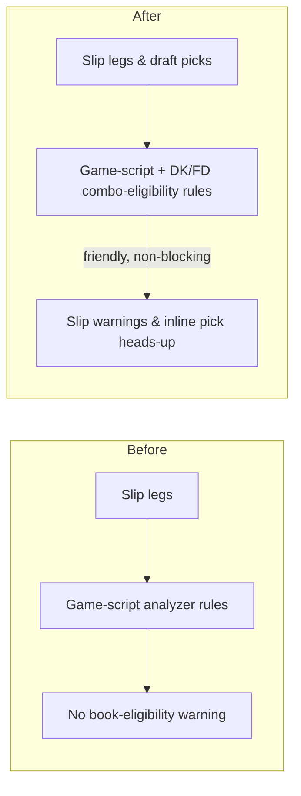
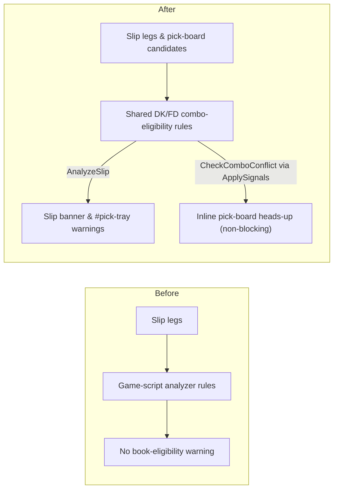

# Warn on sportsbook-ineligible parlay combinations

## Context

The analyzer currently checks game-script conflicts (such as a blowout spread fighting a passing over, or a trailing
underdog fighting a rushing over), but it has no awareness of sportsbook parlay combination rules. Members can build and
lock a slip in the app only to have DraftKings or FanDuel reject the combination as ineligible when they try to place
it.

Common rejections include directly contradictory or redundant same-game lines (such as a team's spread paired with the
same team's moneyline, both sides of the same spread/total/prop, or conflicting team total and game total legs) as well
as same-game prop combinations that DraftKings and FanDuel frequently restrict.

## Goals and non-goals

**Goals:**

- Add deterministic sportsbook combination-eligibility rules to the analyzer covering known DraftKings and FanDuel hard
  blocks (same-game contradictions, redundant markets, and duplicate/opposite selections) plus common SGP-restricted
  pairings.
- Surface friendly, non-blocking warnings ("Heads up: DraftKings and FanDuel usually won't let you combine X and Y on
  the same slip") in the slip analyzer and inline while picking so groups catch bad combos before locking.
- Keep the rule catalog clean and data-driven so newly observed DK/FD rejections can be added easily with regression
  tests.

**Non-goals:**

- Hard-blocking any leg or preventing a slip from locking (every pick stays allowed per product rules).
- Calling live sportsbook SGP pricing or betslip validation APIs.
- Guaranteeing complete parity with proprietary, slate-specific sportsbook SGP engines.

## Decision

Add a dedicated deterministic combination-eligibility rule group to the analyzer that inspects same-game leg pairs for
hard blocks and common DK/FD SGP restrictions, and surface those warnings both on the slip and while picking.

This beats hard-blocking combinations in the slip service, which violates the app's friendly, never-blocking rule and
risks false positives when a book relaxes an SGP rule. It also beats waiting until export to warn, when the group has
already locked the slip and moved on.

- **Complexity: medium** — Requires cataloging deterministic same-game market pair rules across all supported NFL
  markets and wiring non-blocking warnings into both slip analysis and the pick flow.
- **Risk: low** — Pure deterministic Go rules with full unit test coverage, no database schema changes, no external API
  calls, and non-blocking UI output.

## Overview

## Consequences

- **Easier:** Groups spot DraftKings and FanDuel combination rejections while picking legs, before locking the slip.
- **Easier:** Adding newly observed sportsbook rejection pairs takes one predicate and test case, and updates both the slip analyzer and inline pick-board heads-up from a single source of truth.
- **Harder:** Writing synthetic same-game multi-leg test fixtures, since combinations that previously passed silently now trigger `book_combo_ineligible` or `book_combo_restricted`.
- **Revisit:** The `book_combo_restricted` pairs if DraftKings or FanDuel relax kicker or same-player inverse prop SGP restrictions, or if groups hit noisy false positives on live slates.

## Alternatives considered

- **Hard-blocking ineligible combinations in the slip service:** Rejected because it breaks the app's friendly, never-blocking rule and would block valid bets whenever a sportsbook relaxes an SGP restriction.
- **Warning only at slip lock or export:** Rejected because members would only learn about the conflict after building and locking the slip, instead of seeing it inline while picking.
- **Calling live sportsbook SGP or betslip APIs:** Rejected to keep analysis deterministic in plain Go with zero external API calls or sportsbook integrations.

## Implementation notes

- **Tap-to-switch exclusion:** `board.ApplySignals` identifies the sole picked leg in a line group so switching sides (such as Over to Under) excludes the leg being replaced from `CheckComboConflict` while still checking all other slip legs.
- **Static rule boundaries:** Rules are a deterministic approximation of DraftKings and FanDuel restrictions; slate-specific SGP exclusions outside the cataloged predicates are not caught, and `marketOther` legs or legs without a game ID are skipped.
- **One inline conflict per candidate:** `CheckComboConflict` short-circuits on the first `Danger` conflict (or returns the first `Warn` if no `Danger` exists), so an inline pick-board row displays at most one heads-up message at a time.

## Follow-ups

- Add newly observed DraftKings or FanDuel SGP prop restrictions to `internal/analyzer/combo_rules.go` with regression tests as groups encounter them on live slates.
- Evaluate book-specific restriction labels (DraftKings vs. FanDuel) if slip tracking ever records which sportsbook a group is using.
