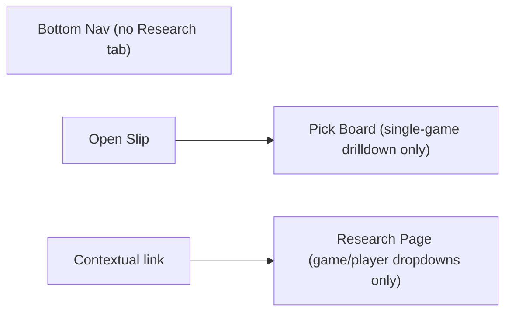
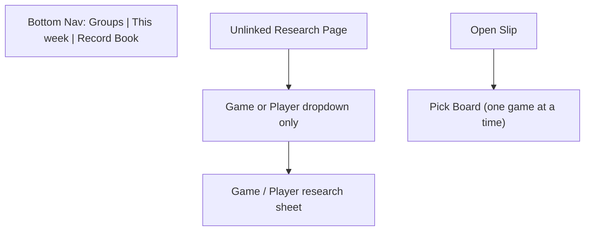
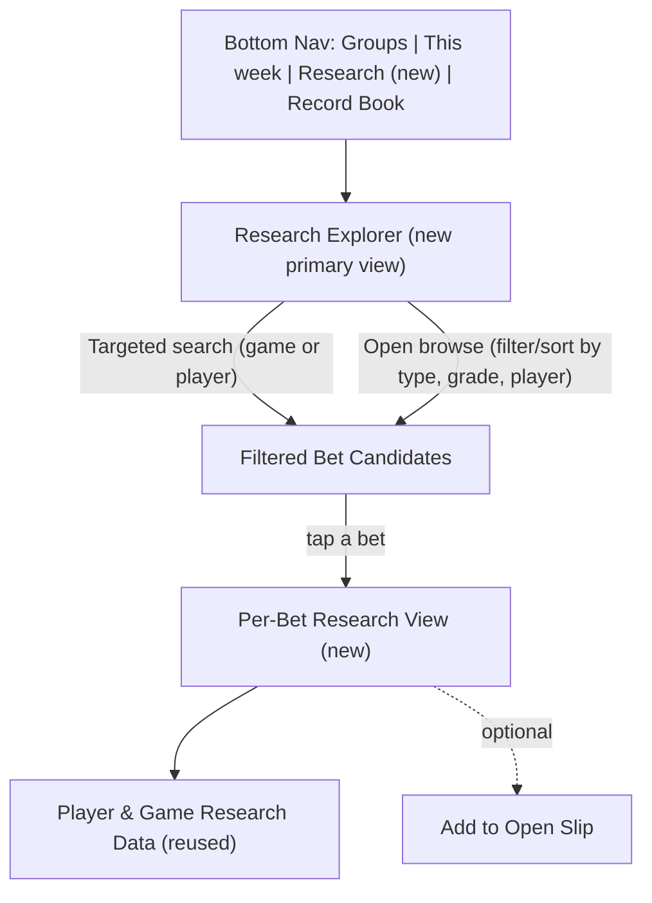
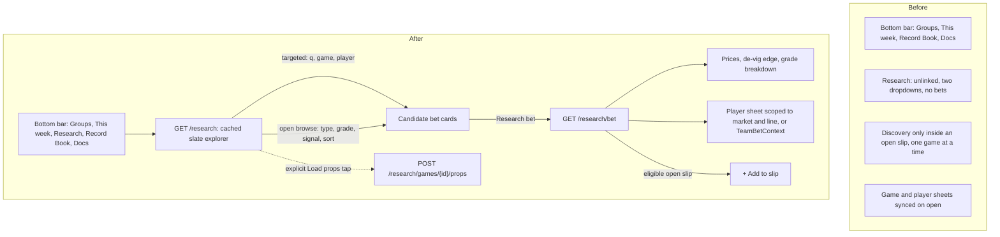

# Dedicated research view for picking legs

## Context

Users pick legs in two ways:

1. **Targeted search.** They already have a game or player in mind and want to inspect that game's or player's bets and
   supporting data.
2. **Open exploration.** They do not have a pick in mind yet and want to browse the week's slate, filtering and sorting
   candidates by bet type, grade, player, or signals to spot strong legs.

Today, neither workflow has a dedicated home. The existing research page is unlinked from the main navigation and only
offers two dropdowns (select a game, select a player) that show a game or player sheet with no bet browsing. The pick
board only exists inside an open slip and forces a game-first drilldown, so you cannot scan across games by bet type,
grade, or player, nor explore bets before a slip is open. Even when a user spots an interesting leg, there is no
dedicated per-bet research view that brings together the stats, matchup context, pricing, and grading factors for that
specific bet.

## Goals and non-goals

**Goals:**

- Add Research as a primary destination in the main navigation, usable both when exploring midweek and while picking for
  an open slip.
- Support both targeted search (jump directly to a game or player) and open exploration (browse bet candidates across
  the slate with filters and sorting by bet type, grade, player/team, and signals).
- Provide a dedicated per-bet research view for each candidate leg, combining the relevant matchup, player/team form,
  pricing, and analyzer factor data in one place alongside existing player and game research.
- Stay within free-tier guardrails by browsing and filtering exclusively over cached odds, stats, and signals, fetching
  on-demand props only when a user opens a game that lacks them.
- Keep the layout phone-first and connected to open slips so a researched bet can be added without losing context.

**Non-goals:**

- Removing the slip-scoped pick board or replacing existing game and player research sheets.
- Adding new paid data providers, new scheduled background jobs, or sportsbook placement/money handling.
- Introducing LLM-generated pick recommendations or blocking any leg from being picked.

## Decision

Promote Research to a primary navigation view built around a dual-mode bet explorer—supporting both targeted game/player
search and slate-wide filtering and sorting by bet type, grade, and player—paired with a dedicated per-bet research
detail view powered by cached odds, analyzer grades, and player/game research data.

### Before

### After

Extending the slip-scoped pick board alone would keep discovery locked behind an open slip and a single-game drilldown.
Leaving Research as a game-and-player dropdown leaves open exploration unsupported. A primary Research view that unifies
targeted lookup, slate-wide filtering/sorting, and per-bet research serves both workflows without duplicating data
fetches.

**Complexity (`medium`):** Coordinates across candidate indexing and grading over the full week's slate, multi-facet
filtering and sorting, per-bet research assembly from existing player/game signals, primary navigation, and optional
handoff into an open slip. **Risk (`medium`):** Slate-wide browsing touches cached odds and props loading paths where an
accidental per-game fetch could burn scarce API credits, and phone-width filter/sort state can regress easily; automated
tests over cache-only browsing, credit guardrails, and filter/sort queries mitigate both.

## Overview

Research became a primary tab built on a cached-only slate explorer and a per-bet research page.

Every GET on the research surface reads cached SQLite. `SyncGameProps` behind the explicit props button is the only paid
call, and the web layer's `Refresher` port no longer even exposes the two research sync methods.

## Consequences

- `Easier:` Bet discovery no longer needs an open slip or a game-first drilldown. A user can scan the whole week by bet
  type, grade, or signal, or jump straight to a game or player.
- `Easier:` Browsing costs nothing. `board.Explore` is pure, the handlers batch their cached loads, and the
  zero-refresher tests plus the narrowed `Refresher` interface keep accidental syncs from coming back.
- `Easier:` One owner for explorer rules. `board.Explore`, `ExploreReason`, and `DefaultExploreLimit` drive the cards,
  the facet counts, the sorts, and the bet page, so the list and the detail view agree.
- `Easier:` Shared links survive line drift. Bet links carry `db.SameSelection` identity and keep the explorer URL in
  `from`, so a moved line does not break the page or the back link.
- `Easier:` The open sheet follows the search. One explorer response carries the cards and an out-of-band
  `#research-panel`, so a chip change can never leave a sheet describing the previous target.
- `Harder:` The bottom bar now holds five labels. At 375px each label gets roughly 70px, and "This week" and "Record
  Book" are the first to crowd.
- `Harder:` A new filter or sort is a four-place change: the `board` chip list, the query normalizer, the chip markup,
  and `docs/reference/routes.md`.
- `Harder:` Research sheets no longer sync on open, so a targeted game with no cached props looks empty until the user
  taps `Load props`. That is the intended trade, but it is one more tap than before.
- `Harder:` Each explorer request rebuilds and scores the week's rows, and `Show more` re-renders every card already on
  screen with a larger limit instead of appending.
- `Revisit:` Confirm the five-tab bar at 375px. Shorten labels or padding if "This week" or "Record Book" wraps.
- `Revisit:` The explorer always browses `LatestWeek`, while `/research/bet` resolves any cached game. A shared bet link
  from an older week has no matching explorer to return to.
- `Revisit:` Player matchup context inside `/research/bet` still comes from `LatestWeek` rather than the bet's own game.
- `Revisit:` The player picker ships the week's full roster in every explorer partial.

## Alternatives considered

- **Extend the slip pick board only.** Rejected: discovery would stay locked behind an open slip and a single-game
  drilldown, so a user could never browse the slate before starting a parlay.
- **Keep Research as two dropdowns and add filtering there.** Rejected: targeted lookup and open browsing need different
  controls. A dropdown page has no bet list to filter, and bolting one on leaves no room for facet counts or sorts.
- **Precompute a scored candidate table in SQLite.** Rejected: a week's odds fold to a few hundred rows that score in
  milliseconds in memory. A table would add migrations and cache-invalidation bugs for no measurable win.
- **Put per-bet research in an inline accordion on the explorer.** Rejected: pricing tables, a hit-rate chart, EPA
  ranks, weather, and injuries are too dense for an accordion at 375px. A dedicated page keeps scanning and deep
  research readable.
- **Make the whole candidate card the per-bet tap target.** Rejected: users still want direct entry to the game and
  player sheets, so the card keeps those links and adds a separate `Research bet →`.
- **List the other side of the same market under related bets.** Rejected: a hedge is not a useful related leg. Related
  bets show other markets, the same player's other props, and same-game legs.

## Implementation notes

- The design's HTMX swap target was `#research-results`. It shipped as `#research-explore` so facet counts, chip states,
  and the card list arrive in one response and cannot disagree.
- The design left the `C+` grade chip undefined. It means "C or better" and filters to A, B, and C rows.
- The design named `parlay.ImpliedProbability`. The real helper is `parlay.ImpliedProb`.
- `ExploreQuery` gained a `Signals` field the sketch did not have. Signal chips need every badge a row earns; with an
  empty `Signals`, counts see only the single applied badge and under-report.
- The plan assumed the research sheets would keep auto-syncing. The zero-credit guardrail won: `SyncGameResearch` and
  `SyncPlayerResearch` are gone from the research handlers and from the `Refresher` port, and survive only for the
  sandbox replay tests.
- The plan expected a non-HTMX props POST to redirect back to the explorer. Production's CSRF guard answers 403 before
  the handler runs, so that branch and its doc lines were removed; the route serves the refreshed partial only.
- `GET /research/bet` returns 404 with "lines are closed" once kickoff passes. That is deliberate: the board and the
  analyzer already drop started games, and the page would otherwise show stale context.
- `board.Explore` has no clock. Callers must hand it rows from `board.Build`, which drops kicked-off games; the explorer
  itself does not re-check kickoff.
- Explorer text search matches team abbreviations, not full names. The game picker covers the full-name case.
- Unknown chip values in a shared URL are ignored rather than emptying the list, and an empty or unknown sort reads as
  `grade`. Sorts break ties down to team, line, and price, so output is stable across input order.
- `docs/concepts/slips.md` sits exactly at its declared 575-line budget. The next edit there must trim elsewhere or
  raise the budget with a reason.

## Follow-ups

- Settle the five-tab bar at phone width: shorten "This week" and "Record Book", switch to icon-plus-label, or add a
  second row. Pin the choice with a 375px rendering test.
- Scope the explorer to the week the user is working on (the active group or an open slip's `WeekID`), or label the week
  it browses and give older bet pages a back link to their own week.
- Pass the bet's game into `populateMatchupContext` so per-bet player cards use the bet's opponent instead of the latest
  cached week's.
- Make `Show more` append the next page of cards instead of re-rendering the full list with a larger `limit`.
- Serve the player picker from a filtered list or accepted targets only, so every explorer partial stops carrying the
  whole week's roster.
- Trim `docs/concepts/slips.md` under its line budget, or move explorer mechanics into a reference doc, before the next
  edit.
