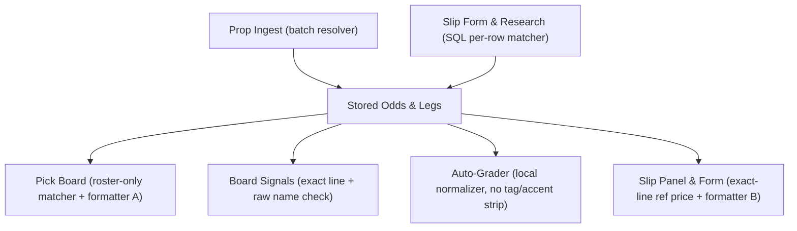
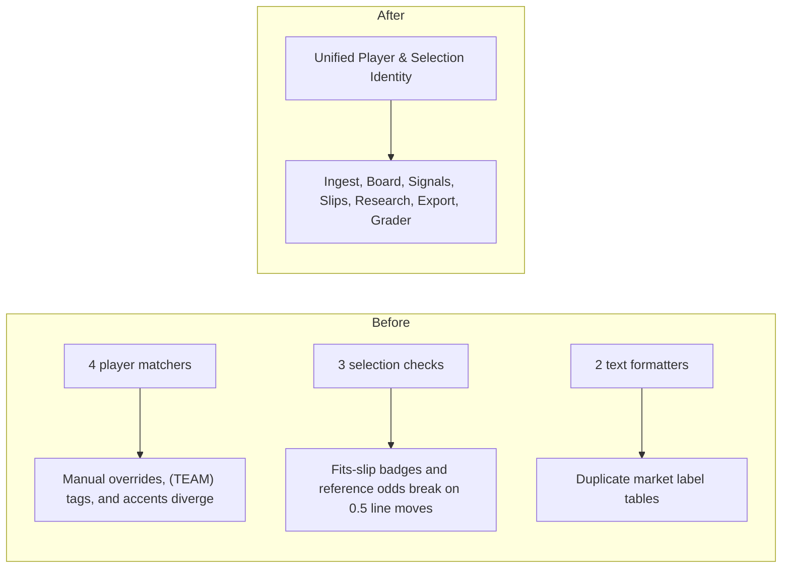

# Consolidate selection and player identity

## Context

Player matching, selection identity, and selection display text are currently duplicated across six modules, and each
copy has drifted on edge cases:

- **Four divergent player matchers:** Prop ingest uses a batch resolver that strips trailing `(TEAM)` tags, folds
  accents, checks manual overrides, and guards against same-name collisions across opposing teams. Meanwhile, the SQL
  single-player matcher drops the `(TEAM)` team hint and runs inside a per-player loop on the game research view; the
  pick board's in-memory roster matcher ignores saved manual overrides; and the post-game auto-grader keeps its own name
  normalizer that omits `(TEAM)` tag stripping and accent folding.
- **Inconsistent moved-line selection rules:** The pick board, slip edits, and sportsbook export match selections across
  half-point line moves, but the board's `Fits slip` signal matcher still requires an exact line and raw player-name
  match. Reference-odds pricing on the slip panel also requires an exact line match, dropping a member's home book
  whenever its line moves by half a point.
- **Duplicate selection formatters:** The pick board and the slip form parser each maintain their own market label
  tables and selection string builders for spreads, totals, moneylines, team totals, and player props.

## Goals and non-goals

**Goals:**

- Unify player name normalization and roster/manual-override resolution behind one shared implementation used by prop
  ingest, leg creation, the pick board, game research, and post-game grading.
- Use one canonical selection and line-group identity across board pairing, `Fits slip` signal evaluation, leg updates,
  sportsbook export, and member reference-odds pricing.
- Format selection display text and market labels in one place so board rows, saved legs, and research views always
  agree.

**Non-goals:**

- Changing the database schema or re-running historical player backfills.
- Altering how post-game grading evaluates win, loss, or push thresholds once a player is matched.
- Redesigning the pick board's UI layout or sportsbook deep-link formats.

## Decision

Consolidate canonical player resolution, selection and line-group identity, and selection text formatting into one deep
domain module that every ingest, board, slip, research, export, and grading path calls.

Centralizing player and selection identity in one module beats patching individual callers because every new sportsbook
quirk or market rule lands once and immediately applies to board grouping, signal badges, reference pricing, and
grading.

The `effort` rating is `medium` because the change coordinates contracts and invariants across six existing modules
without requiring schema migrations or new external integrations.

## Consequences

- **Easier:** Sportsbook name quirks, market labels, and moved-line rules now change in one place (`internal/db`) and
  apply across prop ingest, the pick board, `Fits slip` signals, game research, slip reference pricing, sportsbook
  export, and post-game grading.
- **Easier:** Game research resolves prop players in memory from preloaded rosters and matches instead of issuing a SQL
  query per row, and form-submitted legs share `(TEAM)` hint disambiguation and collision safety with prop ingest.
- **Harder:** `internal/db` now carries display-formatting functions (`MarketLabel`, `FormatSelection`,
  `BuildLegSelection`) alongside persistence and identity rules, and callers must pick between strict
  (`BuildLegSelection`) and graceful (`FormatSelection`) entry points.
- **Revisit:** If display copy diverges further between compact board rows and other views, extract the formatting
  functions out of `internal/db` into a separate package so `internal/db` stays focused on storage and identity.

## Alternatives considered

- **Patch each caller in place:** Fixing `(TEAM)` tag stripping, accent folding, and half-point line tolerances
  separately in `board`, `grader`, `web`, and `export` was rejected because new sportsbook formats or market rules would
  keep drifting across six packages.
- **One selection formatter for all callers:** Sharing a single `FormatSelection` function without a strict variant was
  rejected because board rows must render partial odds when a book omits a line, while slip form parsing relies on an
  empty return value to reject incomplete custom legs.
- **Keep raw SQL in `Store.ResolvePlayerMatch`:** Leaving the SQL matcher in place for form submissions while only
  switching game research to `BatchPlayerResolver` was rejected because form-submitted legs would still drop `(TEAM)`
  team hints and lack ambiguous-match guards.

## Implementation notes

- **Research market labels:** Replacing the local `marketLabel` helper in `internal/web/research.go` with
  `db.MarketLabel` changed research view labels from long names (`"Passing Yards"`, `"Anytime Touchdown"`,
  `"Kicker Points"`) to the shared short labels (`"Pass Yds"`, `"Anytime TD"`, `"Kicking Pts"`).
- **Ambiguous auto-matches:** When two roster players on the game's teams share a normalized name and the odds feed
  omits a `(TEAM)` tag, `BatchPlayerResolver` refuses to cache an automatic match; resolving those players still
  requires a manual override in `player_matches`.
- **Moved-line fallback:** `db.MatchBookOdds` prefers an exact line match and otherwise returns the first matching row
  for that book, which can pick a non-standard line if a book posts multiple lines for the same selection without an
  exact match.

## Follow-ups

None.
