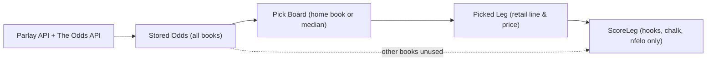
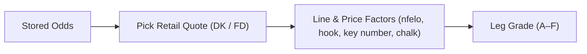
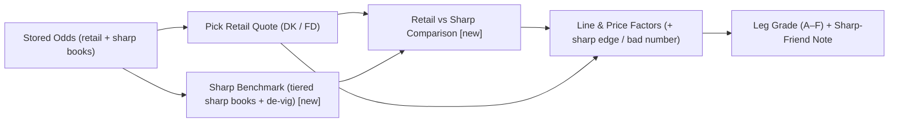
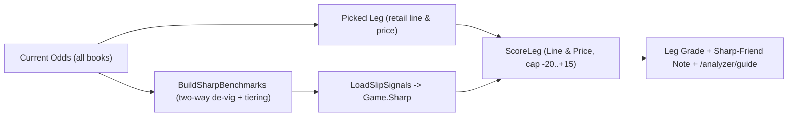

# Sharp bookmaker odds comparison

## Context

Today, the analyzer grades a leg's line and price using only nfelo spread cushion, spread hooks, total key numbers, and
heavy chalk. It never compares the retail sportsbook's line or price (DraftKings, FanDuel) against sharp market-making
books.

Retail books regularly shade popular overs, favorites, and player props away from the sharp market. Without a sharp
benchmark, a leg with strong recent form can earn an A grade even when DraftKings or FanDuel is offering a worse number
or heavier vig than sharp books.

Meanwhile, the odds sync already pulls `regions=us` from Parlay API and The Odds API—which returns sharp-leaning books
such as LowVig and BetOnline alongside retail books—and stores every bookmaker's quote. The analyzer ignores those other
books completely.

## Goals and non-goals

**Goals:**

- Build a tiered sharp-book benchmark for game lines and props, prioritizing true sharp/low-vig market makers (such as
  Pinnacle when available within credit budgets), falling back to sharp US-region books already returned by `regions=us`
  (such as LowVig and BetOnline), and using multi-book consensus when no sharp book quotes a market.
- De-vig two-way sharp quotes to estimate fair probability and fair line, then compare the leg's retail line and price
  against that sharp benchmark.
- Add sharp-line and sharp-price comparison factors (both favorable edge and bad-number penalty) to the analyzer's Line
  & Price category, with plain sharp-friend explanations and no +EV lectures.
- Stay strictly within the existing Parlay API (1,000 credits/month) and The Odds API (500 credits/month) free-tier
  budgets and credit floors.

**Non-goals:**

- Real-time arbitrage alerts, line-shopping across offshore books, or +EV percentage and Kelly staking advice.
- Adding a paid odds provider or raising the monthly credit spend.
- Blocking picks that have a bad price relative to sharp books; every pick stays allowed.
- Backtesting or tuning factor weights against historical results (covered separately by `grading-evals`).

## Decision

### Before

### After

Compute a deterministic sharp benchmark from stored multi-book odds, de-vig two-way sharp quotes, and feed the
retail-versus-sharp line and price gap into the analyzer's Line & Price scoring category.

This beats relying on nfelo alone because nfelo only covers pre-game spreads and win probabilities, missing totals,
player props, and late market moves that sharp books price immediately. It beats adding a paid sharp-odds feed because
sharp-leaning books are already present in our `regions=us` responses (and credit-neutral sharp book queries can be used
where supported), preserving our free-tier guardrails.

`complexity: medium` fits because the change spans odds ingestion, bookmaker tiering, de-vig math, and analyzer scoring
while preserving credit-budget invariants across two odds providers. `risk: medium` fits because flawed de-vigging or
treating a stale or one-sided quote as sharp could skew grades across the board, though deterministic unit tests on real
captured odds payloads and fail-soft behavior when sharp quotes are absent bound the blast radius.

## Overview

## Consequences

- **Easier:** Spot shaded retail lines and heavy vig across game markets and player props without extra API calls or
  credit spend.
- **Easier:** Adjust all eight sharp-factor weights from `RubricV1` while keeping `ScoreLeg` and `/analyzer/guide`
  aligned.
- **Harder:** Trace Line & Price score movements at a glance now that sharp line/price factors share the `-20..+15`
  category clamp with nfelo cushion, hooks, and chalk.
- **Revisit:** Sharp factor weights and Tier 1 bookmaker coverage once historical grading outcomes are evaluated.

## Alternatives considered

- **Add `regions=eu` to The Odds API `/odds`:** Rejected because The Odds API bills `markets × regions`, which would
  double credit burn per call (3 to 6 credits) and risk exhausting the 500 credits/month cap. Using `lowvig` and
  `betonlineag` already returned by `regions=us`, plus Tier 3 consensus, costs zero extra credits.
- **Rely on nfelo alone:** Rejected because nfelo only covers pre-game spreads and win probabilities, leaving totals,
  player props, and late market moves unchecked.
- **Persist sharp benchmarks in a new SQLite table:** Rejected because `odds` already stores every bookmaker's current
  quote; computing benchmarks in memory avoids schema migrations and stale-cache drift.
- **Show "+EV %" in factor details:** Rejected to preserve the sharp-friend tone; quoting the sharp line or fair
  American price communicates the same gap in plain language.

## Implementation notes

- `LinePriceMax` lived on `Rubric` (`RubricV1`) rather than as a package constant in `grade.go`, so the cap raise from
  `10` to `15` was applied to `RubricV1`.
- `PriceEdge` returns `0` when `retailAmerican == 0` or `fairProb` falls outside `(0, 1)` so invalid quotes cannot
  create false positive edges.
- `BuildSharpBenchmarks` fails soft on one-sided markets (`ANYTIME_TD`), DFS/exchange books in Tier 3, mismatched lines,
  Tier 3 groups with fewer than three books, and overrounds outside `[0.95, 1.25]`.
- Sharp factors only adjust the Line & Price score; every pick stays allowed.

## Follow-ups

- Propose `grading-evals` to backtest and tune the `RubricV1` sharp factor weights and `LinePriceMax` cap against
  historical NFL results.
- Verify in production logs which Tier 1 and Tier 2 books appear in Parlay API `/props` and The Odds API `regions=us`
  responses, and update bookmaker key aliases if provider names drift.
