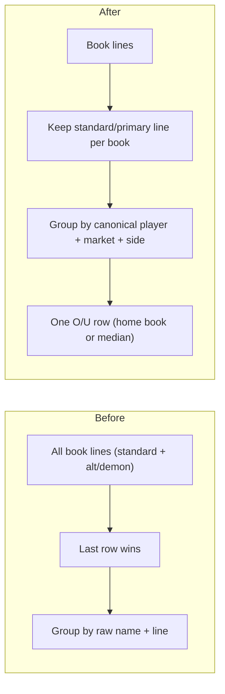

# Show one standard line per player prop

## Context

At launch, a single prop such as `"Ollie Gordon O/U Rushing Yards"` appeared 2–3 times on the same player card with the
same or slightly different lines and odds.

Inspection of prod data and archived Parlay API responses shows two causes:

1. **Line grouping keys on raw player name and line text:** Even when `"Ollie Gordon"` (`73.5`) and `"Ollie Gordon II"`
   (`75.5` / `72.5`) merge onto one player card, each raw name variant forms its own O/U line group instead of
   collapsing into one consensus/home-book row.
2. **Alternate, goblin, and demon lines overwrite standard lines:** In the archived response for `401873059`, PrizePicks
   returned 8 rushing-yard lines (`49.5` goblin to `152.5` demon, all priced `+100/-100`), Novig returned 6 (`59.5` to
   `89.5`), and Bovada returned 5 (`55.5` to `95.5`). Because stored odds hold one row per player/book/market/side,
   ingest overwrote earlier entries with whichever extreme alternate line appeared last (`152.5` for PrizePicks, `89.5`
   for Novig, `95.5` for Bovada), distorting the median line for the `5` of `6` users without a home book.

## Goals and non-goals

**Goals:**

- Show exactly one standard O/U prop row per canonical player and market on the pick board.
- Filter out non-standard (`goblin`, `demon`, and alternate) lines during prop ingest so they do not overwrite standard
  lines or skew consensus pricing.
- Compute the viewer's home-book or median price across all books offering that player's standard prop.

**Non-goals:**

- Adding an alternate-line or milestone ladder selector (e.g., 50+ / 80+ yards).
- Resolving moved lines on already-picked legs and sportsbook export links (covered by `dynamic-line-tracking`).

## Decision

Filter prop feeds to standard lines at ingest (rejecting `goblin`/`demon` tags and picking each book's primary balanced
line when a book returns multiple unlabeled alternates) and pair board rows by canonical player + market + side rather
than raw player name and line number.

Hiding extra rows only in the template would leave `152.5`-yard demon lines corrupting the stored medians. Filtering
non-standard lines at ingest and collapsing by canonical player + market solves both the noisy UI and the bad pricing
data.

The `effort` rating is `medium` because it requires analyzing real provider payload shapes across bookmakers to select
the primary line reliably and aligning ingest filtering with board pairing.

## Consequences

- **Easier:** Every player prop market now shows one O/U row per canonical player on the pick board instead of duplicate
  rows from alternate lines or name variants. Consensus medians and home-book prices are no longer skewed by extreme
  goblin or demon lines overwriting standard lines in `odds`.
- **Harder:** Non-standard alternate lines are discarded at ingest, so downstream views cannot inspect alternate ladders
  without re-fetching.
- **Revisit:** If the app later adds alternate-line or milestone picking (for example, `50+` or `80+` yards), `odds`
  will need to key by line value rather than storing one primary line per
  `(game_id, book, market_type, team, player_name, side)`.

## Alternatives considered

- **Hiding duplicate rows only in the template:** Rejected because extreme goblin and demon lines would still overwrite
  standard lines in `odds` and corrupt median lines and prices for users without a home book.
- **Storing all alternate lines and adding a ladder picker:** Rejected because it requires schema changes to `odds`, a
  ladder UI redesign, and more complex median and sportsbook export selection, while the product focuses on one standard
  O/U line per player market.

## Implementation notes

- When `odds_type` or `projection_type` is present, ingest keeps only `"standard"` (case-insensitive) and drops
  `"goblin"`, `"demon"`, and `"alt"`.
- For unlabeled multi-line books (such as Novig and Bovada), ingest picks one primary line per
  `(book, market_type, normalized_subject)` by preferring two-sided quotes over one-sided ones, minimizing
  `|impliedProb(over) - impliedProb(under)|`, and breaking ties toward `-110`. `ANYTIME_TD` is excluded because it has
  no line.
- Because filtering runs at ingest, any `odds` rows stored before this change remain until the next prop ingest replaces
  them.

## Follow-ups

None.
