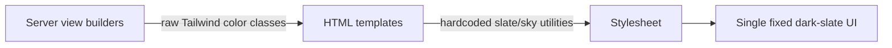
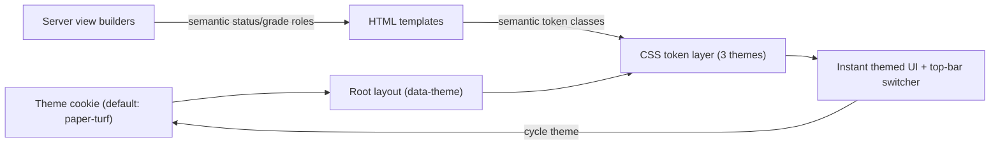
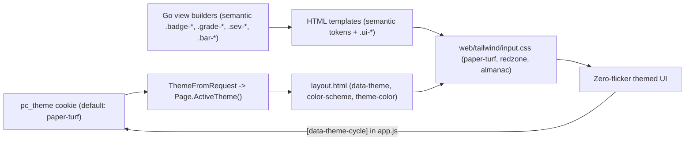

# Semantic theme system and three selectable site styles

## Context

Every screen in Sunday Parlay Club uses default Tailwind dark-mode slate (`slate-950`/`slate-900`) and `sky` accents
with system sans-serif typography. The app works, but it looks like a generic developer dashboard rather than a Sunday
NFL hangout with friends.

Worse, there is no design-token layer. Raw palette classes are hardcoded across all page templates and even emitted as
style strings by several server-side view builders. Trying a new visual direction—or letting the group compare styles
before committing—currently requires scattered find-and-replace edits across templates and Go code.

## Goals and non-goals

**Goals:**

- Replace the current dark-slate style completely with a semantic design-token layer (surfaces, ink, borders, accents,
  status/grade semantics, radii, and typography).
- Ship three cohesive, phone-first themes built on those tokens:
  1. **Paper & Turf** (default): tactile betting-ticket feel—warm cream slip cards on deep stadium-felt dark green,
     monospace odds, perforated slip dividers, and stamp-style status badges.
  2. **Sunday RedZone**: broadcast scorebug aesthetic—true neutral obsidian dark surfaces so team logos and portraits
     pop, condensed uppercase display headings, crisp corners, and turf-green/gold accents.
  3. **90s Almanac**: playful neo-brutalist style—high-contrast light surfaces, 2px ink borders, hard offset shadows,
     chunky vote pills, and bold Record Book badges.
- Add a lightweight theme switcher in the top bar so group members can cycle between all three themes immediately and
  share feedback, with the choice persisted so the server renders the active theme on first paint without flicker.
- Keep theme switching easy to trim down later: once the group settles on a favorite, removing the other themes or
  moving/deleting the top-bar switcher should be a small cleanup.

**Non-goals:**

- Keeping the old slate/sky look as a "Classic" theme option.
- Restructuring page layouts, navigation tabs, or user flows.
- Building a custom color picker, per-group branding, or a database-backed theme preference table.
- Adding a frontend JS framework or heavy client-side styling runtime.

## Decision

Introduce a CSS custom-property token layer driven by a single theme attribute on the root document, migrate templates
and view models from raw palette utilities to semantic roles, and expose a temporary top-bar switcher backed by a
browser cookie.

**Before:**

**After:**

Using one shared template set with CSS tokens beats duplicating templates per style because every screen stays
maintainable and switching themes costs zero runtime JS and zero extra requests. Shipping all three styles behind a
temporary top-bar switcher beats picking one blind because real group feedback on phones during Sunday games is faster
and cheaper than guessing. Dropping raw Tailwind color classes from server view builders beats patching around them
because grades and statuses need to stay readable across both light and dark themes.

**Complexity (`medium`):** Coordinates across the stylesheet token system, all HTML templates, layout chrome, and the
server view builders that currently emit raw color classes, while requiring visual and contrast judgment across three
distinct light/dark aesthetics at phone width.

**Risk (`low`):** The change is purely presentational with no database migrations, auth changes, or betting/grading
logic changes; existing handler and template render tests catch broken markup, and visual issues are isolated to CSS
tokens.

## Overview

## Consequences

- **Easier:** Tuning or trimming themes is isolated to CSS custom properties in `web/tailwind/input.css` and the
  three-entry allowlist in `internal/web/theme.go`, with no template conditionals or Go view-builder edits.
- **Easier:** Group members can compare `paper-turf`, `redzone`, and `almanac` live on phones via the top-bar switcher
  without server round-trips or database migrations.
- **Harder:** Templates must separate page/chrome tokens (`bg-page`, `text-page-ink`, `text-page-muted`) from card
  tokens (`bg-surface`, `text-ink`, `text-ink-muted`), because `paper-turf` pairs a dark felt page with light cream
  cards.
- **Harder:** Maintaining three palettes and `.ui-*` component styles increases CSS surface area and requires checking
  contrast on both light and dark themes when adding UI.
- **Revisit:** Remove the temporary `[data-theme-cycle]` top-bar button, the `app.js` cycling handler, and the two
  unchosen `[data-theme]` blocks once the group settles on a favorite.

## Alternatives considered

- **Duplicating HTML templates per theme:** Rejected because it multiplies layout maintenance; CSS custom properties
  keep one shared template set.
- **Server `POST /theme` route or database preference table:** Rejected because a client-written `pc_theme` cookie read
  by SSR gives instant switching with zero latency, no CSRF/HTMX plumbing, and no schema migration for a temporary
  switcher.
- **Bundling WOFF2 fonts in `web/static`:** Rejected for now to avoid bloating the embedded Go binary and git history
  with fonts for three experimental themes; Google Fonts (`display=swap`) falls back to system fonts offline.
- **Keeping the old `slate`/`sky` palette as a "Classic" theme:** Rejected because carrying a fourth token set would
  keep raw Tailwind palette habits around.
- **Patching around raw Tailwind classes in Go view builders:** Rejected because hardcoded color utilities break
  contrast across light and dark themes; semantic `.badge-*`, `.grade-*`, `.sev-*`, and `.bar-*` classes keep Go code
  theme-agnostic.

## Implementation notes

- The design omitted `.grade-f` and named `severityBadge` in `internal/web/analyzer.go`; implementation added `.grade-f`
  to `web/tailwind/input.css` and updated the actual `analyzerSeverity` helper.
- `[data-theme-cycle]` sits before `{{if .User}}` in `web/templates/layout.html` rather than inside the signed-in block
  so headered unauthenticated pages can also switch themes.
- Per-user avatar swatches (`db.AvatarColor.Class()`, including `bg-sky-500`) and `avatar.html` initials fallback
  (`text-zinc-950`) intentionally stay outside the theme token system so member identity colors remain stable across
  themes.
- Display and mono fonts (`Barlow Condensed`, `Space Grotesk`, `IBM Plex Mono`) load from Google Fonts; offline
  environments fall back to `system-ui` and `ui-monospace`.

## Follow-ups

- Remove the temporary `[data-theme-cycle]` switcher and the two losing themes after group feedback, and self-host the
  winning theme's fonts in `web/static` if desired.
- Spot-check all three themes on physical phones at 360–390px width across modals and secondary screens during Sunday
  games.
