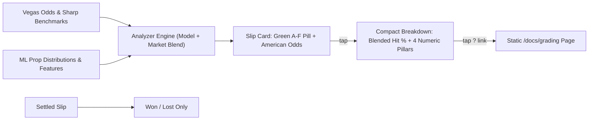
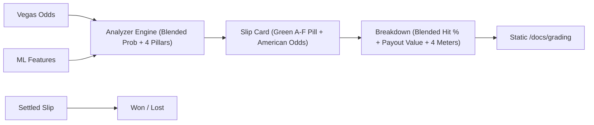
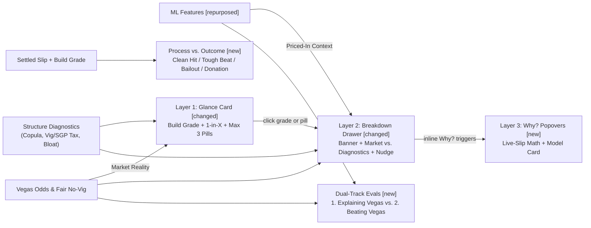
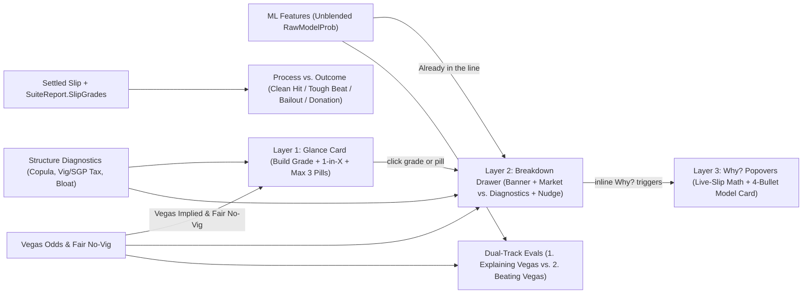

# Reframe grades around slip construction and market reality

## Context

Today, the analyzer stamps a green `A` pill and a `0–100` score onto legs, slips, and board highlights, using the same
positive green token reserved for settled wins. Tapping a grade opens a compact breakdown with a model-blended hit
chance (`CalibratedProb`), a `Strong value` / `Fair value` payout badge, and four numeric pillar meters.

That presentation creates a "lock" illusion. Friends see a green `A (91)` and read it as "the model found an edge over
Vegas," even though we have no long-term Closing Line Value proof that our model beats sharp books. Four friction points
compound the problem:

- **Prediction framing misleads.** Raw letter scores and "value" badges imply predictive alpha rather than structural
  slip quality, and no disclaimer footer fixes a green `A`.
- **Odds hide true likelihood.** Leading with American odds like `+650` obscures that a slip only hits roughly 1 in 8
  times, and the breakdown mixes live market prices with model estimates without labeling provenance.
- **Explanations dead-end in static docs.** Betting terms like vig, correlation tax, and implied probability send users
  away to `/docs/grading` instead of explaining the numbers on their actual slip.
- **Settled slips ignore process.** Post-game views only show Won or Lost, missing the best moment to separate sound
  slip structure from lucky variance.
- **Evals conflate matching Vegas with beating Vegas.** Our offline and in-app evals track outcome calibration and flat
  ROI, but do not separate how well our raw model explains Vegas's odds from whether it actually beats the sharp market.

## Goals and non-goals

**Goals:**

- **Grade slip construction, not win probability.** Reframe grades as a Build Grade paired with a 2-word reality check
  (for example, `A- • Tight Build`, `C- • Longshot`, `D • Vig Trap`, `F • Self-Sabotage`) so an `A` clearly means clean
  structure, not a lock.
- **Lock down visual and copy guardrails across every graded surface:**
  - *Color semantics*: use cool/neutral tones (slate, teal, blue) for clean builds and amber/coral for structural traps,
    reserving green strictly for settled wins.
  - *Provenance labels*: tag every number as `Vegas Implied`, `Fair No-Vig Est.`, or `Model Context` so live market
    prices never blur into model estimates.
  - *Human math first*: lead with implied percentage and `1 in X` frequency before American odds.
  - *Zero dead-end jargon*: attach a one-click inline popover to every betting term using the user's current slip as the
    live example.
- **Repurpose the ML model as a "Priced-In" narrator.** Never show "Model says X% vs. Vegas Y%." Instead, surface 1–2
  top model features in a Context Radar explicitly tagged `Already in the line` / `Likely Priced In` to explain why a
  line sits where it does.
- **Deliver 3-layer progressive disclosure (phone-first):**
  1. *Layer 1 — The Glance* (on the slip card): Build Grade + 2-word descriptor, Vegas implied hit-rate reality, and up
     to 3 clickable blunt Signal Pills (`Conflicting Legs`, `Heavy SGP Tax`, `Leg Bloat`, `Priced-In Narrative`).
  2. *Layer 2 — The Breakdown Drawer* (click grade or pill): pinned 1-sentence Ground-Rule Banner ("We assume Vegas is
     smarter than us. This grade measures how smartly your slip is structured—not whether it beats the book."), strict
     visual separation between Market Reality and Slip Diagnostics, 3–4 plain-English diagnostic rows (Hit-Rate Realism,
     Leg Synergy, The Book's Cut / Correlation Tax, Context Radar), and an optional 1-line "What would make this
     cleaner?" structural nudge.
  3. *Layer 3 — Contextual "Why?" Popovers*: inline micro-lessons on Correlation Tax, Already in the line, vig, and a
     transparent 4-bullet Model Card ("How this grade works") stating that picks are entertainment until long-term
     Closing Line Value is proven.
- **Add post-game "Process vs. Outcome" badges.** Combine settled Won/Lost outcomes with build quality (`A–B` vs. `C–F`)
  to stamp settled slips as `Clean Hit`, `Tough Beat`, `Total Bailout`, or `Book Donation`.
- **Keep board highlights and secondary grade views consistent.** Update pick-board highlights, pick tray, bet research,
  and record book surfaces so none of them fall back to money-green grades or edge-finder framing.
- **Split evals into Market Explanation vs. Market Beating.** Add two distinct tracks in our offline and in-app evals:
  1. *Explaining Vegas (Match First)*: measure how closely the standalone model reproduces de-vigged Vegas/sharp odds
     (divergence, error, and calibration against market prices) so we verify the model actually understands what is
     priced in.
  2. *Beating Vegas (Alpha Gate)*: measure skill vs. the sharp market baseline (proper-scoring lift over market log
     loss, Closing Line Value, and after-vig ROI) as the explicit evidence bar before we ever claim predictive edge.

**Non-goals:**

- **Retraining the v2 model or chasing alpha right now.** Power/Shin de-vigging, GBDT prop distributions, and the
  Gaussian copula stay in place; this change repurposes their outputs, reframes the UX, and splits the eval scorecards
  so future model work can target matching Vegas first and beating Vegas second.
- **Blocking picks or lecturing with `+EV` math.** Every leg stays allowed, and all copy keeps the friendly, sharp
  friend tone.
- **Adding LLM calls, paid API fetches, or new background jobs.** Every diagnostic, nudge, and popover remains
  deterministic plain Go over already-cached data.
- **Deleting `/docs/grading` or `/docs/evals`.** Full reference docs remain available; inline Layer 3 popovers handle
  in-the-moment explanations.

## Decision

### Before

### After

Reframe the analyzer's grading output around slip construction rather than predictive edge, feeding our existing
de-vigged market math, copula correlation checks, and ML feature signals into a three-layer progressive-disclosure UI,
post-game Process vs. Outcome badges, and a dual-track eval split. Keeping the existing deterministic Go engine
underneath lets us separate live Market Reality from Slip Diagnostics and tag model notes as priced-in context without
losing vig, correlation, or injury awareness. Splitting evals into "Explaining Vegas" (matching market prices first) and
"Beating Vegas" (market-beating lift and CLV) gives future model iterations a concrete ladder instead of conflating
pricing fidelity with edge.

This beats adding a disclaimer footer to the current grades because users visually read a green `A (91)` as a model edge
and ignore fine print. It also beats stripping out grades or the ML model altogether, which would throw away useful
structural warnings (conflicting scripts, SGP correlation tax, heavy-chalk leg bloat) and line-context research. Moving
explanations into live-example inline popovers beats relying solely on `/docs/grading` because bettors actually read a
3-sentence lesson when it uses their own slip's numbers.

- **Complexity: medium** — Requires coordinating structural grade semantics, provenance labeling, signal-pill selection,
  1-line cleanup nudges, and post-game classification across the analyzer, view-model layer, semantic theme tokens, and
  several phone-first UI surfaces without breaking existing deterministic scoring or eval harnesses.
- **Risk: medium** — Changes primary user-facing grade presentation, color semantics, and interactive drawer/popover
  flows across slips, pick board, highlights, research, and record book, where DOM layout and phone-width ergonomics
  have only partial automated test coverage even though the core Go math stays well-tested and easy to revert.

## Overview

## Consequences

- **Easier:** Testing whether the prop model understands Vegas lines before trying to beat them, because `RawModelProb` is now preserved unblended and scored separately in `MarketExplanationMetrics` and `MarketBeatingMetrics`.
- **Easier:** Explaining betting math with a user's real slip numbers, since `BuildDiagnostics`, `parlay.FormatImpliedReality`, and Layer 3 popovers are pure server-rendered Go.
- **Easier:** Backfilling Process vs. Outcome badges onto historical settled slips in `/slips/{id}` and `/record` without a SQLite migration, via `SuiteReport.SlipGrades`.
- **Harder:** Maintaining theme palettes, because all four themes (`paper-turf`, `redzone`, `almanac`, `connor-mode`) must keep dedicated `--grade-clean*` and `--grade-solid*` tokens separated from `--positive`.
- **Harder:** Keeping Layer 1 slip cards compact at 375px phone width now that grades show a 2-word descriptor, `1 in X` reality copy, and up to 3 Signal Pills.
- **Revisit:** Revisit the `AlphaGatePassed` bar (`SampleCount >= 250 && LogLossSkill > 0 && FlatROI > 0`) and add Closing Line Value (CLV) once closing sharp lines are stored.

## Alternatives considered

- **Adding a disclaimer footer to green `A` grades:** Rejected because users read a green `A (91)` visually as a predictive lock and ignore fine print.
- **Removing grades or the ML model:** Rejected because structural checks (script conflicts, SGP correlation tax, heavy-chalk bloat) and priced-in context notes help users spot bad builds.
- **Replacing `EngineV2` scoring math now:** Rejected to keep this change focused on framing, diagnostics, and eval separation instead of mixing in model retraining.
- **Adding a SQLite column for pre-kickoff slip grades:** Rejected in favor of `SuiteReport.SlipGrades` in `eval.Cache`, avoiding a schema migration while backfilling settled slips.
- **Computing Layer 3 live examples in client-side JS:** Rejected to keep all odds math deterministic, unit-testable, and server-rendered in Go.

## Implementation notes

- `ClassifyProcessOutcome(letter, won bool)` could not represent pushes or voids on its own, so `ClassifyProcessResult(letter, parlay.Result)` was added to return zero values for `Push`, `Void`, `Pending`, and `NeedsGrading`.
- One-way markets (such as `ANYTIME_TD`) and games lacking sharp quotes have `MarketProb == 0`; `MarketExplanationMetrics` skips those legs instead of comparing `RawModelProb` against zero.
- Settled-slip Process vs. Outcome badges depend on `eval.Cache` (`SuiteReport.SlipGrades`); slips missing from the cached replay render only their settled result.
- Go template and CSS token tests verify markup and non-green grade rules, but 375px layout ergonomics and visual contrast across all four themes still rely on manual browser checks.

## Follow-ups

- Capture closing sharp lines at kickoff and add Closing Line Value (CLV) to `MarketBeatingMetrics`.
- Persist pre-kickoff `BuildDiagnostics` at slip lock time if `eval.Cache` replay misses live-only slips or grows too slow.
- Calibrate or retrain the prop model against `MarketExplanationMetrics` (Explaining Vegas) before targeting `AlphaGatePassed` (Beating Vegas).
