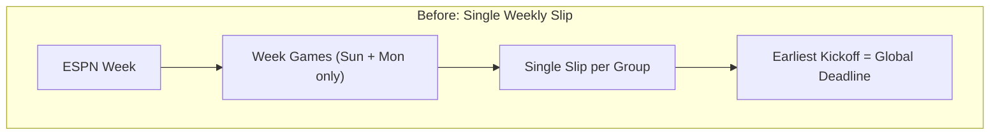
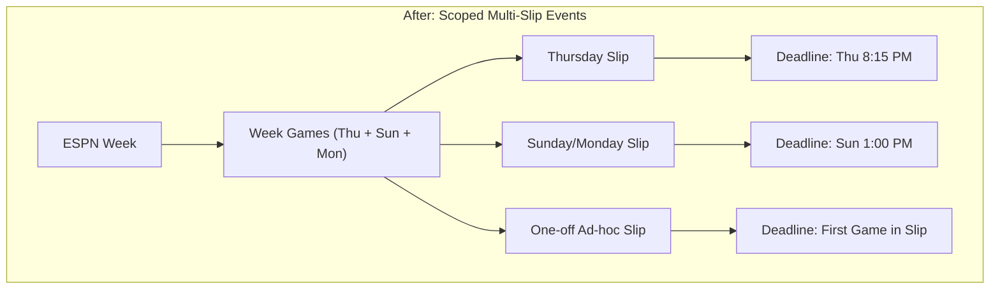

# Thursday Night Games and Multi-Slip Events

## Context

Today, the app discards Thursday night NFL games completely. The slate filter only keeps Sunday and Monday games. A
group cannot build a parlay for Thursday Night Football, and lines, props, and scores for Thursday never load.

At the same time, the app assumes a group builds only one parlay per week. If Thursday games were included naively on
that single slip, the slip's deadline would snap to Thursday kickoff for everyone. Members who only want to bet Sunday
games would be forced to pick before Thursday night or get locked out.

Groups also have different routines. One group may want a weekly Thursday night parlay every week alongside their Sunday
ritual. Another group might only want a one-off slip for a big Thursday matchup, without committing to it every week.
Today, groups have no way to define recurring slip schedules or manage multiple distinct slips in a single week.

## Goals and non-goals

**Goals:**

- Include Thursday night NFL games in the weekly slate alongside Sunday and Monday games.
- Allow groups to manage multiple slips in the same week, each scoped to its own slate of games (for example, a
  Thursday-only slip and a Sunday/Monday slip).
- Keep deadlines separated: a Sunday slip's pick deadline should not be rushed by Thursday night kickoff.
- Let groups configure recurring slip schedules (such as an automatic Thursday slip every week) or spin up one-off slips
  for a specific week.
- Make navigating between a group's active slips straightforward on mobile.

**Non-goals:**

- Adding sports outside the NFL or non-game betting events.
- Placing bets with sportsbooks or handling money.
- Background cron jobs or automated bot picks. Slip generation remains lazy and deterministic when members visit the
  week.
- Auto-grading live plays during games. Grading still triggers once games are final.

## Decision

Extend the game slate to ingest Thursday night football games. Give slips an explicit slate scope (such as Thursday
Night, Sunday Main Slate, or Full Week) so that deadlines, pick validation, and kickoff locks apply only to the games
intended for that slip.

Allow groups to define recurring slip templates and one-off slips. When members open the group for the week, the group
creates slips matching its active schedules, and members can add ad-hoc slips whenever they want an extra parlay. The
group landing page and hub navigation will list all active slips for the week, showing the status and deadline of each.

This beats putting all games onto one shared weekly slip, which would ruin deadlines and force everyone into the same
betting cadence. It also beats building separate sub-groups for different days, which would fragment friends and group
history.

The `effort: medium` rating fits because the change coordinates game slate ingestion, slip deadline logic, group slip
scheduling, and mobile navigation between multiple slips, without requiring architectural changes to the single-process
server or real-time event hub.

## Consequences

- Groups can now wager on Thursday Night Football without rushing pick deadlines for Sunday games.
- Slips and deadlines are scoped by slate (`thursday`, `sunday_main`, `full_week`), keeping early kickoffs from locking
  later slates.
- Groups can manage multiple recurring weekly rituals via `group_slip_schedules` or spin up ad-hoc one-off slips for any
  week.
- Single-slip groups experience no navigation friction; multi-slip weeks gain a dedicated week hub and sibling slip
  switcher.
- Maintaining slips requires accounting for `slate_scope` across leg pickers, docks, and validation rules.
- Schedule configuration is currently housed in the multi-slip week hub; a dedicated group settings view may be cleaner
  as group-level preferences expand.

## Alternatives considered

- **Single slip with all week games**: Rejected because Thursday 8:15 PM ET kickoff would snap the global slip deadline,
  forcing members betting only Sunday games to submit picks before Thursday night.
- **Separate sub-groups for Thursday**: Rejected because creating distinct clubs for different days fragments friends,
  invite links, and betting records.
- **Background cron job for slip generation**: Rejected because the app relies on lazy deterministic sync on page load
  to operate within Cloud Run and SQLite free-tier constraints.
- **Name-based schedule matching**: Rejected because renaming slips or naming one-off slips created collisions that
  triggered duplicate auto-generated slips; resolved by adding a nullable `schedule_id` foreign key on slips.

## Implementation notes

- Migration `0009_multi_slip_events.sql` backfills an active `Main Sunday Slip` schedule for every existing group and
  links each group's newest slip to that schedule via `schedule_id`. New group creation also seeds this default
  schedule.
- `EnsureWeekSlips` idempotently matches slips on `schedule_id` and wraps SQLite unique constraint errors with
  `db.ErrSlipNameTaken` to handle concurrent page-load races cleanly.
- ESPN scoreboard ingestion now includes Thursday, expanding the week 9 slate from 14 to 15 games. Sandbox and odds
  matching test fixtures were updated to reflect the 15th game, and weather lookups properly skip games that have
  already kicked off.

## Follow-ups

- **Dedicated group settings page**: Move recurring schedule management and group settings out of the week hub into a
  dedicated `/groups/{id}/settings` screen.
- **Mid-week slip grading**: Grade completed Thursday slips on Friday morning rather than waiting for the entire week's
  games to complete on Monday night.
