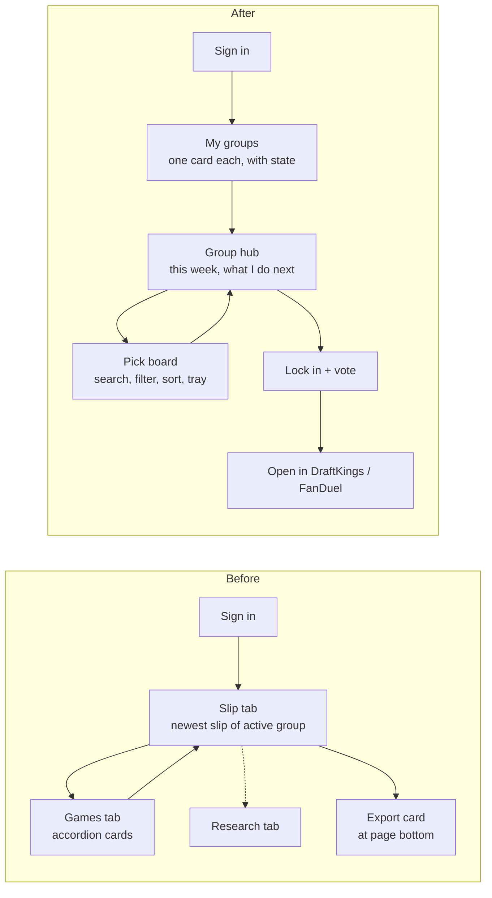

# Make the weekly pick flow the center of the app

## Context

The app has the right parts. It does not have a path through them.

Today the tabs are Slip, Games, Research, and Record. Each tab is a kind of data, not a step in a task. The one thing
nearly everyone does every week is: open the app, see what the group needs from me, pick my legs, lock in, and place the
parlay. That path crosses three tabs and has gaps:

- **No place to land.** Sign-in drops you on the newest slip of whichever group is active. Groups live in a top-bar
  dropdown. You never see "my groups, and what is happening in each." Every person starts in a one-person "Just me"
  group and can join any number of clubs, so most people have two or more groups and no way to see them side by side.
- **No "what do I do next."** The slip page shows members, legs, and lock state, but never says "you owe one more leg"
  or "waiting on Ben."
- **The picker is a list of accordions.** The Games tab shows spreads, moneylines, and totals as pills. Player props
  load when you open a game, grouped by athlete. There is no search, no sort, and no category filter. Finding "Allen
  over passing yards" means opening games one by one.
- **Picking and the slip are far apart.** You add a leg on one tab and see whether it counted on another. At the limit
  you get an error ("you've already added all your legs") instead of a way to swap.
- **No way to react to a friend's pick.** The product is "friends build a parlay together," but the only social surface
  is an activity feed. There are no votes.
- **The last step is buried.** Export appears below the panel once everyone locks, with nothing pulling you toward it.

Research is useful but sits as a top-level tab, even though people reach it from a player or a pick.

## Goals and non-goals

**Why now.** The sandbox and live controls make the full week testable end to end. The data layer is done: lines, props,
weather, rosters, export links. The weak part is how a person moves through it, and every later change (record book,
grading) will bolt onto whatever shape the app has.

**Goals:**

- One happy path, built as a sequence of screens:
  **groups, group hub, pick board, back to the hub, lock in, vote, export.** Someone doing it for the first time needs
  no explanation.
- Every screen has **one primary action** that matches the state: pick your legs, lock in, waiting on others, open in
  DraftKings or FanDuel.
- The group hub is the home of the current week. It shows who has picked, who has locked in, what is missing, and when
  the first kickoff cuts picks off.
- The pick board lets you **search** (player, team, game, prop category), **filter** by category and kickoff window,
  **sort** (by player, category, odds, kickoff), open a game for all its props, and choose 1 to n legs. A tray shows
  your picks, your progress ("1 of 2"), and a way back to the hub from every screen of the flow.
- At the leg limit, choosing another pick offers to **replace** one instead of failing.
- Slip members can **upvote or downvote** each other's legs on the hub, one vote per person per leg, never their own.
  The hub shows a plain tally on each leg, so an owner sees whether friends like the pick. Votes inform; they never
  block or change anything else. The app records them so later stats can use them (for example, how many legs you liked
  that hit versus missed).
- Your own **solo betslip stays first-class.** "Just me" sits in the groups list beside every club you join, with the
  same hub and the same flow.
- **Phone first.** Every screen is built at phone width with thumb-reach actions, then widened.
- Navigation follows the task, not the data. Games folds into the pick board; Research becomes a link from players,
  props, and picks rather than a tab.

**Non-goals:**

- Push notifications, email, or SMS. There is no scheduled job or second process. Nudges are a share-sheet message the
  user sends themselves.
- Changing lock, grading, or kickoff rules. Replace is a delete and an add in one step, so it obeys the same rules: no
  replacing a leg whose game has kicked off, and no replacing after you lock in.
- Changing the analyzer's rules or tone. The pick board shows its existing heads-ups earlier.
- Record Book, auto-grading, and any new data source. Those stay in their own changes.
- Vote stats screens. This change records votes and shows the tally; showing "liked legs that hit" belongs with the
  Record Book.
- Votes that carry weight: no thresholds, no gating the lock, no reordering by score.
- Building a way around the Odds API credit rules (see the search limit below).
- Hiding "Just me" or removing multiple slips per week.

## Decision

Rebuild the front of the app around the story, in this order. Look at the whole shape first:

**The group hub is the center.** It is today's slip page, reshaped around state. A banner at the top says the one thing
to do now, and changes as the week moves: no slip yet, you need legs, you can lock in, waiting on named people, ready to
export, or finished. Below it, each member's legs with votes. A small group list is the new landing page, with one card
per group (clubs and "Just me" alike) showing the week's state. A person with exactly one group, such as a new sign-up
who has only "Just me," skips straight to its hub. The pick board is a focused screen you enter from the hub and leave
back to it, with no tab bar competing for attention. A persistent tray keeps your picks visible, so you never wonder
whether a tap worked. The Record tab keeps its place; Slip and Games give way to the groups list and the hub.

**Live updates stay one stream per page.** The hub keeps today's slip stream. The group list opens no stream: it reads
fresh state on load and when the tab becomes visible again. A list that watched every group would hold the instance open
for a page people glance at and leave.

**The pick board replaces the Games tab.** It reuses the existing props loading, the per-person home book prices, and
the quick-add path, so no new data source and no new credit use. The new work is the screen: search, category and day
chips, sorting, a game view with both sides of a line in one row, selected states that persist, and replace-at-limit.
Votes are one new idea; they attach to a leg and clear when its owner edits or replaces it, because a vote on a pick
that no longer exists is misleading.

**What the story left out, and why each piece matters** (the design will sort these into phases):

1. *A deadline.* Legs lock at each game's kickoff. The slate runs Sunday to Monday night and can start with a 9:30 a.m.
   ET London game. The hub must show the first kickoff that will cut picks off, or "wait for everyone" has no end.
2. *Replace at the limit, and a tray.* Sportsbooks all use a floating bet slip because people lose track of state across
   screens. It is the most proven pattern in this domain.
3. *What votes mean.* Votes are a tally, not a gate, in line with "friendly, never blocking." They open while the slip
   is open and are read-only once everyone locks, because no one can act on them after that. An unlock reopens them.
   They are kept after the week so stats can use them later.
4. *Search has an honest limit.* Props load per game on demand to protect the 500-credit month. Searching "Allen passing
   yards" across the whole week can only search what has been loaded. The board will search game lines, teams, games,
   rosters, and loaded props, and say plainly when a game's props have not been loaded, offering to load that one game.
   It will not fetch props for every game.
5. *Filters before sorting.* On a phone, category and day chips narrow faster than typing or column sorting. Sorting
   stays small: by player, category, odds, kickoff.
6. *Empty and first-run states.* A new person, a group with no slip, a week with no lines, and a slip with one person
   still missing each get a real screen.
7. *The analyzer at the moment of choosing.* The sharp-friend heads-up is most useful when you pick, not after. Show it
   in the tray.
8. *The hand-off.* "Prices may have moved" at export, and a share-sheet nudge for the person you are waiting on.

This beats the alternatives. Polishing each tab leaves the path broken, because the problem is between screens, not in
them. A new wizard that sits beside the current tabs leaves two apps to maintain. Reshaping the existing slip page and
Games tab keeps the rules, routes, live updates, and tests that already work, and moves them under a clearer shape.

The effort is `hard`. It touches navigation, three screens, a new vote concept, and live updates, while holding the
credit and single-instance limits. Each decision depends on the others, so it needs a careful design before any code.

## Consequences

The app now has one path a person can walk without explanation: groups, group hub, pick board, hub, lock in, vote,
export. The bottom bar follows the task (Groups, This week, Record Book) instead of naming data. Games is a redirect,
and Research is a link from the rows that need it rather than a tab.

The group hub is the center. One pure function, `slips.NextStep`, decides what a person should do next on both the hub
banner and every group card, so the two cannot disagree. Every dead end has a screen: a new sign-up with only "Just me",
a group with no slip, a week with no games or no lines, every game kicked off, a search that matches nothing, and a
member who never finished before the first kickoff.

Picking moved to a focused board with search, category and window chips, four sorts, a one-game view, and a tray that
stays visible. Reaching the leg limit now offers a swap instead of an error. The board reads stored odds only: opening
it, typing, filtering, and sorting spend no credits, and each "Load them" tap is one person asking for one game through
the same floors and cache as before.

Votes give the group a way to react without making the product heavy. They are a tally, never a gate, and the app
records them so a later Record Book can use them. A vote writes no activity entry, so the feed stays a feed of picks.

What got harder:

- There are more surfaces to keep in step: the board page and its results partial, the tray, the swap sheet, the vote
  route, and four kinds of empty state. Empty-state copy now lives in four places.
- The group list costs four queries per card on every landing and every refetch-on-visible. Fine on one SQLite instance
  with a handful of groups, unmeasured at scale.
- The board rebuilds a week of odds rows on every keystroke, filter, and sort. The 250 ms debounce and one `OddsForWeek`
  read keep it cheap, but it is the first place to look if latency shows.
- Votes carry one deliberate exception to the editing rules: no activity entry, and removal from the activity story.
  `slips.md` rule 9 records it.

We would revisit chip counts (they follow the whole week, not the current search), the past-week tray, and whether vote
tallies belong on the pick board so a person can see what the group liked while choosing.

## Alternatives considered

- **Polish each existing tab.** Rejected: the problem was between screens, not inside them. The tabs were kinds of data,
  not steps, so improving each one left the path broken.
- **A new wizard beside the current tabs.** Rejected: two apps to maintain, two sets of rules to keep true. Reshaping
  the existing slip page and Games tab kept the routes, rules, live updates, and tests that already worked.
- **Client-side search over a JSON blob.** Rejected: it would put a second rendering path in `app.js` and move logic out
  of Go, where the tests are. Server-side partials keep one implementation.
- **A live stream on the group list.** Rejected: a list that watched every group would hold an instance open for a page
  people glance at and leave. Refetch on visible is enough.
- **A separate `ReplaceLeg` method.** Rejected: `UpdateLeg` already enforces owner, lock in, and kickoff on both the old
  and the new game. Replace is an edit, and a second method would drift from the first.
- **Votes as activity entries.** Rejected: a feed of thumbs would bury the picks, and it would make the feed the source
  of truth for a tally.
- **Searching props for the whole week.** Rejected: it would break the credit floors. The board searches what is loaded
  and offers to load one game when the search names it.

## Implementation notes

- **Join needed a new rule, not just a route.** The design assumed a group member could add themselves through the
  existing add-member path, but `AddMember` required the caller to already be on the slip. It now falls through to
  `loadJoin` when the actor is the target and belongs to the group, and writes an activity entry.
- **`currentOdds` was wrong across a week.** It kept only the newest prop fetch across every game, so loading one game
  later hid another game's props and made the board offer "Load them" for stored data. It now keeps the newest fetch per
  game and sync group. This was a real bug the week read exposed, not a rename.
- **The export card is a wrapper that is always first and empty until the slip locks.** Moving the card above the banner
  on a live lock would need out-of-band swapping. The wrapper gives the same order without a reorder.
- **`?slip=` is additive.** `/games/{id}/props` takes an optional slip for board loads but keeps its standalone partial
  for old game and Research links. It never guesses a slip.
- **The board has five empty states, not four.** "No games stored", "games with no lines yet", "every game kicked off",
  a search that matches nothing, and a week with no odds rows suppress the per-game prompts. One week-level note beats a
  "Load them" button per game.
- **`closed` outranks `waiting`.** A locked viewer whose week is over and whose slip still has someone short of legs
  sees the member named and no nudge, so nobody is asked to chase a pick that cannot arrive.
- **Small decisions the design did not name:** selection counts as part of "a different pick" for vote clearing, so a
  relabeled manual leg loses its votes; `ErrVoteInvalid` is a new typed error for values outside -1/0/1; the vote route
  answers with the refreshed panel so the voter's tally changes without waiting for their own stream event; and the
  tally is drawn only when the viewer can vote or the leg already has votes, so an owner's unvoted leg shows nothing.
- **Limits a maintainer will hit:** search covers only loaded props, so an honest miss offers one game to load; the
  nudge is client-only via `navigator.share` with a clipboard fallback and has no automated test; live updates stay one
  stream per page, so the group list deliberately has none; and the app still assumes one process writing SQLite.
- **The shell marks the group the page acts in.** `/groups/{id}/week` and a slip link from another group switch the
  active group through `Dependencies.SetGroup`, so the Record Book and the bar follow the page rather than the cookie
  that was there a moment ago.

## Follow-ups

- **Clear a removed member's votes.** `leg_votes.user_id` references the user, so removing someone from an open slip
  leaves their votes on other members' legs, and adding them back revives the old votes. Delete that person's votes for
  the slip inside `RemoveMember` in the same transaction, with a service test.
- **Make chip counts follow the search.** `categoryChips` and `windowChips` count the whole week's rows, so a filtered
  board can show a count that includes hidden rows and an active chip at zero. Count the rows `board.Search` returned
  and keep the active chip visible.
- **Close the tray for a past week.** `trayFrom` skips the kickoff lock when `WeekPast` is true, so a past week's tray
  still draws remove buttons the service then refuses. Show "Picks are closed for this week" instead.
- **Delete the dead Games template.** `web/templates/games.html`, the `games` entry in `render.go`, and the `games` name
  in `render_test.go` remain though nothing routes to them.
- **Cache built board rows.** If keystroke latency shows, cache `board.Build` output per (week, odds fetch time) rather
  than rebuilding it. The design left this open.
- **Batch the group list read.** If a person in many groups sees slow landings, read the week's slips once and group
  them in Go instead of four queries per card.
- **Cover the nudge in a browser test.** The server side is tested, but the share-sheet call, the clipboard fallback,
  and the "Nudge copied" label are only checked by hand.
